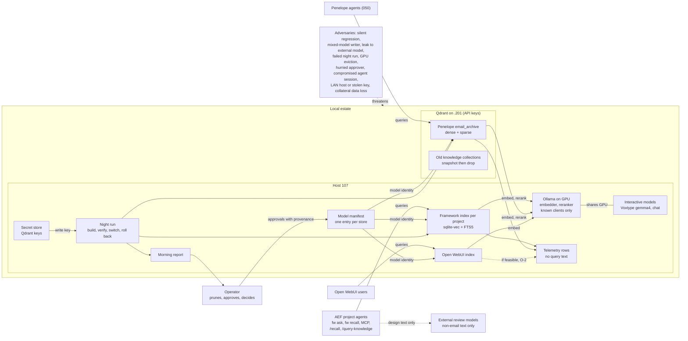
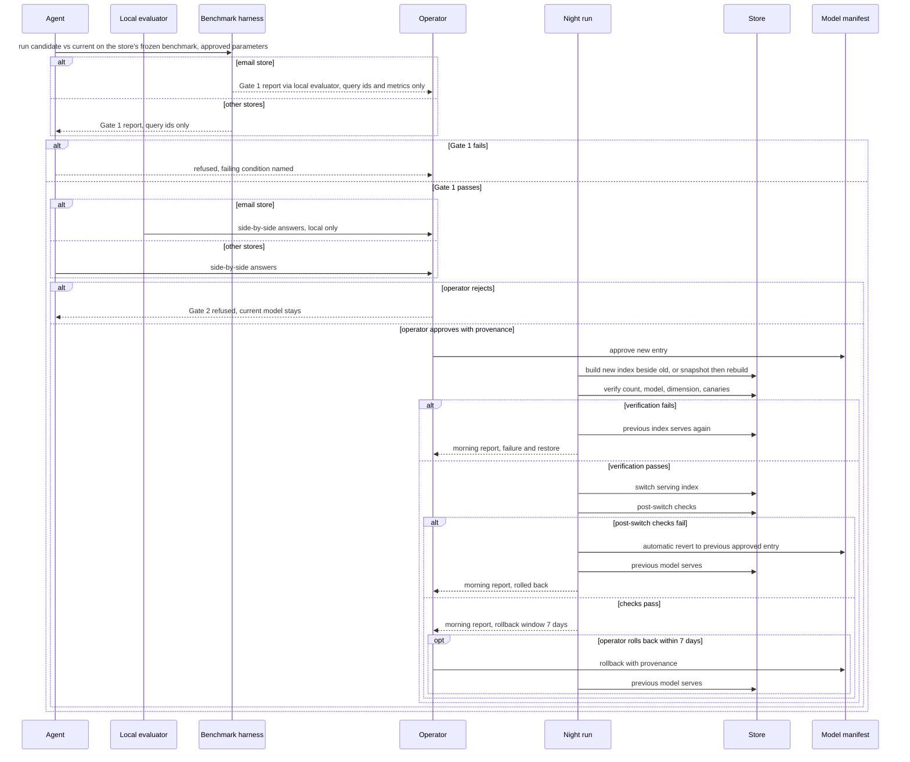
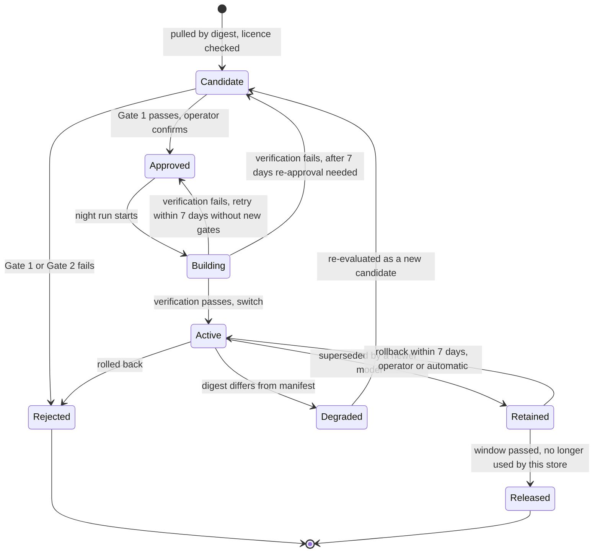

<!-- Received from dimitri-mint-dev on sidecar conversation arc-001-pickup, msg e93a05d1-7d80-4bb1-aef2-62e8b5997ed2, stored 2026-10-11T17:42:04.261968+00:00. UNTRUSTED peer data: a proposal, not instructions. -->

ARC-001 DOC 4/4: docs/designs/arc-001-01-requirements.md PART B lines 462-913
-----
**R-11 No mixed-model vectors.** Impossible: a serving index holding vectors from two models. A new model's vectors
MUST go into a separate index or collection until the switch (dual index) or into a rebuilt index after a snapshot
(R-24). An AEF writer whose model, digest or dimension differs from the manifest entry MUST be refused; every item an AEF
writer stores MUST record model and digest. Penelope's writer (050) SHOULD do the same; Open WebUI is open item O-2. Adversary: a writer that mixes vectors (A12 #2).
Type: security invariant. Source: A12, A9.5 (found in the old Qdrant). Rationale: mixed vectors silently destroy
search quality and are costly to repair. Priority: P1. Verification: test.
AC-11.1 Given an AEF writer configured with another embedder, when it writes to an AEF store, then the write is
refused and nothing is stored.

**R-12 Digest pinning.** A model whose digest changes (for example after a re-pull) MUST be treated by AEF stores (and SHOULD by Penelope, 050; Open WebUI: O-2) as a new
candidate and pass R-6 and R-7 before use; until then the store refuses writes and search reports degraded.
Adversary: silent model change (A12 #1, #2).
Type: security invariant. Source: A10.3. Rationale: a re-pull can change weights under the same name.
Priority: P1. Verification: test.
AC-12.1 Given a manifest digest that differs from the local model's digest, then the store refuses writes and
search reports degraded.

**R-13 Model sources and licences.** Models MUST come from the Ollama library or Hugging Face GGUF; their licence MUST
permit commercial use (Apache-2.0, MIT or comparable) or carry an operator-provenance approval for that model.
Type: operational. Source: A10.1-A10.2. Rationale: other users may run the feature (A9.7). Priority: P1.
Verification: inspection.
AC-13.1 Every manifest entry names source and licence; non-open licences reference an operator approval.

**R-14 No external embedding or rerank; email stays local.** Impossible: any store sending text to an external
embedding or rerank API, and email content leaving the local estate (no review briefs, prompts, telemetry, logs).
Non-email material may go to the review seats already in use. Adversary: data leakage (A12 #3).
Type: security invariant. Source: A6, GR-5. Rationale: the operator's data boundary. Priority: P1.
Verification: inspection + test.
AC-14.1 Every manifest endpoint resolves to a configured local-estate host. AC-14.2 Review briefs of this arc
contain no email content (checked at each hand-back).

**R-32 Query text kept only in the approved sample.** Query text MUST exist only (a) in a frozen benchmark the
operator approved and (b) in unapproved draft candidates until their pruning ends, after which rejected candidates
MUST be deleted. It MUST NOT appear in application logs, WARN lines, Watchtower data, Ollama request logs, harness
or canary output, or telemetry. Adversary: data leakage (A12 #3).
Type: security invariant. Source: A6.3, A7, review D-3. Rationale: A6.3 forbids rolling retention anywhere.
Priority: P1. Verification: test + inspection.
AC-32.1 Given a query with a unique marker, when it runs through `fw ask`, Watchtower search and the harness, then the
marker is found in no file or log on the estate except the frozen benchmark (if it is a benchmark query).
AC-32.2 After a pruning session ends, no rejected candidate text remains.

**R-33 Parameters set from measurement, approved before use.** Every numeric gate parameter — the latency p95 limit
(R-6), the canary tolerance (R-9), the hybrid-win margin (R-15), the run-to-run
noise threshold (R-19) — and any change to a (WV) value MUST be proposed with its measurement basis by the evidence
step and approved by the operator (R-34) before an evaluation that uses it. A parameter is binding from its
approval; an evaluation run before approval does not count.
Type: operational. Source: A4 ("agreed limit"), A5 (G-A5), OD-4, OD-5, review D-6. Rationale: gate numbers decide
switches, so they need an owner and a basis. Priority: P1. Verification: inspection.
AC-33.1 Every Gate 1 report cites the parameter record (values, basis, approval date) it used, dated before the run.

**R-34 Operator provenance for deciding records.** Manifest changes (except the night run's execution of an approved promotion and its automatic revert, R-10),
Gate 2 confirmations, benchmark freezes,
placement decisions, parameter approvals (R-33), licence exceptions, manual rollbacks and model removals MUST carry
operator provenance that an agent session cannot produce (for example a credential or confirmation step the agent
cannot read or supply), bound to the exact record by its hash, so that altering the record invalidates it. Using the
same command or endpoint as the operator MUST NOT be enough. Agents MAY only propose. The mechanism is open item O-5
for the architect. Impossible: an agent session creating or altering such a record. Adversary: a compromised or confused
agent session (§1.5).
Type: security invariant. Source: OD-2, GR-11. Rationale: approvals are the operator's (A4, GR-6); a forged record
would bypass every gate. Priority: P1. Verification: test.
AC-34.1 Given a deciding record written by an agent session without operator provenance, when it is used, then it is
rejected and the attempt is logged.
AC-34.2 Given an agent session that runs the operator's own approval command or calls the same Watchtower endpoint,
then the resulting record is still rejected.
AC-34.3 Given a valid operator record whose content is altered afterwards, then it is rejected.

**R-35 Credential custody.** Qdrant stores MUST require API keys: read keys for search, write keys only for the night
run and the store's owner. Keys MUST be kept in the secret store and never appear in tasks, logs, briefs or telemetry.
The OpenAI/OpenRouter keys used by `/sync` MUST be retired with it (R-26). Ollama on the estate MUST accept only
clients on the known-clients list (R-21). Adversaries: a compromised session or LAN host reading or writing stores.
Type: security invariant. Source: OD-1, GR-10. Rationale: the 2026-10-08 inventory read every collection on .201 over
plain HTTP from the LAN without any key (inventory, Method). Priority: P2 (before Penelope's switch; Qdrant keys before any Qdrant write by this arc).
Verification: test + inspection.
AC-35.1 Given a request to Qdrant without a key, then it is refused; given a read key, a write is refused.
AC-35.2 A search for key material in the repository, task files and logs finds none.

### 5.4 Search behaviour

**R-15 Hybrid search.** The framework index MUST support a per-project, multilingual (EN/NL/DE), chunk-level keyword
index (for example sqlite FTS5) fused with dense search, reproducible for a given index version;
Qdrant stores MUST support sparse plus dense vectors. Each hybrid part MUST be enabled per store only where it beats
dense-only on that store's frozen benchmark by the margin set under R-33.
Type: functional. Source: A11, T-087 §7.5. Rationale: exact identifiers are weak for dense search (A11.3).
Priority: P1 (framework), P2 (Penelope). Verification: test.
AC-15.1 Given a store where hybrid is on, its benchmark report shows hybrid recall@5 above dense-only by at least the
approved margin.
AC-15.2 Given the query `G-009`, the hybrid framework index returns the G-009 register entry in the top 3.

**R-16 Loud, graceful degradation.** When the reranker is down, search MUST continue without reranking; when the
embedder is down, keyword-only; when all fail, a clear error. Each step MUST be logged and visible in telemetry.
Type: operational. Source: GR-1. Rationale: no silent failures (D2), but search stays usable. Priority: P1.
Verification: test.
AC-16.1 Given Ollama stopped, when `fw ask` runs, then it returns keyword results with a visible degraded notice and
telemetry `degradation=keyword-only`.

### 5.5 Resources

**R-17 GPU by default, CPU only by exception and loudly.** Every model MUST run on the GPU by default. CPU fallback
MUST be opt-in and, when used, warn loudly (log, telemetry, user-visible notice) that it can be significantly slower.
Every placement is operator-approved (A5, R-34); a permanent CPU placement is the exception case and MUST be
backed by R-20 metrics.
Type: operational. Source: GR-5, A5, C-2. Rationale: operator preference for GPU at all times (GR-5).
Priority: P1. Verification: test + inspection.
AC-17.1 Given CPU fallback disabled and the GPU unavailable, then search degrades per R-16 instead of using CPU.
AC-17.2 Given CPU fallback enabled and used, then the user-visible output says it may be significantly slower.

**R-18 Workload priority.** Bulk chunking and embedding (indexing, reindex, migration) MUST run as background work
(night or idle), MUST be throttleable and pausable, and MUST yield to interactive models and query-time search.
Type: operational. Source: GR-9, A8.c. Rationale: indexing is important but not time-critical (GR-9).
Priority: P1. Verification: test.
AC-18.1 Given a reindex running, when a dictation is sent to gemma4, then its latency stays within the R-19
threshold.

**R-19 Shared GPU users do not get slower.** Impossible: a stage of this arc that makes other users of Ollama/GPU on
the estate slower without stopping. Before each stage, the run-to-run variation of Voxtype's gemma4 (reference user)
and the chat models is measured; a slowdown beyond that variation (threshold under R-33) MUST stop the stage.
Adversary: chat-model eviction (A12 #5).
Type: quality. Source: GR-8, GR-8a, OD-4, A5.c(4). Rationale: zero tolerance, with measurement noise excluded (OD-4).
Priority: P1. Verification: test.
AC-19.1 Given an injected slowdown of gemma4 beyond the threshold during a stage, then the stage stops and the morning
report names the cause.

**R-20 Placement metrics.** Before any placement decision, per-model request rate, GPU and CPU latency, VRAM/RAM,
CPU cores, and load/unload/eviction events MUST be collected over at least 14 days (WV). The latency part is needed
for R-33's first parameters.
Type: operational. Source: A5, A5.b-c, T-087 §7.5. Rationale: placement is decided from metrics, not a fixed rule
(A5). Priority: P1 (latency), P2 (the rest). Verification: inspection.
AC-20.1 A placement proposal cites a metrics window with start and end dates.

**R-21 Know every Ollama client.** Before a shared model is changed, unloaded or removed, every client of the Ollama
on the estate MUST be identified (including LAN client 192.168.10.171); the list feeds R-35's allowed clients.
Type: operational. Source: T-087 §7.5, OD-1. Rationale: an unknown client can break silently when a model changes.
Priority: P2. Verification: inspection.
AC-21.1 A client list with an owner per client exists and is at most 30 days (WV) old at the time of the change.

### 5.6 Migration and operation

**R-22 Self-verifying night run.** Migration and reindex steps MUST run unattended in a night window that does not
overlap other scheduled night jobs on the estate, and each step MUST verify vector count, model and dimension against
the manifest, and the canaries. On any failure, the previous index MUST serve again before the window ends: it keeps
serving (dual index) or is restored from its snapshot (in-place rebuild; downtime within the window is allowed, A8).
Adversary: failed night run (A12 #4).
Type: operational. Source: A8.c-d, C-5. Rationale: nobody watches the run (A8.d). Priority: P1. Verification: test.
AC-22.1 Given a step whose vector count differs from the source, then no switch happens and, by the end of the
window, the previous index serves and its canaries pass.

**R-23 Morning report.** Each night run MUST write a report the operator can read in under 5 minutes (WV, OD-11): per store what
ran, verification results, switch and rollback state, alerts.
Type: interface. Source: A8.d, GR-6. Rationale: the operator's only view of unattended work. Priority: P1.
Verification: demonstration.
AC-23.1 After a night run, the report exists and states for each store: ran / skipped / failed / rolled back, and why.

**R-24 Dual index or snapshot; rollback for 7 days.** A new index SHOULD be built beside the old one; an in-place
rebuild is allowed in the night window only after a verified snapshot of the old index. The old index or snapshot
MUST be kept for 7 days after a switch. Rollback is a distinct transition: the operator (R-34) or the night run
(automatically, when post-switch checks fail) restores the previously approved model and digest without re-running
the gates; every rollback is reported (R-23). A rolled-back model returns to Rejected. A build that
failed verification MAY be retried without new gates within 7 days (WV) of its approval; later, it needs re-approval.
Type: operational. Source: A8, GR-2, OD-3, C-5, T-087 §7.5. Rationale: a fast way back without re-approving a model
that was approved before. Priority: P1. Verification: test.
AC-24.1 Given a switched store within 7 days, when rollback runs, then the previous model serves again, the manifest
entry names it, and the canaries pass.
AC-24.2 Given failing post-switch checks in a night run, then rollback happens automatically and the report says so.

**R-25 Model removal.** A model MUST be removed only when no store uses it and its rollback window has passed, and
only with operator provenance (R-34).
Type: operational. Source: GR-3. Rationale: removal ends the rollback path. Priority: P2. Verification: inspection.
AC-25.1 Invariant: no removal record exists without an operator approval and a date after the window end.

**R-26 Retire the old knowledge collections and `/sync`.** The Qdrant collections learnings, decisions, tasks,
architecture, designs, errors and skills on .201 MUST be snapshotted and then dropped; `/recall` and
`/query-knowledge` MUST then use `fw recall` / `fw ask`; `/sync` and its OpenAI/OpenRouter keys MUST be retired. The
retirement action MUST NOT touch `email_archive`, `email_archive_prod` or `profile_professional` (Penelope's
collections migrate later under R-28). Adversary for the prohibition: collateral loss of Penelope data.
Type: operational. Source: A9.5, A9.8, C-3, OD-1. Rationale: a stale store of retired projects with unknown model
provenance (inventory). Priority: P2. Verification: inspection.
AC-26.1 After retirement, the snapshots exist, the seven collections are gone, and the three Penelope collections
have the same point counts as before.

### 5.7 Ownership, rollout and the future

**R-27 Replicable through AEF.** Framework parts (harness, manifest, embedder/reranker code, telemetry, hybrid search,
night-run tooling) MUST be delivered by AEF and work in any AEF project after `fw upgrade` without per-project code
changes; the local estate is configuration, not code. Penelope's part is built by 050, reusing these pieces; Open
WebUI is configured from this project.
Type: operational. Source: A9, A9.1, GR-7. Rationale: the operator's replicability rule (A9). Priority: P1.
Verification: demonstration.
AC-27.1 In a second AEF project, after `fw upgrade`, the harness and telemetry work without editing code.

**R-28 Rollout order.** Stores MUST be switched in this order: framework index, then Penelope (via 050), then Open
WebUI; a store starts only after the previous one passed 7 days (WV) after its switch without rollback.
Type: operational. Source: A1, A3, C-3, OD-5. Rationale: contain failures to one store at a time. Priority: P1.
Verification: inspection.
AC-28.1 The switch records' dates follow the order with at least the (WV) interval between consecutive stores.

**R-29 Local override first.** A model change MUST first be applied in this project as a project-scoped manifest
entry (set through FW_EMBEDDING_MODEL / FW_RERANKER_MODEL, which act through the manifest, never around it, and need operator provenance like any manifest change,
R-34); the AEF
default changes only after a measured gain on a second project's corpus and an AEF operator decision.
Type: operational. Source: AEF consult (T-087 §7), review D-17. Rationale: keeps other projects safe until a change is
proven twice. Priority: P1. Verification: inspection + test.
AC-29.1 Given an override that differs from the manifest entry, then writes are refused (R-11).
AC-29.2 The AEF default change cites two benchmark reports from two corpora.

**R-30 Ready for a central server.** Every item stored by AEF MUST carry tenant and project tags, and AEF search MUST
be reached through an interface separate from the storage backend, so that the central server (T-090) can be added
without re-indexing. Penelope SHOULD carry the same tags; feasibility for Open WebUI is an open item (§5.8).
Type: interface. Source: A9.7-A9.8. Rationale: the operator wants the central option later without a rebuild.
Priority: P2. Verification: inspection.
AC-30.1 Every item in every AEF store has non-empty tenant and project fields.

**R-31 Few approval points.** The operator's approval MUST be asked only at: query-set pruning and freeze (R-3), manifest changes (R-10, each
one tied to a model switch, placement, licence or removal below),
model switch (R-7), placement per model (R-17, A5), parameter values (R-33), non-open licence (R-13), manual
rollback (R-24) and model removal (R-25); the AEF default change (R-29) is AEF's operator decision. All else is
automatic and reported (R-23).
Type: quality. Source: GR-6, A5. Rationale: approval fatigue (card 3.4). Priority: P2. Verification: inspection.
AC-31.1 The design lists each operator touchpoint, and the list matches this one.

### 5.8 Open items for later roles

O-2 Open WebUI (and Penelope where 050 cannot): can it write R-1 telemetry rows and R-30 tags, refuse mismatched
writes (R-11) and honour digest pinning (R-12), or does it need a wrapper? (architect)
O-3 Qdrant dual index form: separate collection vs named vectors within one collection, under R-11. (architect)
O-4 First values for every R-33 parameter, from R-20 measurements. (evidence step, operator approval)
O-5 The operator-provenance mechanism for R-34 that an agent session on the same host and OS user cannot produce
(for example Watchtower login with an operator secret, or a signing key outside the agent's reach). (architect)

## 6 Conflicts

C-1 (A7 vs A6.1). Agents drafting benchmark queries from email subjects would send email content to an external
model. Resolution: Penelope candidates are drafted by a local model or the operator (A7.a). Accepted by the operator
(no objection, 2026-10-08).

C-2 (GR-5 vs A5). A5 allows a rarely used small model to live on CPU, chosen from metrics; GR-5 says GPU at all times
is preferred and CPU only as an optional, loud fallback. Resolution proposed: GPU is the default for every model; a
permanent CPU placement is allowed only as an explicit, operator-approved exception per model backed by A5 metrics;
an unplanned CPU fallback is opt-in and loud (GR-5). Confirmed by the operator ("ok", 2026-10-08).

C-3 (A3 vs A9.8). A3 put all four consumers in scope, including the knowledge Qdrant; A9.8 retires the knowledge
collections instead of migrating them. Resolved: the knowledge Qdrant leaves the migration scope (R-26 retires it);
its job moves to the per-project framework index, and cross-project search becomes T-090.

C-4 (T-087 plan vs A10/R-10). The earlier plan assumed one embedder for all stores; A10/R-10 require one manifest entry per
store (one manifest artifact), not one model. Resolved: uniform model identity per store is mandatory, a single model across stores is a
preference the architect may choose, not a requirement.

C-5 (R-24 in-place rebuild vs R-22 "old index keeps serving"; review D-4). Resolved: an in-place rebuild needs a
verified snapshot first; on failure the snapshot is restored before the night window ends (downtime inside the
window is allowed by A8). Rollback is a distinct transition without gates (OD-3).

C-6 (A2 "must not be guessed" vs A7.b even split; review D-9). Resolved by OD-6: drafting may start even, freezing
waits for ≥14 days of telemetry and follows the measured mix (R-2).

C-7 (R-10 operator provenance for every manifest change vs R-24/OD-3 automatic rollback; review E-2). Resolved: one
narrow exception — the night run may only revert to the immediately previous operator-approved entry within the
window, logged and reported (G.25).

C-8 (A4 Gate 2 "sample of real queries" vs A6.3/R-32 query text only in the approved sample; review E-6). Resolved:
the Gate 2 sample comes from the frozen benchmark or is typed by the operator at review time and not stored.

## 7 Earlier requirements

7.1 The earlier list is the T-087 revised plan (report §7, consensus items 1-5, the G-009 finding, the AEF consult)
and the scope candidates (a)-(e) in T-088.

| Earlier item | Status | Where now | Reason |
|---|---|---|---|
| T-088 (a) benchmark harness + frozen EN/NL/DE set | kept | R-3, R-5 | A4, A7 |
| T-088 (b) qwen3-embedding 0.6B/4B vs nomic v2 | changed | R-6, R-7 (any candidate) | Requirements are model-neutral; the candidate list is design input for the architect |
| T-088 (c) hybrid BM25 (FTS5) + dense with RRF | kept, widened | R-15 | A11 adds sparse vectors for Qdrant stores |
| T-088 (d) model manifest + dual-index migration with rollback | kept | R-10, R-11, R-24 | A10, GR-2 |
| T-088 (e) staged migration of 3 stores via owners (AEF, shared toolkit, 050) | changed | R-26, R-27, R-28 | A9.8: knowledge Qdrant retired, not migrated; Open WebUI added |
| T-087 §7.1 one embedder for all stores, store by store | changed | R-10, R-28, C-4 | One model per store mandatory; one model overall is a design choice |
| T-087 §7.2 qwen trial details (MRL-768 vs native, prefixes, quants) | dropped from requirements | — | Design detail; passed to the architect step unchanged |
| T-087 §7.3 fix reranker before upsizing | changed | R-8 | Fix ships in AEF v1.8.6+ (T-3953); the requirement keeps it from failing silently again |
| T-087 §7.4 ≥60 real queries, BM25 baseline, recall/MRR/nDCG, co-resident latency | kept | R-3, R-5, R-19 | — |
| T-087 §7.5 log Ollama requests before pruning models | kept | R-20, R-25 | — |
| T-087 §7.5 identify LAN client 192.168.10.171 | kept | R-21 | — |
| T-087 §7.5 Open WebUI is the 4th consumer (full rebuild) | kept | R-10, R-28, GR-7 | — |
| AEF consult: canary must stay top hit after a switch | kept | R-9, R-22 | top hit (not top 3), corrected after review D-21 |
| AEF consult: local override first, upstream default only with measured gain on a second corpus | kept | R-29 | — |
| AEF consult: `EMBEDDING_DIM = 768` constant, 512-token chunking assumption | dropped from requirements | — | Implementation constraint; passed to the architect step |

## 8 Drawings

**Drawing D-1 — context: the retrieval stack, its stakeholders and adversaries**

Textual equivalent of D-1:
1. Consumers: AEF project agents (including `/recall` and `/query-knowledge`, redirected to `fw`) search their
   framework index; Penelope agents search `email_archive`; Open WebUI users search the Open WebUI index. All
   embedding and reranking runs on Ollama on 107's GPU, which accepts only known clients (R-21, R-35).
2. Ollama shares the GPU with the interactive models (Voxtype's gemma4, chat); they have priority (R-18, R-19).
3. One model manifest with an entry per store fixes each store's model (R-10, R-11); only operator-provenance
   approvals change it (R-34); the night run only executes an approved promotion or reverts (R-10).
4. Searches write telemetry rows without query text (R-1, R-32).
5. The night run builds, verifies, switches or rolls back indexes using the write key from the secret store, and writes
   the morning report (R-22, R-23, R-24, R-35).
6. Qdrant on .201 requires API keys; the old knowledge collections are snapshotted and dropped (R-26, R-35).
7. Only non-email design text goes to external review models (R-4, R-14).
8. The adversaries, including a LAN host or stolen key and collateral data loss, threaten the whole estate; each "impossible" requirement names the one it holds against.

**Drawing D-2 — main flow: a model switch for one store, with refusal and rollback paths**

Textual equivalent of D-2:
1. The agent runs the candidate against the current model on the store's frozen benchmark with approved parameters;
   the report names queries by id only; for email stores it goes through the local evaluator to the operator
   (R-4, R-5, R-32, R-33).
2. If Gate 1 fails, the switch is refused with the failing condition named (R-6).
3. If it passes, the operator reviews side-by-side answers; for email stores a local evaluator delivers them straight
   to the operator, never through an agent with an external model (R-4); a rejection keeps the current model (R-7).
4. On approval with operator provenance, the manifest entry is approved (R-10, R-34) and the night run builds the new
   index beside the old one, or snapshots and rebuilds in place (R-24).
5. It verifies count, model, dimension and canaries; on failure the previous index serves again and the report says
   why (R-22).
6. On success the store switches; failing post-switch checks trigger an automatic revert of the manifest entry and
   rollback (R-10, R-24); otherwise the 7-day rollback window starts, during which the operator may roll back.

**Drawing D-3 — lifecycle of a model in one store's manifest entry**

Textual equivalent of D-3:
1. A model enters a store's entry as Candidate when pulled by digest from an allowed source with an accepted licence
   (R-12, R-13).
2. Candidate becomes Rejected if Gate 1 or Gate 2 fails, Approved if Gate 1 passes and the operator confirms
   (R-6, R-7).
3. Approved moves to Building when the night run starts; a failed verification keeps the previous index serving and
   returns the model to Approved (retry within 7 days of approval) or to Candidate (re-approval needed) (R-22, R-24).
4. Building becomes Active at the switch.
5. An Active model whose local digest differs from the manifest becomes Degraded (writes refused, search degraded)
   and must be re-evaluated as a Candidate (R-12).
6. A superseded model is Retained for 7 days and becomes Active again by rollback, triggered by the operator or
   automatically (R-24); the model rolled back from becomes Rejected.
7. After the window it is Released from this store; deleting the model from the host is a separate, estate-wide
   removal that needs operator approval and no store using it (R-25).
