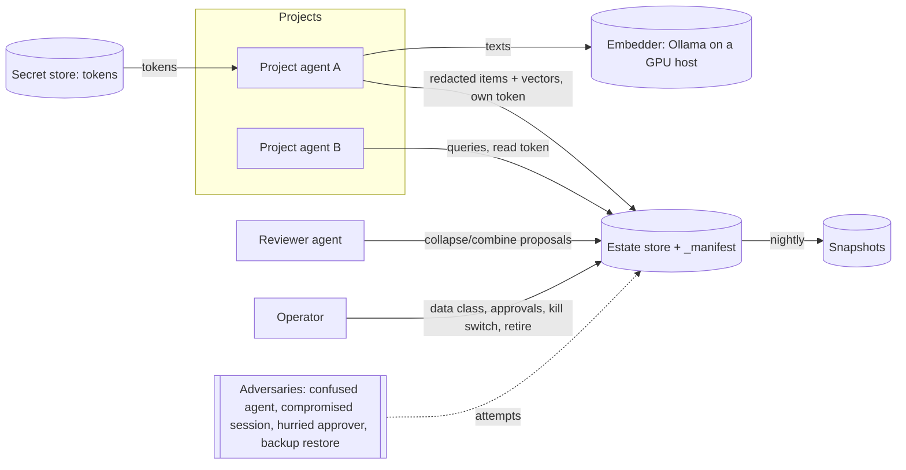
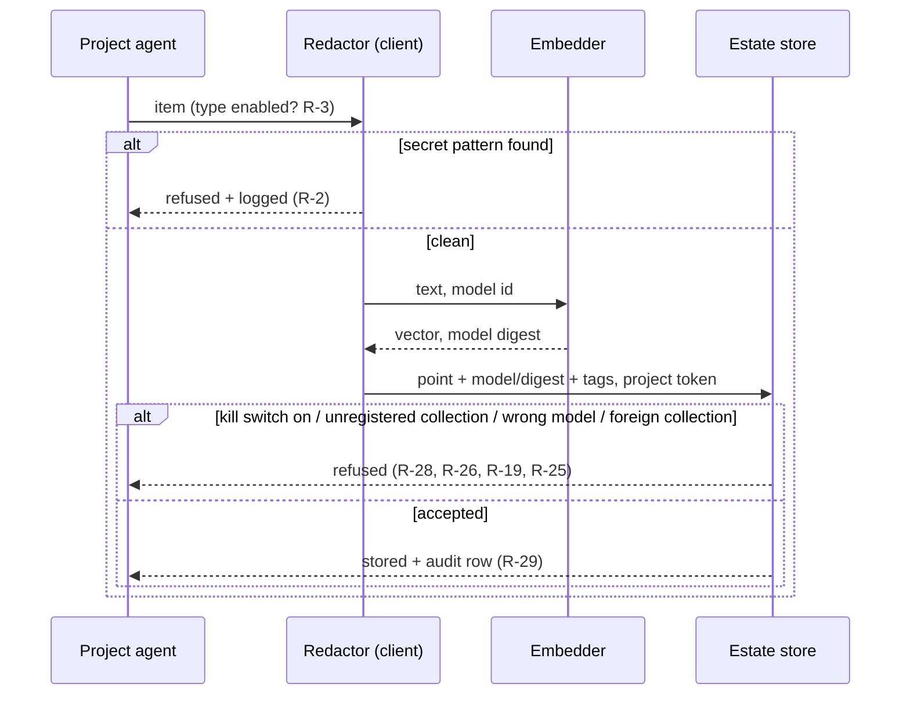
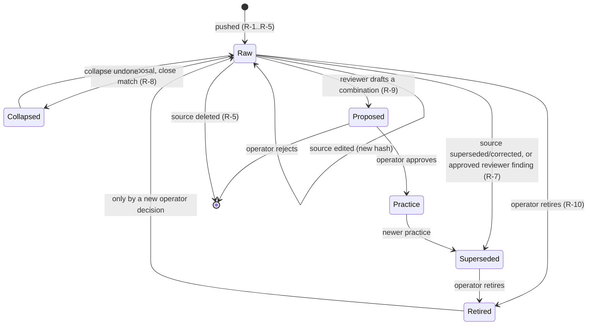

# Estate knowledge platform — requirements

## 0 Version history

| Version | Date | Change | Task |
|---|---|---|---|
| 0.1 | 2026-10-12 | Skeleton; operator's framing captured; five stakeholder consults sent | T-4123 |
| 0.2 | 2026-10-12 | Draft R-1..R-32, conflicts CF-1..CF-8, earlier requirements, D-1..D-3, open questions — from dimitri-mint-dev and ring20-manager only | T-4123 |
| 0.3 | 2026-10-13 | 832's answer: R-33..R-40, CF-9..CF-11; sent to three external models (operator-approved paid consults) before 010/1409/055 answered | T-4123 |

## 1 Why this document exists

ring20 operates a shared knowledge store for the estate (Qdrant 1.19.2, cluster mode, JWT RBAC, `_manifest`
collection, backups with a tested restore; ring20 T-2346). Nothing can write to it yet. The pipe (T-4091) was
about to be designed, but the operator stopped it there: first establish **what the platform is for and what it
must do**, then build the pipe.

Method: the ring20 **design role chain** (ring20-manager's T-2222 answer to AEF, 2026-10-04), step 1,
**requirements collector**: answers, glossary, R-n requirements with acceptance criteria, conflicts. Interactive
steps run in the orchestrator's session with the operator. Later chain steps (threat modeler, security floor and
phasing, architect, evidence, pseudo-code, external panel, planner) follow only after a GO.

**Output format (from the role card, `T-4123-inputs/02b-ring20-manager-role-cards.txt`):** Answers (numbered);
Glossary; Requirements R-n, each with statement (RFC 2119), type (functional / security invariant / interface /
operational / quality), source, rationale, priority, verification method and at least one testable acceptance
criterion (Given-When-Then or pre/postcondition/invariant), "must be impossible" requirements naming the adversary;
Conflicts (resolved or open); Earlier requirements (kept/changed/dropped); drawings D-1 context view, D-2 main flow
incl. the refusal path, D-3 lifecycle of the central entity (an item). The adversary is a named stakeholder. The
human decides what is required and signs the list off.

## 2 Scope areas named by the operator (2026-10-12)

| Area | Operator's words (paraphrased) | Notes |
|---|---|---|
| A Content | what knowledge goes in, from where | today's per-project corpus: learnings, decisions, patterns, episodic summaries, completed-task summaries |
| B Curation | "pruning, collapsing, combining" | today only per project: `fw consolidate` (duplicates/stale), `fw promote` (learning → practice), `fw harvest` (project → framework, by hand) |
| C Retrieval | "then we also need to think about the retrieval" | how an agent asks, what comes back, ranking, cross-project scope, trust |
| D Fabric solution finder | "I'm working with this and this — which other applications already have elements, solutions or practices that would help us" | component fabric (`.fabric/`) across projects |
| E Model selection | default model, configurable, selectable from what Ollama has | arc-001 C3 (model manifest), P6; no model change on .107 before P1a/P1 |
| F Push interface | T-4091 | plumbing; designed after this is decided |
| G Error resolution | "store errors across projects with their resolutions, or even not if they do not have resolutions, then we can store the amount of times this happens" | overlap check: per-project healing patterns (`fw healing`, FP-n) and concerns (G-n); a host-level error service (skills `errors_*`, `/error-patterns`); arc-001 C1 telemetry is search telemetry, not errors. Proposed split: occurrences are telemetry (stay local / error service); the error class with its resolution status and occurrence count is knowledge (store) |

## 3 Facts established so far

- Embedding model: `nomic-embed-text-v2-moe` (768 dims) fixed in `web/config.py:64`, overridable only by env
  `FW_EMBEDDING_MODEL`; not in `fw config`, not in Watchtower, no Ollama listing, no guard against mixing.
- Embedding host: per install, default `localhost:11434`; silent failover between hosts is arc-001 finding F-7.
- arc-001 (T-4017, GO 2026-10-11): C3 model manifest, C12 tenant/project tags and search interface, search kept
  separate from storage, all to fit the central store; benchmark (C2) gates model changes.
- Collection naming already proposed by dimitri-mint-dev / ring20: `<tenant>__<scope>__<model-slug>-<dims>`
  behind an alias; payload fields tenant, project, item_type, content_hash, source_path, model_id, model_digest.

## 4 Stakeholder consultation

Five agents, each a user or operator of the platform, get the same brief plus one question specific to them.
Answers are stored unedited in section 7 and synthesised into sections 5, 6 and 6.1.

| Stakeholder | Why them | Sent | Answer |
|---|---|---|---|
| dimitri-mint-dev | pilot tenant; arc-001 author; owns requirements A9.7 | 2026-10-12 | 2026-10-12 → `T-4123-inputs/01-dimitri-mint-dev.txt`, area G: `01b-dimitri-mint-dev-G.txt` |
| proxmox-ring20-management (ring20-manager) | operates the platform; author of the role chain | 2026-10-12 | 2026-10-12 → `T-4123-inputs/02-ring20-manager.txt` (incl. platform-operator constraints P.1–P.7); role cards → `02b-ring20-manager-role-cards.txt` |
| 832-Workflow-designer | designer corpus; heavy fabric user | 2026-10-12 | 2026-10-12 → `T-4123-inputs/03-832-workflow-designer.txt` (their T-1141; full body recovered from the receiver store, the prompt hook had cut it at 4000 chars). For v0.3: per-item framework_version/observed_on, `guarded_by` check links, install-shape awareness, requests as items, size/type gates at ingest, visible trust tier for peer reports; votes server-side embedding (CF-2) |
| 010-termlink | cross-project transport; a different codebase (Rust) | 2026-10-12 | acked, answer within a day (host incident) |
| 1409-sprind | German-language project; own focus-anchor practice | 2026-10-12 | acked, answer within a day (their operator sees it first) |

055-agentic-fleet-cockpit was the intended fifth stakeholder; its receiver rejected the send twice with HTTP 401
after the host reboot (filed as T-4124). 1409 was asked instead; 055 can be added once its receiver accepts.

Per-stakeholder questions: dimitri-mint-dev — what verification convinces you, which A9.7 items are hard;
ring20-manager — operating constraints, plus the full requirements-collector and _common role cards;
832 — fabric search useful vs noise, is the designer corpus knowledge; 010 — non-Python and remote hosts,
which TermLink learnings others should find; 1409 — non-English knowledge, practices others should find.

## 5 Glossary (draft)

| Term | Meaning |
|---|---|
| Estate | all projects and hosts the operator runs |
| Tenant | top-level owner partition in the store (e.g. `estate`) |
| Item | one stored unit of knowledge (a learning, decision, pattern, summary, fabric card …) |
| Prune | remove an item that is stale, wrong or superseded, everywhere it was pushed |
| Collapse | merge items that say the same thing into one, keeping every source |
| Combine | synthesise related items (possibly across projects) into a higher-order item, e.g. a practice |
| Raw item | an item pushed from one project's source, unchanged in meaning; fast lane, no review |
| Curated item | an item produced by collapse or combine; always labelled, keeps every source |
| Superseded | an item its source (or an approved reviewer finding) declares replaced by a newer one |
| Retired on purpose | an item or collection deliberately taken out of use; never restored without a new operator decision |
| Error class | what a recurring error IS (sanitised signature, component), which projects hit it, how often, last seen, resolution status; an occurrence is telemetry and stays local |
| Source | the project file or task an item came from; every answer links to it |
| Data class | the sensitivity class of a collection, set by the operator in `_manifest` |
| Solution-finder mode | a retrieval mode that ranks other projects' items first ("who already has this?") |

## 6 Requirements (draft v0.2, from two of five stakeholders)

Sources are cited by stakeholder file and section: **DM** = `T-4123-inputs/01-dimitri-mint-dev.txt` (+ `01b` for
G), **RM** = `02-ring20-manager.txt`, **OP** = the operator (Dialogue Log), **A9.7** = arc-001's earlier list.
Priority: MUST-pilot (needed for the first project to write), MUST (needed before a second project writes),
SHOULD. Every requirement is a proposal until the operator signs the list off. Hosts are named by role.

### 6.A Content

**R-1** (functional, MUST-pilot) The platform MUST accept these item types: learning, failure pattern with its
resolution, decision with rationale and rejected options, episodic task summary, gap/concern with status, fabric
component card, report/design reference (summary plus chunks), error class (R-23).
Source: DM A, RM A.1, OP area A. Rationale: the units other projects reuse.
Verify: test. AC: Given a pilot project with N items of each pushed type, when one push cycle completes, then the
store's count per `item_type` for that project equals N for every type (DM pilot 1).

**R-2** (security invariant, MUST-pilot) It MUST be impossible for secret values, `.env` contents, process command
lines, email or mail data, personal data, raw command/tool output, browser cookies or profiles, raw session
transcripts, `.context/working` state and runme logs to enter the store. Filtering MUST be by value pattern, at
write time (before the item leaves the project), reusing the framework's secret-scan patterns.
Holds against: a confused agent pushing raw output; a compromised session using its write token to stage data.
Source: DM A, RM A.2/M.1, A9.7. Rationale: key-name redaction misses encoded copies (RM A.2).
Verify: test + scan. AC: Given an item carrying a planted token in plain, base64 and URL-encoded form, when pushed,
then the push of that item is refused, the refusal is logged, and nothing reaches the store. Invariant: a
store-wide secret-pattern scan returns 0 hits after every cycle.

**R-3** (functional, MUST-pilot) Pushing MUST be opt-in per project and per item type.
Source: A9.7 (hard). Verify: test. AC: Given a project with type `report` disabled, when a cycle runs, then no
`report` item of that project exists in the store.

**R-4** (quality, MUST) Freshness: learnings, patterns and fabric cards MUST be findable within 24 h of being
recorded or changed; episodic summaries within 24 h of task close; reports within 24 h of commit. Status changes
(gap closed, learning corrected) MUST propagate within the same bound.
Source: DM A, RM A.3. Rationale: "a problem I have now that someone solved last week". Verify: measurement.
AC: Given a task closed at time t, when queried by exact title at t+24 h, then it is top-1.

**R-5** (functional, MUST-pilot) Change and deletion MUST propagate: a deleted source item is gone from the store
within one cycle; an edited one replaces its predecessor (old `content_hash` gone, new present).
Source: DM pilot 3, A9.7. Verify: test. AC: delete a test learning → absent after one cycle; edit one → only the
new hash present.

### 6.B Curation

**R-6** (functional, MUST) The store MUST keep two labelled layers: raw items, which flow automatically and fast
(R-4), and curated items, which wait for review. A curated item MUST NOT silently replace or hide its raw sources.
Source: RM M.2 (resolves CF-4). Verify: inspection + test. AC: every curated item carries `layer: curated` and the
ids of its sources, and each source stays retrievable.

**R-7** (functional, MUST) Prune: an item MUST be marked superseded automatically when its source is deleted or
marked superseded/corrected in its project; a reviewer agent MAY propose "superseded by X" with attached evidence;
nothing is pruned silently. Superseded items MUST NOT appear in default top results, and MUST be retrievable on
request with the flag visible.
Source: DM B, RM B.1, C.4 (resolves CF-6). Verify: test. AC: Given a learning marked `corrected` at source, after
one cycle a default query does not return it in the top 5, and a query with `include_superseded` returns it
flagged.

**R-8** (functional, MUST) Collapse: a reviewer agent proposes; applied automatically when the texts match above an
agreed threshold; reversible; every source kept and linked.
Source: DM B, RM B.2. Verify: test. AC: undoing a collapse restores the N raw items unchanged.

**R-9** (security invariant, MUST) Combine: a reviewer agent drafts; the item is labelled `proposed` until the
operator approves it. It MUST be impossible for a combined item to be shown as an approved practice without a
recorded operator approval. Holds against: a confused reviewer agent (a synthesis that states what no source
said, RM B.3) and a hurried approver (approval needs the sources shown beside the draft).
Source: DM B, RM B.3, OP area B. Verify: test. AC: a combined item without an approval record is always returned
with `status: proposed`.

**R-10** (security invariant, MUST) "Retired on purpose" MUST be a first-class state for items and collections,
recorded in `_manifest`; it MUST be impossible for a retired item or collection to return to service (by restore,
re-push or cleanup) without a new operator decision. Holds against: a restore from backup, and an agent with a
stale write path to a retired store (DM 01b: six user-level commands still point at the retired store).
Source: RM B.4/P.7/M.1. Verify: drill. AC: restoring a snapshot that contains a retired collection leaves it
retired, and the probe reports it.

**R-11** (functional, MUST) Provenance MUST survive collapse and combine: every curated item lists its sources,
each linking to the project's own file or task.
Source: RM M.1. Verify: inspection. AC: for every curated item, each source link resolves to an existing item.

### 6.C Retrieval

**R-12** (interface, MUST-pilot) Every answer MUST carry: source project, task id or path, item type, date
recorded, date last confirmed, evidence type (tested / observed / reasoned), status (open / closed / superseded /
retired / proposed), model id, score.
Source: DM C, RM C.3. Rationale: an uncheckable answer is not used. Verify: schema test.
AC: every result of every query in the R-15 question set has all fields non-empty.

**R-13** (functional, MUST) Scope MUST be selectable per query: own project only, estate only, or both; a
cross-project hit is always labelled as such.
Source: DM C. Verify: test.

**R-14** (functional, MUST) Ranking MUST have two modes: default (own items first when scores are within a
configurable margin; a cross-project item ranks above own when it is newer and evidence `tested`) and
solution-finder (other projects first). A collapsed item ranks by its sources, own included.
Source: DM C, RM C.4/M.2, OP area D (resolves CF-3, CF-8). Verify: test on a fixed corpus.

**R-15** (quality, MUST-pilot) Each pilot project MUST keep a fixed question set with an agreed expected top-5,
re-run every cycle; every pushed item MUST be top-1 for its exact title.
Source: DM pilot 2. Verify: measurement. AC: recall ≥ the agreed threshold on two consecutive cycles before a
second project writes.

**R-16** (operational, MUST-pilot) When the store or the embedder is unavailable, `fw ask`/`fw recall` MUST answer
from the local index and say "estate unavailable".
Source: DM missed, A9.7/A9.6. Verify: test. AC: with the store unreachable, a recall returns local results and the
banner, exit 0.

**R-17** (quality, SHOULD) Items and queries in English, Dutch and German MUST be retrievable across languages to
the benchmark threshold. Source: DM missed, 1409 (pending). Verify: benchmark (arc-001 C2).

### 6.D Fabric as solution finder

**R-18** (interface, SHOULD) A fabric card pushed for solution finding MUST carry: purpose (one line), the problem
it solves phrased as the symptom someone would search for, technology tags, interfaces, dependencies (credential
*type*, never value), host/OS constraints, status (live / experimental / retired), owning project and sidecar
contact, how to reuse (entrypoint), known limits. Cards below this minimum MUST NOT be pushed as solutions.
Source: DM D, RM D.2, OP area D. Rationale: 11 of 13 (DM) and 110 of 398 (RM) cards lack edges; the finder needs
card quality, not only a store. Verify: lint. AC: the card linter rejects a card missing `problem` or `tags`.

### 6.E Model and embedding

**R-19** (functional, MUST) The embedding model MUST have a default, be configurable per install (`fw config` and
Watchtower), and be selectable from the models the configured Ollama offers. Every vector MUST carry model id and
digest; one collection per model; a write whose model or digest differs from the collection's MUST be refused.
Source: OP area E, DM E, RM E.1, arc-001 C3. Verify: test. AC: a write declaring another digest is refused and
logged.

**R-20** (operational, MUST) A model change MUST pass the arc-001 C2 benchmark first; no model change on the shared
GPU host before arc-001 P1a/P1. Source: arc-001. Verify: gate.

**R-21** (operational, MUST) Embedding load MUST be bounded: batches of at most ~64 texts, retry with backoff, no
bulk re-embedding on the shared GPU host during the day, and the embedder's load counted under T-4090's rule.
Source: RM E.2/P.5, DM E. Verify: inspection + monitoring.

### 6.G Error resolution

**R-22** (functional, SHOULD) Occurrences of errors MUST stay local (telemetry). Only the error class goes to the
store.
Source: OP area G, DM 01b, RM G. Verify: inspection.

**R-23** (security invariant, SHOULD) An error-class item MUST hold only: class name, sanitised signature
(normalised message with variables replaced, exit code, component), projects that hit it, counts, first and last
seen, resolution status (none yet / fixed upstream in version X / verified in M of N projects) and the resolving
task ids. It MUST be impossible for raw output, environment dumps, file contents, credential-bearing URLs or
command lines to enter an error item. Holds against: a confused agent pasting raw output into an error report.
Source: DM 01b (4), RM G.4. Verify: test. AC: an error item with a planted raw-output block is refused.

**R-24** (functional, SHOULD) "N projects hit this, no fix yet" and "fixed upstream in vX, verified in M of N"
MUST be queryable and surfaced as a priority signal.
Source: DM 01b (3), RM G.3. Rationale: G-012 and G-114 were each found by accident in one project while every
consumer had them.

### 6.P Platform and security

**R-25** (security invariant, MUST-pilot) Each project writes with its own token, scoped to its own collections;
reads use an estate read-only token; the master key is never given to a project; tokens live in the secret store
and are never printed. It MUST be impossible for project A's token to write or delete project B's points.
Holds against: a compromised session in one project. Source: RM P.1, DM pilot 5. Verify: test. AC: a write with A's
token to B's collection returns 403; an anonymous request returns 401.

**R-26** (operational, MUST-pilot) Every collection MUST be registered in `_manifest` before its first write:
owner project, model and digest, vector size, data class, retention, size budget. A write to an unregistered
collection MUST be refused, and an unregistered collection is a probe finding.
Source: RM P.2/P.3. Verify: probe.

**R-27** (security invariant, MUST) A collection's data class MUST be set by the operator, never by the writing
project; the estate store holds framework knowledge only, never email. Source: RM P.6, A9.7.

**R-28** (operational, MUST) The operator MUST be able to stop one project's writes without affecting any other
(per-project kill switch). Source: RM M.1. Verify: drill. AC: with A switched off, A's push is refused and B's
succeeds.

**R-29** (operational, MUST) Every write MUST be audit-logged: which project, which token, which items, when.
Source: DM missed. Verify: inspection.

**R-30** (operational, MUST) Nightly per-collection snapshots, a monthly restore test; a restored collection MUST
pass R-1, R-5 and R-15's checks. Source: RM P.4, DM pilot 6. Verify: drill.

**R-31** (security invariant, MUST) Every point MUST carry tenant and project tags from day one; a tenant MUST NOT
be able to read another tenant's points unless shared. Holds against: a future second tenant's compromised
session. Source: A9.7, DM missed.

**R-32** (operational, SHOULD) What happens to a retired project's items MUST be decided by the operator per
project; until decided, they are `retired on purpose` (R-10). Source: DM missed.

### 6.Q From 832's answer (v0.3)

Source **WD** = `T-4123-inputs/03-832-workflow-designer.txt`.

**R-33** (functional, MUST-pilot) Every item MUST carry `observed_on` and the framework (or artefact) version it
is about; retrieval MUST be able to say "true at version X, not re-observed since".
Source: WD A, missed 1. Rationale: a lesson about one framework version can be wrong in the next. Verify: schema
test. AC: every result carries both fields; a query filtered by the asker's version flags items about older versions.

**R-34** (functional, SHOULD) An item MAY link to the check that guards it (`guarded_by`: test or script id, with
the date it last passed); retrieval MUST show whether such a check exists.
Source: WD A, missed 2 ("a learning with a check is a fact, one without is an opinion"). Verify: schema test.

**R-35** (functional, SHOULD) Items about files or components MUST state the install shape they apply to
(framework repo / vendored consumer) and the per-shape location; retrieval MUST be able to filter by the asker's
shape. Source: WD D, 832-specific, missed 3. Verify: test. AC: a query from a vendored consumer does not rank a
hit about a path that only exists in the framework repo above one that applies.

**R-36** (security invariant, MUST) A peer agent's report MUST be stored as "project X reported Y on date D, msg
id", never as a fact; retrieval MUST show a visible trust tier (tested / observed / reasoned / peer report).
Holds against: a confused or compromised peer whose message would otherwise become estate knowledge.
Source: WD A, G(4), conflict 2. Verify: test. AC: an item of type peer report never returns with evidence `tested`.

**R-37** (security invariant, MUST-pilot) Ingest MUST refuse binaries, caches and derived artefacts (vector
indexes, databases, archives) and items above a size limit declared per type.
Holds against: a confused agent pushing a cache (832's local index was tracked in git by accident: a 36 KB blob was committed, and it grew to 991 MB on disk afterwards, so the next bulk `git add` would have committed it; corrected by 832, `T-4123-inputs/03b-832-correction.txt`).
Source: WD A, missed 5; complements R-2 and RM P.3. Verify: test. AC: a push of a 2 MB binary blob is refused.

**R-38** (functional, SHOULD) A request received from a peer (for example a field-test list) SHOULD be storable as
an item with its id when it arrives. Source: WD A, missed 4. Verify: inspection.

**R-39** (functional, MUST) Collapse MUST keep every observation with its own date and version (refines R-8).
Source: WD conflict 1. Verify: test. AC: a collapsed item lists N observations, each with `observed_on` and version.

**R-40** (functional, SHOULD) An error-class item MUST route to the owning project and MUST NOT name an agent or a
person as cause ("names the structural gap, not who tripped it"). Source: WD G(3), G(4).

**Curation, 832's view (for the operator, refines R-7..R-9):** prune flags automatically but never auto-deletes;
collapse is proposed by an agent and decided by the originating project; combining across projects is AEF's
(as framework owner), keeping every source; anything that becomes a rule (directive, carve-out, gate) is the
operator's — curation never promotes a learning into enforcement on its own. Recorded as CF-9.

**Fabric (refines R-18):** cards need runtime edges (`served_by`, `executed_by`, `reads_at_runtime`), per-install-shape
locations and `guarded_by`; 176 of 507 cards in 832 have no edges. The designer corpus goes in as an index (map ids,
versions, rails passed, changing task) linking to a pinned commit, never as a copy.

## 6.1 Conflicts

| Id | Conflict | Between | State |
|---|---|---|---|
| CF-1 | OD-15 allows cloud fallback for framework stores (marked external); estate items carry internal topology and incident detail | DM conflict 1 vs R-27 | **OPEN — operator ruling needed**: is the estate store a "framework store" for OD-15? Recommendation: no; the estate store never falls back to an external model. |
| CF-2 | Server-side embedding (one point keeps "never mix models" true; queries embedded by the same point) vs client-side (the shared GPU host is a single point of failure; any host with the same model+digest can embed) | DM E vs RM E.2 | **OPEN — operator**. Note: RM's own enforcement for client-side (the platform re-embeds a sample to spot-check) contradicts RM P.5 ("the platform never calls Ollama"). A third option: client-side embedding with the spot-check run by an independent verifier agent off the platform host. A fourth (operator, 2026-10-13: "what about both?"): a central embedder as the normal path, client-side embedding with the identical model+digest as fallback when it is down, plus the independent verifier. |
| CF-3 | Own-first ranking vs the solution finder (cross-project first) | DM C vs OP area D | Resolved by R-14 (two modes) — pending sign-off |
| CF-4 | Freshness within a day vs reviewer/operator curation | RM A.3 vs B.2/B.3 | Resolved by R-6 (two layers) — pending sign-off |
| CF-5 | Full text in the payload (easy curation) vs leak cost; backups inherit the class | DM conflict 2, RM A.1 | **OPEN — operator**: RM reports "full text OK for curated framework knowledge" (2026-10-12, ring20 T-2325); confirm whether that covers raw items and reports. |
| CF-6 | Superseded must stay visible (DM) vs never in top results (RM) | DM C vs RM C.4 | Resolved by R-7 (out of default top results, retrievable with flag) — pending sign-off |
| CF-7 | Hostnames and IPs in items: replace with roles (DM 01b) vs allowed while the store stays inside the estate (RM G.4) | DM vs RM | **OPEN — operator**. Recommendation: roles in error items and cross-project items (they are the most-read data, and CF-1 is unresolved). |
| CF-8 | Own-first ranking vs collapsed items with many owners | RM M.2 | Resolved by R-14 (rank by sources, own included) |
| CF-9 | Who curates: reviewer agent applies collapse automatically on close match (RM) / reviewer agent, reversible (DM) vs the originating project decides collapse and only AEF combines across projects (WD) | RM B.2, DM B vs WD B | **OPEN — operator** |
| CF-10 | Embedding vote count: server-side DM + WD, client-side RM | CF-2 | Input to CF-2; WD adds: client index per project multiplies size (991 MB for one project), keep only a small offline cache outside the repo |
| CF-11 | Server-side store vs portability: one more dependency for every project | WD conflict 3 | Resolved by R-16 (degrade to own-project recall, say so) |

## 6.1.a External consultation on the open conflicts (2026-10-13)

Three models via OpenRouter (operator-approved paid consults RP-ee8d27f1, RP-8bb3c40a, RP-67a694a3; ~$0.28 in all
incl. the cut-off first calls), each given the same sanitised v0.3 draft (no hostnames, IPs, names or secrets).
Answers unedited in `T-4123-inputs/external/`.

| Conflict | gemini-2.5-pro | gpt-5 | grok-4.7 | Agreement |
|---|---|---|---|---|
| CF-1 outside fallback | No | No — queries never leave the estate | No — skip the cycle, use local recall (R-16) | **unanimous: No** |
| CF-2 where to embed | per-project + independent verifier | phased "both": central only for the pilot, verifier, client fallback later with identical model+digest | central only; client vectors are a poisoning / digest-skew channel; revisit only once a verifier re-embeds 100% of writes | split; two of three start central |
| CF-5 full text | full text, stronger security | full text for curated items only; raw items minimal excerpts + source link | no full text for raw, reports or errors; cross-project readers get a structured summary + source pointer | two of three: full text only where curated |
| CF-7 hostnames | roles (names are brittle, they change) | roles in everything estate-visible; exact names only own-project scope | roles in every cross-project payload; "inside the estate" is not a boundary once backups and a broad read token exist | **unanimous: roles** |
| CF-9 who curates | the originating project decides (WD model) | owner project approves collapse; operator approves cross-project combine | originating project accepts; reviewer only proposes; no auto-apply | **unanimous: owner decides, no auto-apply** |
| R-8 auto-collapse | wrong and dangerous → propose only | unsafe → owner approval | no auto-apply; threshold in config; a near-miss test case | **unanimous: change R-8** |

## 6.2 Earlier requirements (arc-001 A9.7)

| A9.7 item | Status | Now |
|---|---|---|
| never email (hard) | kept | R-2, R-27 |
| opt-in per project and per type (hard) | kept | R-3 |
| tenant + project tags from day one (hard) | kept | R-31 |
| content hash (hard) | kept | R-5 |
| deletion propagation (hard) | kept | R-5 |
| per-project index works when the store is down (hard, A9.6) | kept | R-16 |
| push rather than federated query (leaning) | open | OQ-1 |
| server-side embedding (leaning) | changed to open conflict | CF-2 |
| monitored sync (leaning) | kept | R-4, R-15, R-26 probe |

## 6.3 Drawings

Drawing D-1: context view (structure)

1. Projects push redacted items (with vectors) using their own write token and query with the estate read token.
2. Embedding happens on an Ollama host (where: CF-2).
3. A reviewer agent proposes collapses and drafts combinations; the operator sets data classes, approves combinations,
   retires items or collections, and can stop one project's writes.
4. Tokens come from the secret store; the store is snapshotted nightly.
5. Adversaries act against the store through these same channels (R-2, R-9, R-10, R-25).

Drawing D-2: main flow, push of one item including the refusal paths (behaviour)

1. The agent offers an item of an enabled type.
2. The client redactor scans it by value pattern; a hit refuses the item and logs it.
3. A clean item is embedded; the vector comes back with the model digest.
4. The store refuses the write if the project is switched off, the collection is unregistered, the model or digest
   does not match, or the token does not own the collection; otherwise it stores the point and writes an audit row.

Drawing D-3: lifecycle of an item (behaviour)

1. A pushed item is raw; edits at the source replace it; deleting the source removes it.
2. It becomes superseded when its source says so or an approved reviewer finding does.
3. Raw items may be collapsed (reversibly) or drafted into a combination, which stays proposed until the operator
   approves it as a practice.
4. The operator may retire any item; a retired item returns only by a new operator decision.

## 6.4 Open questions

- **OQ-1** Push (each project writes) or federated query (the store asks projects)? A9.7 leans push; no stakeholder
  argued otherwise yet.
- **OQ-2** Which project runs the reviewer agent for prune/collapse/combine, and on what schedule?
- **OQ-3** CF-1, CF-2, CF-5, CF-7 need operator rulings.
- **OQ-4** Answers still to come: 832 (fabric search, designer corpus), 010 (non-Python, remote hosts), 1409
  (non-English knowledge), 055 (cockpit view). Draft v0.3 after they arrive; then the paid external consults.
- **OQ-5** Gap review per the role card (credential custody, compromised sessions, approval fatigue, offline,
  recovery, revocation, resource identity, unsupported targets): offline (R-16), recovery (R-30), revocation (token
  revocation not yet stated), approval fatigue (combine approvals could pile up: not yet stated). To add in v0.3.

## 7 Unedited answers

### 7.0 Brief as sent

Verbatim in `docs/reports/T-4123-inputs/00-brief-as-sent.txt`; `{TO}` and `{SPECIFIC}` were filled per recipient
(section 4). Answers will be stored unedited beside it, one file per stakeholder.

## Dialogue Log

- **2026-10-12, operator:** stop designing the pipe (T-4091); first think about what the platform is.
  Everyone uses the same model because the framework configures it, and the same GPU Ollama — is that right?
  → Agent checked: model yes (fixed default, env-overridable), host no (per install, default localhost); same
  name does not guarantee the same model digest.
- **Operator:** make the model selectable from what Ollama offers, with a default, configurable. → Agent agreed;
  fits arc-001 C3 (scope area E).
- **Operator:** knowledge-building practices: building, pruning, bundling; then "pruning, collapsing,
  combining" explicitly. → scope area B.
- **Operator:** the component fabric as a cross-project solution finder ("what do other applications already
  have that would help us"). → scope area D.
- **Operator:** "then we also need to think about the retrieval." → scope area C.
- **Operator:** "first think about what it is"; use the role-based format from ring20-manager; then "go talk with
  5 different agents externally to get input, design input." → this document, role chain step 1, five
  stakeholder consults.
- **Operator:** another category, error resolution: errors across projects with their resolutions, or without
  when there is none, plus how often each happens; "a little more telemetry, I don't know if I start overlapping."
  → Agent checked existing pieces (healing FP-n, concerns, host error service, arc-001 C1 is search telemetry)
  and proposed the event/knowledge split; unresolved classes seen in several projects flagged as a priority
  signal. Added as scope area G and IW-6; follow-up question sent to the stakeholders.
- **2026-10-12, operator:** "proceed as you see fit" while the hotfix worker runs. → Agent drafted v0.2 (R-1..R-32,
  CF-1..CF-8, D-1..D-3) from the two answers in; four conflicts left open for operator rulings; v0.3 after 832, 010,
  1409 and 055 answer.
- **2026-10-13, operator (direction after the external consults):** "Each project has its own vector database …
  used for knowledge management, prompt generation, retrieval … that will continue running. This we can use to
  feed the central database. Let's just start feeding it and then later see if we need to aggregate or
  rationalize it." And: "I don't want a whole component fabric in, but on a module level … knowledge modules with
  certain capabilities … we also need to improve the module description … quality needs to be good … a project
  can [ask the] central database: I need this and this capability, do we already have that? … gets back examples
  of similar solutions." → Agent checked: every project's local index (web/embeddings.py, sqlite) uses the same
  path-based categories (web/search_utils.py:19 categorize(): Active/Completed Tasks, Episodic, Project Memory,
  Saved Answers, Handovers, Component Fabric, Research Reports, Agent Docs, Specifications), so the scheme is
  standard across projects; project identity is implicit (one index per project) and must become a tag centrally.
  Module level = fabric subsystems: here 18 declared with purpose/summary/entry points plus 9 auto-discovered with
  no description; no "capabilities" field exists. Consequences recorded for v0.4: (1) feed from the local index,
  raw layer first, curation later (matches gemini's pilot cut); (2) categories to feed vs exclude (Handovers and
  Active Tasks hold working state); (3) feeding locally made vectors = per-project embedding (CF-2), so model +
  digest must match and a checker is needed — or the centre re-embeds the chunk text; (4) a capability card per
  module/subsystem (purpose, capabilities, problem solved as a searchable symptom, technology tags, entry points,
  status, owner) with a quality bar, as the unit of the "do we already have this capability?" query.
- **2026-10-13, operator:** recompute vectors centrally for the pilot — "not only for tampering, but maybe a
  different tagging, etcetera". Module capability descriptions: a separate task with high priority, start with
  what exists and improve, raise priority as value shows. → Agent filed inception T-4142 (capability cards,
  horizon now, recommendation GO); asked the operator to pick the categories to feed by number.
- **2026-10-13, operator — pilot scope, categories to feed** (after GO on T-4123): (1) completed tasks — what
  succeeded and what broke; (2) episodic memory — what went wrong and the solutions; (3) project memory —
  learnings, decisions, recurring patterns, known gaps; (4) research reports incl. designs; (5/11) component
  fabric at MODULE level only — "the overarching functionality descriptions … the clusters" (fabric subsystems),
  i.e. the capability cards of T-4142, not per-file cards; (6) saved answers — yes; (7) agent docs — yes, so
  agents and commands can be shared across projects; (8) specifications/designs — yes. NOT: (9) active tasks,
  (10) handovers. → This is the feed list for the T-4091 pipe pilot.
