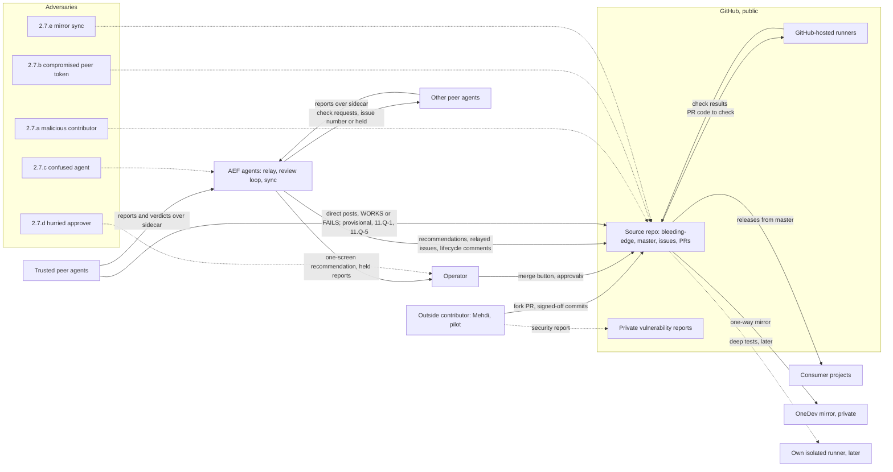
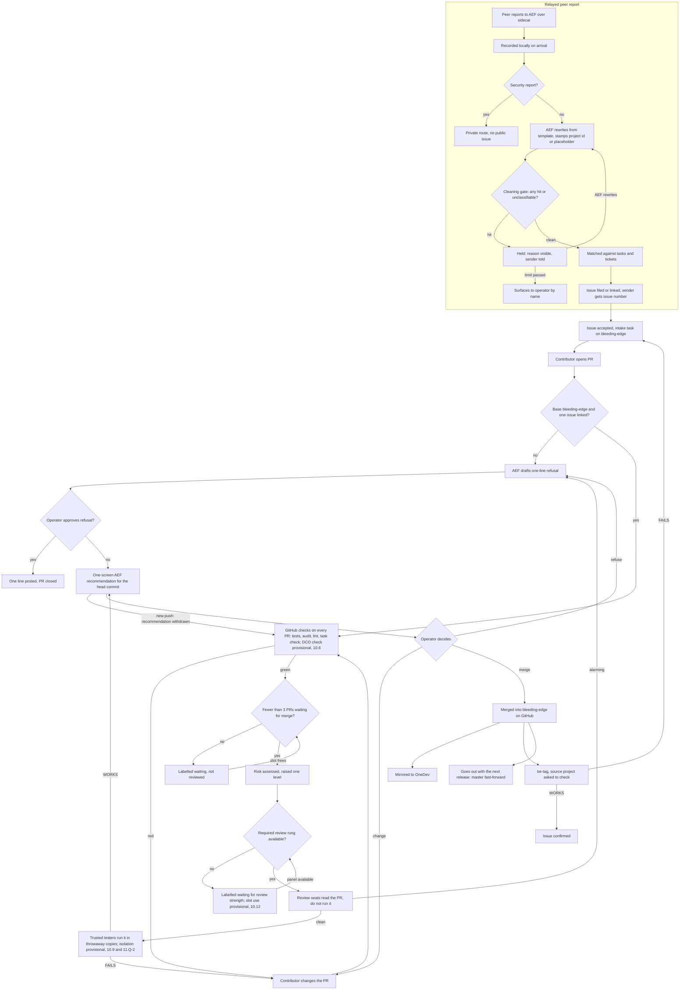
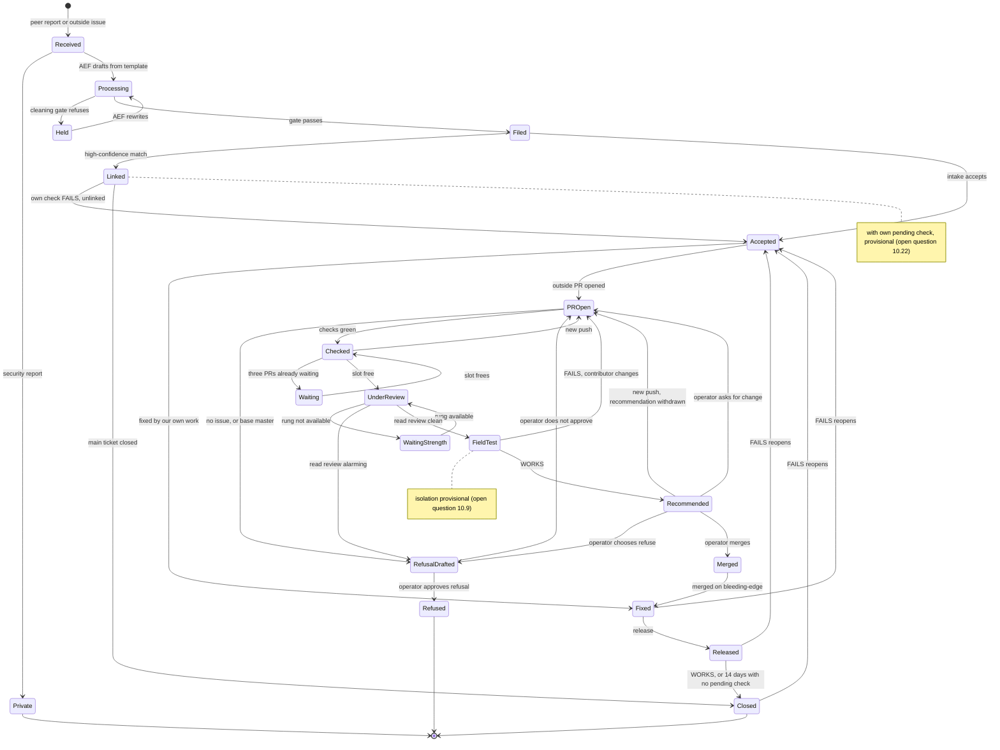

# Outside contributions through GitHub — requirements

## 0 Version history

| Version | Date | Change | Task |
|---|---|---|---|
| 0.1 | 2026-11-02 | Skeleton; stakeholders; question list; answers A10-A12 carried in from the T-5007 dialogue | T-5006 |
| 0.2 | 2026-11-02 | Draft: glossary, requirements, conflicts, earlier requirements, drawings | T-5021 |
| 0.3 | 2026-11-02 | Review round 1 dispositioned (section 11): requirements restated, R-52 to R-57 added, drawings D-2/D-3 corrected, open questions 10.23 to 10.29 | T-5021 |

## 1 Why this document exists

1.1 An outside contributor (Mehdi, GitHub MikeEchoVoid) wants to send pull requests and proposed how
(`T-5006-github-contributions.md`). The operator also wants cross-project requests (bugs, enhancements,
structural items) to move from the sidecar to GitHub issues (`T-5007-pickups-to-github.md`).
1.2 Method: ring20-manager's design role chain (their T-2222 v0.3), step 1, requirements collector, interview
mode. Card: `T-4123-inputs/02b-ring20-manager-role-cards.txt`. Later steps (threat modeler, security floor
and phasing, architect, evidence, pseudo-code, external panel, planner) follow after the operator signs this
list off.

## 2 Stakeholders

2.1 **Operator** (Dimitri): owns the framework, approves and merges, decides releases.
2.2 **Outside contributors**: Mehdi first; later anyone on GitHub.
2.3 **Peer project agents** (010, 050, 055, 832, ring20, others): send bugs and requests; test fixes.
2.4 **AEF agents**: take in issues and PRs, run the review loop, relay peer reports.
2.5 **Consumer projects**: install the framework through `fw upgrade`; everything merged reaches them.
2.6 **Protected systems**: the OneDev source repo (`origin`), the GitHub mirror, the release train
(`bleeding-edge` → `master`), CI, the peers' hosts (their names must not go public).
2.7 **Adversaries**:
2.7.a a malicious contributor who hides harmful code in a PR (a supply-chain path into every consumer);
2.7.b a compromised or careless peer bot account or token;
2.7.c a confused agent that copies host names, paths or secrets into a public issue;
2.7.d a hurried approver who merges without the review loop;
2.7.e the mirror sync itself, which can erase merged work (it already did: #76, #77, #79).

## 3 Questions

Interview mode: one at a time; "skip", "back" and "overview" work.

3.1 **Q1 Purpose**: in your words, what must be true when this arc is done?
3.2 **Q2 Who may contribute**: anyone on GitHub, invited contributors only, or Mehdi first as a pilot?
3.3 **Q3 Where a merged PR lands**: merge on GitHub and bring it into OneDev at once; never merge on GitHub
(apply on OneDev, the mirror marks the PR merged); or make GitHub the source.
3.4 **Q4 Who merges**: only you; or an AEF agent after your recorded approval?
3.5 **Q5 Task reference in outside commits**: the intake task id plus issue number (Mehdi's proposal); the
issue number alone; or a task created in the fork.
3.6 **Q6 Checks before you look**: what must run on a PR automatically (tests, audit, lint), and what may a
fork PR's CI see?
3.7 **Q7 Framework gates before landing**: must a contributed change pass the same review loop as our own
work (review seats, criteria, Verification), and at which strength?
3.8 **Q8 Protecting history**: branch protection on GitHub `bleeding-edge`, and how it fits the mirror sync.
3.9 **Q9 Licence terms**: Apache-2.0 section 5 alone, a DCO sign-off line, or a CLA?
3.10 **Q10 Which requests move to GitHub** — answered (A10).
3.11 **Q11 Who files the issue for a peer** — answered (A11).
3.12 **Q12 Telling the source project** — answered (A12).
3.13 **Q13 The old path**: `fw pickup` and sidecar requests: keep, wrap (they become issues), or retire?
3.14 **Q14 What may never go public**: hosts, IPs, paths, accounts, secrets; anything else? Who checks?
3.15 **Q15 Security reports**: private GitHub security advisory, or another route?
3.16 **Q16 Your time**: how much review time per week is acceptable; how are refusals given?
3.17 **Q17 Migration**: what happens to open pickups, auto-deferred envelopes and existing issues?
3.18 **Q18 Gap review** (card 3.4): credential custody, compromised sessions, approval fatigue, offline
operation, recovery, revocation, identity, unsupported cases.

## 4 Answers

4.1 **A1 Purpose** (2026-11-02): the operator chose two of the four offered statements:
4.1.a an outside contributor can open a PR against `bleeding-edge` and see tests run on it;
4.1.b peer projects' bugs and requests live as GitHub issues, with AEF relaying them and asking the reporter
to check the fix.
4.1.c Not chosen as purpose: "merged work lands in OneDev and ships without being lost" and "nothing reaches
consumers without the same review loop". Recorded as candidate requirements, not dropped; they are asked
directly under Q3 (landing) and Q7 (gates).
4.1.d Operator, on 4.1.c: "So I do merge it, but it lands in GitHub, not in OneDev anymore." Recorded as the
answer to Q3 (below, A3), given ahead of order.
4.2 **A2 Who may contribute** (2026-11-02): **1 — Mehdi first, as a pilot.** The whole circuit runs end to end
with one contributor who knows the framework; it opens wider only after it has held. Reason given: with GitHub
as the source repo (A3), a bad merge lands where consumers install from.
4.2.a A7 to A9: not yet asked.
4.6 **Q6 Checks before you look** — in discussion (2026-11-02). Operator: "the framework's directives are one"
(the framework's own checks come first), "but why do we run them on GitHub's runner? This I don't understand."
4.6.a Agent's explanation: GitHub's runner is a throwaway machine outside the operator's network. A PR's code
is untrusted until reviewed (adversary 2.7.a); running it there means a harmful PR can damage nothing of ours,
and the contributor sees the result on the PR (A1.a). Running it on our own hosts is possible (a self-hosted
runner, OneDev's build server, or an AEF agent that checks the PR out) but executes untrusted code inside the
network, next to credentials and the peers' hosts.
4.6.b Operator: "But do I need to pay for that? Then I need to start to use GitHub resources." Facts
(2026-11-02): the GitHub repo is public, and GitHub-hosted runners are free for public repositories. GitHub
resources are already in use: `test.yml` runs on every push to `master`, and its last three runs
(2026-10-20, 2026-10-20, 2026-10-29) all FAILED unnoticed. A same-day field report (ring20-dashboard, G-128,
T-5008: a review seat on a shared host killed a production service) is a live example of why untrusted code
should not run on the operator's hosts.
4.6.c Operator: "Then I depend on GitHub infrastructure to do that, right?" Agent: yes, for the pre-merge
checks. Two qualifiers: (1) A3 already makes GitHub the source repo, so the dependency exists either way;
Actions adds the runner, not a new vendor. (2) Portability (directive D4) is kept if the workflow only calls the
framework's own commands (`fw audit`, `fw test`, the task check), so the same checks can run elsewhere
(OneDev's build server or an isolated local seat, once T-5008 lands) if GitHub is down or its terms change.
Candidate requirement: the CI workflow contains no logic of its own, only calls to framework commands.
4.6.d Operator: "What are the costs from GitHub?" Agent (web sources, 2026-11-02): public repositories are free
on standard GitHub-hosted runners, with no minute cap; GitHub's 2025-12-16 changelog says public-repo usage
stays free. Paid only: private repos beyond the free quota, and "larger" runners. A $0.002/min fee on
self-hosted runners in private repos was announced for 2026-03-01 and reported postponed; it never applied to
public repos. Not checked against GitHub's live billing page.
4.6.e **A6** (2026-11-02): "I would like to have it under my own control. OK, let's do GitHub runners, but let's
have an activity that also starts developing and testing our own runners for later. That needs to be a
high-priority activity, not immediately but high priority."
4.6.f Recorded as: (1) now: every check (tests, structure audit, lint, the framework task check) runs on
GitHub-hosted runners, through framework commands only (4.6.c), so it can move; (2) a separate high-priority
task in this arc, scheduled next (not started now): build and test our own isolated runner under the operator's
control (candidate: a throwaway VM or container on the operator's Proxmox, on a network segment that cannot
reach other hosts, driven by OneDev's build server or registered as a runner), and prove it runs the same checks.
The goal is control: the operator wants the checks to end up on their own infrastructure.
4.4.a **Merge target** (operator, 2026-11-02, while discussing Q7): "where do I merge it to? To bleeding-edge."
Confirmed: outside PRs target and are merged into `bleeding-edge` on GitHub (Mehdi's point 1); `master` keeps
receiving fast-forwards at release time only (release train); nothing outside merges into `master`.
4.7 **Q7 Gates before merge** — in discussion (2026-11-02). Agent offered review by reading, at a rung set by
risk (1 / 3 / 5), or a floor of rung 3, or rung 5 always. Operator: "at least it should have been tested. How
can we test it, and depending on the risk test it more thoroughly, and have the test results judged like we do
with any external tester. It follows the normal review logic, maybe a little more stringent."
4.7.a Agent's reading: (1) every PR is tested, not only read: the automated checks on GitHub (A6) always;
(2) higher risk means deeper testing (more of the suite, then field tests in real projects); (3) the test
results are judged the way field reports are (WORKS / FAILS with evidence), by the normal review logic, one
step stricter (floor rung 3 for outside code). Open: where the deeper tests run before the merge, since running
an unmerged PR runs a stranger's code (G-128).
4.7.b **Operator: "That means the risk automatically gets increased, because it comes from external."**
Requirement: a PR from outside the estate is assessed one risk level higher than the same change made by us
(low → medium, medium → high, high stays high). Its testing depth and review strength follow the raised level.
4.7.c **A7 Where deeper tests run before the merge** (operator, 2026-11-02): **option 1** — the review seats
read the PR first (they do not run it); only if they find nothing alarming does testing start. Trusted peer
testers then run the PR in a throwaway copy of their project, never the live one, and post WORKS / FAILS on the
PR through the secondary account (4R.6.c). Higher risk means more testers and more scenarios. When T-5009 (own
isolated runner) exists, deep tests move there.
4.8 **A8 Protecting history** (operator, 2026-11-02): **option 1** — on GitHub, `bleeding-edge` and `master`
refuse force pushes and deletion. Direct pushes stay allowed (the session pushes to `bleeding-edge`; releases
fast-forward `master`). No PR requirement for our own commits. With GitHub as the source and OneDev mirroring
from it (A3, A3.a), the protection no longer conflicts with the mirror sync.
4.9 **A9 Licence terms** (operator, 2026-11-02): **option 1 — Apache-2.0 section 5 plus the DCO.** The project
is already Apache-2.0 (`LICENSE`; section 5: a contribution submitted for inclusion is under the same licence
unless stated otherwise). Each outside commit also carries `Signed-off-by:` (`git commit -s`), certifying the
contributor has the right to submit it; the commit-msg check verifies the line on outside commits. No CLA.
4.15 **A15 Security reports** (operator, 2026-11-02): **option 1** — GitHub private vulnerability reporting
("Report a vulnerability"), visible only to the operator and people they add; fixed privately, advisory
published with the fix; a short `SECURITY.md` points there. Peers in the estate may still report over the
sidecar (private). Security reports never go into public issues, and the relay (F1) refuses to file one
publicly.
4.14 **A14 What never goes public** (operator, 2026-11-02): **option 1.** The cleaning gate (F1) refuses public
text containing: host names; IP addresses; file paths on estate machines; account and user names; tokens, keys
and secrets; TermLink hub ids; personal data (email addresses, real names other than a contributor's own GitHub
name, phone numbers); content from a project's own data (for example a quoted email in a 050 report); open
security weaknesses (private route, A15); and estate layout (which host runs what, network layout, backup
locations). Project names are allowed unless a project opts out (F4). Anything the gate cannot classify is held
for rewriting, never posted (F1).
4.16 **A16 Your time and refusals** (operator, 2026-11-02): **option 1.** At most 3 outside PRs wait for the
operator's merge at once; further ones are labelled "waiting" and not reviewed until a slot frees. Each PR gets a
one-screen AEF recommendation (what it changes, risk level, test results, merge / change / refuse). A refusal is
one line on the PR (Mehdi point 6), drafted by AEF and approved by the operator.
4.18 **Q18 Gap review** (card 3.4), agent's pass:
4.18.a Credential custody: the secondary account is owned by the operator (password, 2FA); each token lives in its
holder's credential store, named in a registry, never in the repo (A11, 4R.6.c). Covered.
4.18.b Compromised session or host: a peer host → revoke its token alone; the AEF host → revoke AEF's token;
branch protection (A8) and operator-only merge (A4) cap the damage. Covered.
4.18.c Approval fatigue: queue of 3 and one-screen summaries (A16). Covered.
4.18.d Offline: GitHub down → PRs and direct posts wait; AEF down → the sidecar holds relay reports (F6). Covered.
4.18.e Recovery: GitHub account lost → the OneDev mirror holds the history (A3.a) and the local issue ledger the
intake. Covered.
4.18.f Revocation: per-peer tokens; the operator-owned trusted list (4R.6.c). Covered.
4.18.g Identity: contributors by GitHub account plus DCO (A9); peers by the stamped project id (F5). Covered.
4.18.h Unsupported cases: a PR without an issue, or against `master`, is refused with a one-line reason (A16,
4.4.a). **Open:** a PR that is high risk (every outside PR is raised one level, 4.7.b) needs a rung-5 panel, and a
rung-5 panel cannot be assembled today (two launchable worker kinds; the antigravity seat is T-4997). Put to the
operator. **Operator (2026-11-02): option 1 — it waits.** Low- and medium-risk outside PRs proceed; a high-risk
one is labelled "waiting for review strength" until a rung-5 panel can run. T-4997 becomes a dependency of this
arc. No step-down for outside PRs.
4.18.i **Interview complete** (2026-11-02): Q1-Q18 answered or settled; review findings F1-F9 braided in.
4.13 **A13 The old path** — answered by F8 (4R.8): `fw pickup send` for bugs and features is wrapped onto the new
route; learnings and patterns stay on the sidecar.
4.17 **A17 Migration** — answered by F8 (4R.8): forward only.
4.5 **A5 Task reference** (2026-11-02): **1 — intake task id plus issue number**, "T-4935 (#104): …". The
commit-msg hook stays unchanged; the intake task file must be on `bleeding-edge` before the PR is opened.
4.4 **A4 Who merges** (2026-11-02): **1 — only the operator, with the GitHub merge button.** AEF agents run the
review loop and post a recommendation on the PR; no agent holds merge rights.
4.3 **A3 Where a merged PR lands** (2026-11-02, given with A1): the operator merges, and the merge lands on
GitHub; OneDev is no longer where it lands. This is option 3 of Q3: GitHub becomes the source repo.
4.3.a Follow-up (2026-11-02): OneDev retired, a mirror of GitHub, or a backup only? **Operator: 1 — OneDev
becomes a mirror of GitHub.** We push to GitHub; OneDev copies it (the reverse of today). OneDev's builds and
the private copy on the operator's network stay.
4.3.b Facts that bear on it: today `origin` is OneDev and pushes to GitHub; `fw mirror sync` runs every 15
minutes in that direction; consumers already install from GitHub (`lib/consumer-recover.sh:19` calls it the
canonical public mirror); the session, hooks, release train and handovers push to `origin`.
4.10 **A10** (T-5007 IW-1, 2026-11-02): bug reports, enhancement requests and other structural items move to
GitHub issues; field reports, live consults and notices stay on the sidecar. PRs are not a third kind: each
PR is the fix or build for one issue. Open: which further structural kinds (agent suggested wrong
documentation, design proposals, a cleaned per-release verdict thread; security reports go private).
4.11 **A11** (T-5007 IW-2): AEF relay is the path every agent has: the agent reports to AEF, AEF cleans host
detail and files the issue naming the source project. Per-project GitHub bot accounts are an optional
addition (operator likes the idea; it means every agent needs an account). One shared cleaning step for both
routes.
4.12 **A12** (T-5007 IW-2): when the issue reaches fixed or released, AEF tells the source project's agent to
check; their verdict comes back as a field report and confirms or reopens the issue.

## 4R Review findings braided in (T-5007 reviews, 2026-11-02)

Input from `T-5007-review-codex.md` (sound with fixes) and `T-5007-review-opencode.md` (unsound as specified,
fixable). Each finding is put to the operator one at a time; the answer becomes a requirement or a conflict.

4R.1 **F1 Cleaning is too weak.** `lib/issues.py:_scrub` (line 1441) replaces a local-host regex and this
machine's own hostname with `[host]`; its docstring says names it cannot recognise are not caught. It runs only on
release evidence (line 1521), never on issue bodies.
4R.1.a **Operator (2026-11-02): rewrite fresh** (option 1). AEF never copies a peer's text; it writes the issue
from a fixed template; the cleaner is a gate that refuses on any hit, never a filter that repairs.
4R.1.b **Operator: "What I do want to prevent: oh, it's not good enough, we ping it back and it disappears in the
void."** Recorded as a requirement: a refusal never loses a report. Every peer report is recorded locally on
arrival, before any public step; a refused draft stays in a visible "held" state with its reason; AEF rewrites
it; a report still held after a set time (or attempts) surfaces to the operator by name (operator pending,
Watchtower); the sending project is told either the issue number or that it is held and why. Nothing is ever
bounced back to the sender as the only copy.

4R.2 **F2 Relayed issues lose the lifecycle.** `fw issues sync` classifies owner-authored issues as internal
(ledger only: no stages, no submitter confirmation). **Operator (2026-11-02): option 1** — AEF files relayed
issues with a `relayed` label and a source field; sync gives them the full lifecycle, and where it would wait for
the GitHub author it waits for the source project's verdict over the sidecar. One account, no new credentials.

4R.3 **F3 No reopen; the 14-day sweep can close too early.** **Operator (2026-11-02): option 1** — a FAILS
verdict (source project over the sidecar, or a "not fixed" reply on GitHub) reopens the issue: back to accepted,
task reopened or a follow-up linked, a cleaned public comment posted. The sweep skips an issue while a requested
check is pending; an overdue check surfaces to the operator by name instead of closing silently.

4R.4 **F4 Naming the source project is a disclosure.** **Operator (2026-11-02): option 3, "unless requested
otherwise"** — the relayed issue names the real source project by default; a project that asks not to be named
gets "reported by a project in the maintainer's estate" with the mapping kept only in AEF's local ledger. The
cleaning gate (F1) still removes hosts, IPs, paths, accounts and tokens; only the project name is allowed.

4R.5 **F5 Bot accounts per peer.** GitHub machine accounts must be created and owned by a human; one free
machine account per person (both reviews). Agent offered: no bots in this arc; one shared machine account; one
per peer. **Operator (2026-11-02): alternative — identify peers by unique, stable project ids following the
TermLink naming convention, instead of GitHub accounts.** Under discussion: identity comes from the id stamped
by the relay, not from who is logged in to GitHub.
4R.5.a A TermLink identity has three layers: host (`//<host>/…`), hub id (16 hex characters), project id (the
project name). Agent recommended publishing the project id only. **Operator: the hub id might be worse, "because
you give away part of a key."** Not verified whether the hub id is derived from key material; treated as
sensitive either way. Requirement: hub ids and host names never appear in public text; the cleaning gate (F1)
refuses them.
4R.5.b **Operator (2026-11-02): confirmed.** No bot accounts in this arc. The relay stamps the project id (the
project name) on the issue; nothing else from TermLink goes public. The full address stays in AEF's local
ledger, used only to reach the project over the sidecar (F2, F3).

4R.6 **F6 The relay is a single point of failure and a bottleneck.** Agent offered: (1) nothing lost, delays
visible, AEF has no veto; (2) plus a direct fallback through a shared account; (3) accept as is.
4R.6.a **Operator rethink (2026-11-02), revises F5:** the concern with accounts was the number of accounts, not
tokens. One secondary GitHub account, only for creating and updating issues, shared with **trusted** peers who
file and update directly; this also lets peers that test a PR send their results to it. Other peers go through
the AEF relay. Under discussion: how the account is shared, and its permissions.
4R.6.b Agent offered: (1) one account, a separate fine-grained token per trusted peer, scoped to issues and PR
comments on this repo only (no push, no merge), revocable per peer; (2) one shared token; (3) only AEF holds a
token. **Operator: "AEF holds at least — my AEF instance here holds at least [one], right?"** Read as: the
operator's own AEF instance always holds a token of the secondary account (for the relay and the lifecycle);
trusted peers get their own on top. **Operator: "Sounds good" (option 1, confirmed 2026-11-02).**
4R.6.c Resulting model (revises 4R.5.b): one secondary GitHub account for issues and PR comments only; the
operator's AEF instance holds a token; each trusted peer holds its own fine-grained token, scoped to issues and
PR comments on this repo, revocable per peer; the trusted-peer list is an operator-owned policy file. Machine
traffic leaves the operator's personal account. F1 (cleaning gate), F5 (project-id stamp) and F2 (lifecycle)
apply to direct posts as well as relayed ones.
4R.6.d **Relay route, remainder of F6 — operator: option 1.** A peer keeps its report until AEF acknowledges with
an issue number or a held status; the sidecar holds messages while AEF is down; a report waiting too long
surfaces to the operator by name; AEF has no veto: it files and adds its view as a comment. Only the cleaning
gate (F1) can hold a report, visibly.

4R.7 **F7 Duplicates.** Pickup dedup (content hash + project) is lost on the GitHub route; sync has only a title
similarity hint. **Operator (2026-11-02):** AEF must do the matching, because it has far stronger tools: the
component fabric, the vector database (semantic match) and BM25 keyword search. AEF matches each new ticket
against existing tasks and tickets, links the new ticket to the main one (or closes it as part of it), records
the link in the main ticket, and when the main ticket is closed, closes all linked tickets.
4R.7.a Agent's view: agreed, with two refinements under discussion — (a) a linked reporter whose check FAILS
reopens their own ticket (unlinked), because the symptom may differ; (b) a weak match is never linked
silently: high confidence links, medium confidence posts "possible duplicate of #N" for the operator.
4R.7.b **Operator: option 1 — the design plus both refinements.** Matching runs in `fw issues sync` on every new
ticket (relayed and direct alike), against tasks and tickets, using the fabric, vector and BM25 search.

4R.8 **F8 No migration plan.** **Operator (2026-11-02): option 1 — forward only, old command wrapped.** The 82
processed pickups stay (each became a task); the 4 auto-deferred are filed on GitHub when their blocker clears;
`fw pickup send` for bug reports and feature proposals routes to the new filing command (direct for trusted
peers, relay for the rest); learnings and patterns stay on the sidecar; the GitHub issue templates ask for a
cleaned description and the project id, not raw `fw doctor` output or logs.

4R.9 **F9 "Fixed" must be tied to the source repo** (codex 8). Dissolved by A3: GitHub is the source repo, so a
fix merged there is the authoritative one.

## 5 Glossary

Each term is defined once here; later roles use it in this sense. The source is the answer or finding that
set it.

5.1 **Contribution**: a change proposed to the framework from outside the operator's own sessions, carried as an
outside PR (5.2). Source: A1.a, A2.
5.2 **Outside PR**: a GitHub pull request opened from a fork by an outside contributor, targeting `bleeding-edge`,
fixing or building exactly one issue (5.3). Source: A1.a, A10, 4.4.a.
5.3 **Issue**: a GitHub issue on the framework's source repo (5.9); the public, numbered record of one bug report,
enhancement request or other structural item. Source: A10.
5.4 **Relayed issue**: an issue AEF files on behalf of a peer project after the peer reported to AEF over the
sidecar; it carries the `relayed` label and a source field. Source: A11, F2.
5.5 **Direct post**: an issue, issue update or PR comment written by a trusted peer (5.6) itself, with its own token
of the secondary account (5.7), without the AEF relay. Source: 4R.6.a, 4R.6.c.
5.6 **Trusted peer**: a peer project named in the operator-owned trusted-peer policy file; it may post directly and
may act as a tester of outside PRs. Every other peer uses the relay. Source: 4R.6.a, 4R.6.c, A7.
5.7 **Secondary account**: the one GitHub account, owned by the operator, used only for creating and updating
issues and writing PR comments; machine traffic runs through it, not through the operator's personal account.
Source: 4R.6.a, 4R.6.c, 4.18.a.
5.8 **Project id**: the stable, unique project name of a peer project in the TermLink naming convention (the
project layer only, never the host or hub id), stamped on relayed issues and direct posts to identify the source.
Source: 4R.5, 4R.5.a, 4R.5.b.
5.9 **Source repo**: the authoritative repository where merges land and from which consumers install: the GitHub
repo. Source: A3.
5.10 **Mirror**: the OneDev copy of the source repo, updated from GitHub (the reverse of the direction before this
arc); OneDev's builds and the private copy stay. Source: A3.a.
5.11 **Landing**: an outside PR being merged by the operator into `bleeding-edge` on the source repo. `master`
receives work only by fast-forward at release. Source: A3, A4, 4.4.a.
5.12 **Cleaning gate**: the one shared check every piece of public text (title, body, comment, verdict) passes
before it is posted, on both the relay and the direct route; it refuses on any hit and never repairs. Source: F1,
4R.1.a, A14, A11.
5.13 **Held report**: a peer report whose public draft the cleaning gate refused; it is kept, visible, with its
reason, until AEF rewrites it or the operator acts. Source: 4R.1.b, 4R.6.d.
5.14 **Main ticket / linked ticket**: when AEF's matching finds that a new ticket is the same problem as an
existing one, the existing one is the main ticket and the new one is linked to it; the main ticket records its
links. Source: F7, 4R.7.b.
5.15 **Risk level**: low, medium or high, as the framework's normal review logic assesses a change; an outside PR is
assessed one level higher than the same change made inside the estate. Source: 4.7.b.
5.16 **Review rung**: the review strength of the framework's review policy (rung 1, 3 or 5) required by a risk level;
rung 5 is a three-seat, three-vendor panel. Source: A7, 4.18.h.
5.17 **Field test**: a trusted peer running a change in a throwaway copy of its own project (never the live project)
and reporting WORKS or FAILS with evidence. Source: A7, A12.
5.18 **be-tag**: the pre-release tag on `bleeding-edge` that a source project is asked to test when its issue
reaches fixed. Source: A12, T-5007 IW-2.
5.19 **DCO**: the Developer Certificate of Origin; a `Signed-off-by:` line on each outside commit certifying the
contributor has the right to submit it, in addition to Apache-2.0 section 5. Source: A9.
5.20 **Pilot**: the period in which only Mehdi's contributions run through the circuit; it ends by an operator
decision after the circuit has held end to end. Source: A2.

## 6 Requirements

6.0 How to read this section.
6.0.a Each requirement has: statement (RFC 2119), a. type · source · priority · verification method, b. rationale,
c. acceptance criterion a test can check, and d. for requirements that make something **impossible**, the
adversary (2.7.a-e) it holds against.
6.0.b Priority (proposed by the collector; the operator decides at sign-off): **P1** needed for the pilot (A2);
**P2** needed before contributions open wider; **P3** later.
6.0.c Verification methods: **test** (automated, repeatable), **demonstration** (a live run observed once and
recorded), **inspection** (reading a file or setting), **analysis** (reasoning over records).
6.0.d Nothing here is new: every item traces to an answer (A-n) or a finding (F-n). Gaps are open questions
(section 10), not requirements.

### 6.1 Source repo, landing and history

6.1.1 **R-1 GitHub is the source repo.** Merges of outside PRs and the session's own pushes MUST land on the GitHub
repo, and the GitHub repo MUST be treated as authoritative for "fixed" and "released".
6.1.1.a Functional · A3, F9 · P1 · demonstration.
6.1.1.b The operator merges on GitHub and wants the merge to stick there (A3); a fix merged on the source repo is
the authoritative one (F9).
6.1.1.c Given an outside PR merged on GitHub `bleeding-edge`, when every scheduled sync has run, then the merge
commit is still reachable from GitHub `bleeding-edge` and the issue lifecycle refers to that commit.

6.1.2 **R-2 OneDev mirrors GitHub.** OneDev MUST be updated from GitHub (one direction: GitHub → OneDev). OneDev's
builds and the private copy on the operator's network MUST keep working.
6.1.2.a Interface · A3.a, A3.b · P1 · demonstration.
6.1.2.b The operator chose to reverse today's direction rather than retire OneDev (A3.a).
6.1.2.c Given a commit pushed to GitHub `bleeding-edge`, when the mirror cycle runs, then OneDev `bleeding-edge`
points at the same commit, and a OneDev build can run on it.

6.1.3 **R-3 The mirror cannot erase merged work.** It MUST be impossible for the mirror sync to remove or rewrite a
commit on GitHub `bleeding-edge` or `master`.
6.1.3.a Security invariant · A3.a, A8, 2.7.e (PRs #76, #77, #79) · P1 · test.
6.1.3.b Merged PRs were lost once when the mirror rewrote GitHub's history.
6.1.3.c Invariant: after any mirror run, the previous GitHub tip of each protected branch is an ancestor of the
new tip.
6.1.3.d Holds against: 2.7.e (the mirror sync).

6.1.4 **R-4 Protected branches.** On GitHub, `bleeding-edge` and `master` MUST refuse force pushes and deletion.
6.1.4.a Security invariant · A8, Mehdi point 7 · P1 · inspection and test.
6.1.4.b Branch protection stops the #76/#77/#79 loss class, and with GitHub as the source it no longer conflicts with
the mirror (A8).
6.1.4.c Given the protection is on, when anyone (operator token, agent token or peer token) force-pushes to or
deletes `bleeding-edge` or `master`, then GitHub refuses.
6.1.4.d Holds against: 2.7.e (mirror sync), 2.7.b (compromised peer token), 2.7.d (hurried approver).

6.1.5 **R-5 Our own pushes stay direct.** Direct (fast-forward) pushes to `bleeding-edge`, and release fast-forwards
to `master`, MUST stay allowed, and our own commits MUST be pushable without a PR.
6.1.5.a Operational · A8 · P1 · demonstration.
6.1.5.b The session pushes to `bleeding-edge`; releases fast-forward `master` (release train).
6.1.5.c Given protection is on, when the session pushes a fast-forward to `bleeding-edge`, then the push succeeds
without a PR.

6.1.6 **R-6 Outside work never enters `master` directly.** Outside PRs MUST target `bleeding-edge`. A PR against
`master` MUST be refused with a one-line reason. It MUST be impossible for outside work to reach `master` other than
by a release fast-forward from `bleeding-edge`.
6.1.6.a Security invariant · 4.4.a, 4.18.h, Mehdi point 1 · P1 · test.
6.1.6.b `master` is the consumer install surface and receives only releases.
6.1.6.c Given an outside PR with base `master`, when AEF takes it in, then AEF drafts a one-line refusal and no
review or test starts. Invariant: at every update of `master`, the update is a fast-forward and the new tip was
already reachable from `bleeding-edge` (checked by the release command and by audit).
6.1.6.d Holds against: 2.7.a (malicious contributor), 2.7.d (hurried approver), for every path through the
framework's tooling.
6.1.6.e Prevented, detected, residual (0.3, section 11 row 17): prevented — outside work reaching `master` through
framework tooling other than a release fast-forward; detected — a non-fast-forward or out-of-band `master` update,
by the invariant check; residual — the repo owner's account can push to `master` directly, so a direct landing by
the owner is detected, not prevented.

### 6.2 Who contributes, who merges, licence

6.2.1 **R-7 Pilot first.** Until the operator decides the circuit has held end to end, only Mehdi's outside PRs MUST
be taken through review, testing and merge.
6.2.1.a Operational · A2 · P1 · demonstration.
6.2.1.b With GitHub as the source repo, a bad merge lands where consumers install from (A2).
6.2.1.c Given the pilot is on, when a PR from another account arrives, then no review is dispatched, no test is
requested and no merge recommendation is posted; it is answered as 10.2 decides.

6.2.2 **R-8 Only the operator merges.** Outside PRs MUST be merged only by the operator, with the GitHub merge button.
Agents MUST NOT merge. No token of the secondary account (held by AEF or by a peer) MAY have push or merge rights.
(Restated in 0.3: the session's own push credential, R-5, is not a secondary-account token; see 6.2.2.e.)
6.2.2.a Security invariant · A4, 4R.6.c · P1 · inspection and test.
6.2.2.b AEF agents run the review loop and recommend; deciding is the operator's (A4).
6.2.2.c Given each secondary-account token, when it is used to merge a PR, push a branch, change branch protection
or write to another repository, then GitHub refuses.
6.2.2.d Holds against: 2.7.b (compromised peer token), 2.7.c (confused agent), for secondary-account tokens.
6.2.2.e Prevented, detected, residual (0.3, section 11 rows 4 and 6): prevented — merging or pushing with a
secondary-account token, **only if** 11.Q-5 yields a repository role without push and merge (on a personal-account
repo every collaborator can push and merge); not prevented — the session's push credential can push to
`bleeding-edge` (R-5, A8) and can therefore land a PR's commits; the framework's own gates refuse it and R-58
(proposed) would detect it; residual — a process using that credential outside the framework. Operator question
11.Q-3.

6.2.3 **R-9 One PR, one issue.** Every outside PR MUST link exactly one issue. A PR without an issue MUST be refused
with a one-line reason.
6.2.3.a Functional · A10, 4.18.h, Mehdi point 2 · P1 · test.
6.2.3.b A PR is the fix or build for one issue, not a third kind of request (A10). (Mehdi's documentation exception:
10.3.)
6.2.3.c Given an outside PR whose description links no issue, when AEF takes it in, then AEF drafts a one-line
refusal and no review starts.

6.2.4 **R-10 Task reference.** Each outside commit message MUST start with the intake task id and the issue number
("T-NNNN (#N): …"). The commit-msg hook MUST stay unchanged. The intake task file MUST be on `bleeding-edge` before
the contributor opens the PR.
6.2.4.a Interface · A5, Mehdi point 3 · P1 · test.
6.2.4.b The intake already creates one task per issue; this needs no new mechanism (A5).
6.2.4.c Given an issue accepted by intake, when the contributor is told to start, then its task file is already on
GitHub `bleeding-edge`; and given a commit "T-NNNN (#N): …" for that task, the unchanged hook accepts it.

6.2.5 **R-11 Licence and DCO.** Outside contributions MUST be under Apache-2.0 (section 5). Each outside commit MUST
carry a `Signed-off-by:` line, and a check MUST verify it on outside commits. No CLA is required.
6.2.5.a Interface · A9, Mehdi point 8 · P1 · test.
6.2.5.b The DCO certifies the contributor's right to submit at no cost to them (A9). Where the check runs: 7.6.
6.2.5.c Given an outside PR with a commit lacking `Signed-off-by:`, when the checks run, then the DCO check fails
and the PR is not recommended for merge.

### 6.3 Checks before anyone looks

6.3.1 **R-12 Every PR is tested.** Every PR to `bleeding-edge` MUST run the automated checks (tests, structure audit,
lint, the framework task check), and the result MUST be visible to the contributor on the PR.
6.3.1.a Functional · A1.a, A6, Mehdi point 5 · P1 · demonstration.
6.3.1.b Today `test.yml` ignores PRs to `bleeding-edge`; the contributor must see tests run (A1.a).
6.3.1.c Given a new PR to `bleeding-edge`, when it is opened (and, for a first-time contributor, the run is
approved), then each listed check runs and reports its status on the PR.

6.3.2 **R-13 Checks run on GitHub-hosted runners for now.** The automated checks MUST run on GitHub-hosted runners.
Untrusted PR code MUST NOT run on estate hosts for these checks.
6.3.2.a Security invariant · A6, 4.6.a, 4.6.b · P1 · inspection.
6.3.2.b A PR's code is untrusted until reviewed; a throwaway runner outside the network can damage nothing of ours.
6.3.2.c Given the workflow file, when inspected, then every job uses a GitHub-hosted runner label and none a
self-hosted one.
6.3.2.d Holds against: 2.7.a (malicious contributor).

6.3.3 **R-14 The CI holds no logic of its own.** The workflow MUST only call framework commands, so the same checks
can run elsewhere unchanged.
6.3.3.a Quality (portability, directive D4) · 4.6.c, 4.6.f · P1 · inspection and demonstration.
6.3.3.b The operator wants the checks under their own control later (A6); this keeps them movable.
6.3.3.c Given the workflow file, when each step is read, then it is a framework command (or checkout/setup), and
running the same commands on another machine gives the same verdict.

6.3.4 **R-15 Own runner, high priority.** A separate task in this arc MUST build and test an isolated runner under the
operator's control and prove it runs the same checks; it is scheduled next, at high priority, not started now.
6.3.4.a Operational · A6, 4.6.f (T-5009) · P2 · inspection, then demonstration.
6.3.4.b "I would like to have it under my own control" (A6).
6.3.4.c Given the own-runner task completes, when the R-12 checks run on the own runner for a commit already
checked on GitHub, then each check gives the same verdict as on GitHub for that commit.

### 6.4 Risk, review and testing

6.4.1 **R-16 Outside raises risk.** An outside PR MUST be assessed one risk level higher than the same change made
inside the estate: low → medium, medium → high, high stays high. Testing depth and review strength MUST follow the
raised level.
6.4.1.a Functional · 4.7.b · P1 · test.
6.4.1.b "The risk automatically gets increased, because it comes from external" (operator, 4.7.b).
6.4.1.c Given a change the risk assessment rates low, when it arrives as an outside PR, then the recorded risk level
is medium and the review rung required is the medium one.

6.4.2 **R-17 Read before run.** Review seats MUST read an outside PR (not run it) first. No framework procedure (AEF
dispatch, review seat, test request) MAY run an outside PR's code, check it out for execution, or send it for testing
on any estate host or in any peer project before that read review has returned clean. (Restated in 0.3: the earlier
"impossible" could not hold against a peer acting outside the procedure; see 6.4.2.e.)
6.4.2.a Security invariant · A7, 4.7.a, G-128 · P1 · test and analysis.
6.4.2.b Running an unmerged PR runs a stranger's code (4.7.a); a review seat on a shared host already killed a
production service once (G-128, T-5008).
6.4.2.c Given an outside PR whose read review has not returned clean, when any tester asks for it or any AEF step
would test it, then no test request is sent, the dispatch and test-request records show no checkout of its head for
execution, and the PR shows it awaits review.
6.4.2.d Holds against: 2.7.a (malicious contributor), 2.7.d (hurried approver), inside the framework's procedures.
6.4.2.e Prevented, detected, residual (0.3, section 11 row 2): prevented — execution through the framework's
procedures before a clean read; not prevented — a public PR can be fetched by anyone, so a peer acting outside the
procedure can run it; detected only if reported; residual for the operator (11.Q-2).

6.4.3 **R-18 Testers use a throwaway copy.** After a clean read review, trusted peer testers MUST run the PR only in a
throwaway copy of their project, never in the live one, by the procedure AEF sends. Testers MUST post WORKS / FAILS on
the PR through the secondary account (account model: 11.Q-5). Until an isolation floor (R-53, proposed) is decided and
in place, the throwaway copy is the only protection (11.Q-2).
6.4.3.a Security invariant · A7 · P1 · demonstration.
6.4.3.b A field test of a stranger's code must not reach a working project.
6.4.3.c Given a test request, when a tester follows it, then the PR is checked out into a fresh copy that is removed
afterwards, and a WORKS/FAILS comment with evidence appears on the PR from the secondary account.
6.4.3.d Holds against: 2.7.a (malicious contributor), for writes to the live project's working tree.
6.4.3.e Prevented, detected, residual (0.3, section 11 row 2): prevented — the PR's code changing the live project's
files, when the procedure is followed; not prevented by a throwaway copy — the code reading credentials on the host,
reaching the network or other hosts, or affecting other projects on the same host (the G-128 class); residual for the
operator until R-53 or the own runner (R-22) exists. (Where the copy runs until the own runner exists: 7.2.)

6.4.4 **R-19 Depth follows risk.** A higher risk level MUST mean more testers and more scenarios.
6.4.4.a Functional · A7, 4.7.a · P1 · analysis. (Counts per level: 10.10.)
6.4.4.b Deeper testing for riskier change, like any external tester (operator, 4.7).
6.4.4.c Given two outside PRs rated medium and high, when tests are requested, then the high one has more testers and
more scenarios than the medium one.

6.4.5 **R-20 Results judged like field reports.** Test results MUST be judged as field reports are (WORKS / FAILS
with evidence), under the normal review logic.
6.4.5.a Functional · 4.7 (operator), 4.7.a · P1 · inspection.
6.4.5.b "Have the test results judged like we do with any external tester" (4.7).
6.4.5.c Given a WORKS comment without evidence, when AEF builds the recommendation, then it counts as no result.

6.4.6 **R-21 No step-down for outside PRs.** An outside PR MUST get the review rung its raised risk level requires.
A high-risk outside PR MUST wait, labelled "waiting for review strength", until a rung-5 panel can run; a step-down
for outside PRs MUST be impossible.
6.4.6.a Security invariant · 4.18.h (T-4997 dependency) · P1 · test.
6.4.6.b The operator chose "it waits" (4.18.h).
6.4.6.c Given a high-risk outside PR and no rung-5 panel available, when AEF processes it, then it is labelled
"waiting for review strength", no merge recommendation is posted, and no step-down is recorded.
6.4.6.d Holds against: 2.7.a (malicious contributor), 2.7.d (hurried approver).

6.4.7 **R-22 Deep tests move to the own runner.** When the own runner (R-15) exists, deep tests of outside PRs MUST
run there.
6.4.7.a Operational · A7 · P3 · demonstration.
6.4.7.b The own runner is the isolation the operator wants under their control (A6, A7).
6.4.7.c Given the own runner is live, when a deep test is requested, then it runs on the own runner.

### 6.5 The operator's time

6.5.1 **R-23 A queue of three.** At most 3 outside PRs MUST wait for the operator's merge at once; further PRs MUST be
labelled "waiting" and not reviewed until a slot frees.
6.5.1.a Operational · A16 · P1 · test.
6.5.1.b Caps approval load (approval fatigue, 4.18.c).
6.5.1.c Given 3 outside PRs awaiting merge, when a fourth passes intake, then it is labelled "waiting" and no review
is dispatched for it until one of the three is merged or refused.

6.5.2 **R-24 One screen per PR.** Each outside PR MUST get a one-screen AEF recommendation: what it changes, risk
level, test results, and merge / change / refuse.
6.5.2.a Interface · A16 · P1 · inspection.
6.5.2.b The operator decides from one screen (A16).
6.5.2.c Given a PR ready for the operator, when the recommendation is posted, then it contains all four parts,
names the head commit it applies to (R-55), and fits one screen: at most 40 lines of at most 100 characters (bound
provisional, 10.26).

6.5.3 **R-25 One-line refusals, approved.** A refusal MUST be one line on the PR, drafted by AEF and posted only after
the operator approved it.
6.5.3.a Functional · A16, Mehdi point 6 · P1 · test.
6.5.3.b Refusing is the operator's decision; one line is enough (Mehdi point 6).
6.5.3.c Given AEF drafts a refusal, when no operator approval is recorded, then nothing is posted.

### 6.6 Peer requests as issues

6.6.1 **R-26 What moves.** Peer bug reports, enhancement requests and other structural items MUST live as GitHub
issues. Field reports, live consults and notices MUST stay on the sidecar. Trusted peers MAY also create and update
issues and post PR comments directly (5.5, 4R.6.c). (0.3: "and replies" withdrawn, no answer supports it.)
6.6.1.a Functional · A10, A1.b, 4R.6.c · P1 · inspection. (Further structural kinds: 10.1.)
6.6.1.b GitHub gives a numbered thread and lifecycle; the sidecar delivers into a running session.
6.6.1.c Given a peer files a bug report, when it is processed, then it ends as a GitHub issue; given a live consult,
it stays on the sidecar.

6.6.2 **R-27 Relay for every peer.** Every peer MUST be able to report to AEF over the sidecar without any GitHub
account, and AEF MUST file the issue naming the source project (subject to R-33).
6.6.2.a Functional · A11 · P1 · demonstration.
6.6.2.b The relay is the path every agent has (A11).
6.6.2.c Given a peer with no token sends a bug report to AEF, when AEF processes it, then a relayed issue exists
naming the source project, or the report is held (R-30).

6.6.3 **R-28 Fresh rewrite.** AEF MUST write each relayed issue from a fixed template in its own words; publishing a
peer's raw text MUST be impossible on the relay route.
6.6.3.a Security invariant · F1, 4R.1.a · P1 · test.
6.6.3.b A filter that repairs text misses what it cannot recognise; rewriting removes the copy path (4R.1).
6.6.3.c Given a peer report, when AEF drafts the issue, then every field of the draft is a template field, no run of
8 or more consecutive words of the report appears in the draft (run length provisional, 10.26), and the draft still
passes through the cleaning gate (R-29) before posting.
6.6.3.d Holds against: 2.7.c (confused agent).

6.6.4 **R-29 The cleaning gate.** All public text (titles, bodies, comments, verdicts) that the framework posts — by AEF
on the relay route, and by a trusted peer through the framework's filing command on the direct route — MUST pass one
shared cleaning gate that refuses on any hit and never repairs. (Restated in 0.3: the earlier "impossible" could not
hold for text posted outside the framework's command; see 6.6.4.e.) The gate MUST refuse text containing: host names; IP addresses; file paths on estate machines; account and user names; tokens,
keys and secrets; TermLink hub ids; personal data (email addresses, real names other than a contributor's own GitHub
name, phone numbers); content from a project's own data; open security weaknesses; estate layout (which host runs
what, network layout, backup locations). Anything the gate cannot classify MUST be held, never posted.
6.6.4.a Security invariant · F1, 4R.1.a, A14, A11, 4R.5.a, 4R.6.c · P1 · test.
6.6.4.b The mirror is public and a leak is never undone; one gate for both routes (A11).
6.6.4.c Given a draft containing an item of any listed class, when it is submitted through the framework's filing
command on either route, then the gate refuses, nothing is posted, and the report becomes held with the class named.
Given a draft the gate cannot classify, then it is held. Given each draft of a fixed set of clean samples (the set is
part of the test), then it passes and is posted; a gate that refuses clean samples fails the test.
6.6.4.d Holds against: 2.7.c (confused agent) and 2.7.b (careless peer), when posting goes through the framework's
command.
6.6.4.e Prevented, detected, residual (0.3, section 11 row 1): prevented — a listed item reaching public text through
the framework's filing command, on either route; not prevented — any holder of a posting token (a compromised trusted
peer, or an AEF process calling GitHub directly) can post any text with any GitHub client, where the gate does not
run; detected — only if R-52 (proposed) is adopted; residual for the operator — text exposed between posting and
detection is public and may be copied or cached, and hiding it afterwards does not undo that. Operator question
11.Q-1 (7.7, 10.8).

6.6.5 **R-30 A refusal never loses a report.** Every peer report MUST be recorded locally on arrival, before any public
step. A refused draft MUST stay in a visible held state with its reason; AEF rewrites it; a report still held after a
set time or number of attempts MUST surface to the operator by name (operator pending, Watchtower). The sender MUST
be told the issue number or that it is held and why. A report MUST NOT be bounced back as the sender's only copy.
6.6.5.a Functional (reliability) · 4R.1.b, 4R.6.d · P1 · test. (Limits: 10.11.)
6.6.5.b "We ping it back and it disappears in the void" is what the operator wants to prevent (4R.1.b).
6.6.5.c Given a report whose draft is refused, when the held limit passes, then it appears in operator pending by
name, and the sender has received a held notice with the reason.
6.6.5.d Holds against: 2.7.c (confused agent dropping a report).

6.6.6 **R-31 Peer keeps until acknowledged.** A peer MUST keep its report until AEF acknowledges with an issue number
or a held status; the sidecar MUST hold reports while AEF is down; a report waiting too long MUST surface to the
operator by name.
6.6.6.a Operational · 4R.6.d, 4.18.d · P1 · test.
6.6.6.b Separates receipt from publication so nothing is lost while AEF is down (F6).
6.6.6.c Given AEF is down, when a peer sends a report, then the message is held and, when AEF returns, processed
and acknowledged.

6.6.7 **R-32 AEF has no veto.** AEF MUST file every relayed report that passes the cleaning gate and MAY add its view
as a comment. Only the cleaning gate MAY hold a report, and visibly; silent dropping by AEF MUST be impossible.
6.6.7.a Security invariant · 4R.6.d · P1 · analysis (every local record ends as issue or held).
6.6.7.b Disagreement about a request must not erase it (F6).
6.6.7.c Invariant: every locally recorded peer report is in exactly one of: received, processing, filed (with issue
number), held (with reason), private (security route, R-35); and no report stays received, processing or held past
the held limit (10.11) without appearing in operator pending by name.
6.6.7.d Holds against: 2.7.c (confused agent).

6.6.8 **R-33 Naming the source project.** A relayed issue MUST name the real source project by default. A project
that asks not to be named MUST appear as "reported by a project in the maintainer's estate", with the mapping kept
only in AEF's local ledger. This applies on every public surface: relayed issues, direct posts by that project,
later comments and verdicts, and the project-id stamp (R-34). Its name appearing publicly through the framework's
posting MUST be impossible. (0.3: carried through every surface, section 11 row 10.)
6.6.8.a Security invariant · F4 · P1 · test.
6.6.8.b "Unless requested otherwise" (F4).
6.6.8.c Given a project on the opt-out list, when an issue is filed for it, a direct post is made by it, or a later
comment or verdict is posted for it, then the public text carries the placeholder phrase and not the project's name or
id, and AEF's ledger maps the item to the project.
6.6.8.d Holds against: 2.7.c (confused agent).

6.6.9 **R-34 Project id stamp.** Relayed issues and direct posts MUST carry the project id of the source project, or
the placeholder for a project that opted out (R-33). Nothing else from TermLink (host, hub id, address) MAY appear publicly; the full address MUST stay in AEF's local
ledger, used only to reach the project over the sidecar.
6.6.9.a Interface · 4R.5, 4R.5.b, 4R.6.c · P1 · test. (How the stamp is trusted: 10.7.)
6.6.9.b Identity comes from the stamp, not from who is logged in to GitHub (4R.5).
6.6.9.c Given a relayed issue, when its public text is read, then it contains the project id (or the placeholder)
and no host name or hub id; and AEF's ledger maps the issue to the full address.
6.6.9.e Limit (0.3, section 11 row 9): the stamp is a claim, not authentication. On direct posts every holder writes
as the same secondary account, and a post shows the account, not the token that wrote it, so a stamp cannot be
verified from GitHub. What a stamped direct post may change (confirm, reopen) is operator question 11.Q-6.

6.6.10 **R-35 Security reports stay private.** Security reports MUST go through GitHub private vulnerability reporting,
visible only to the operator and the people they add, with a short `SECURITY.md` pointing there; estate peers MAY
report over the sidecar. The weakness MUST be fixed privately, and the advisory MUST be published together with the
fix, not before. (0.3: A15's visibility, private fixing and advisory timing restored.) Filing a security report as a
public issue through the relay MUST be impossible.
6.6.10.a Security invariant · A15 · P1 · test and inspection.
6.6.10.b An open weakness in public helps an attacker before the fix ships.
6.6.10.c Given a peer report classified as a security weakness, when AEF processes it, then no public issue is filed
and the report goes to the private route; and given a private report fixed, when the advisory is published, then the
fix is already on the source repo.
6.6.10.d Holds against: 2.7.c (confused agent filing it publicly).

### 6.7 Accounts and credentials

6.7.1 **R-36 No per-peer bot accounts.** This arc MUST NOT add any GitHub account other than the secondary account
(R-37); peers get tokens, not accounts. (0.3: narrowed from a framework-wide limit to this arc, as 4R.5.b says.)
6.7.1.a Operational · 4R.5.b, 4R.6.a, F5 · P1 · inspection.
6.7.1.b GitHub allows one free machine account per person; the concern was the number of accounts (4R.6.a).
6.7.1.c Given the arc is done, when the GitHub accounts this arc added are listed, then there is exactly one: the
secondary account.

6.7.2 **R-37 One secondary account.** One secondary GitHub account, owned by the operator (password, 2FA), MUST be
used for creating and updating issues and writing PR comments only; machine traffic MUST NOT use the operator's
personal account.
6.7.2.a Security invariant · 4R.6.c, 4.18.a · P1 · inspection.
6.7.2.b Machine traffic leaves the personal account; the account's rights are narrow (4R.6.c).
6.7.2.c Given the secondary account, when its repository role is inspected, then it can write issues and comments
but cannot push or merge; and AEF-generated issues and comments are authored by it.
6.7.2.d Holds against: 2.7.b (compromised token: the damage is limited to issues and comments), if 6.7.2.e is resolved.
6.7.2.e Feasibility (checked 2026-11-02 against GitHub's public documentation, section 11 row 6): the source repo is
owned by a personal account, not an organisation. A personal-account repo has only two levels, owner and
collaborator, and a collaborator can push and merge. So a secondary account that is a collaborator can push and merge;
one that is not can open issues and comment like any GitHub user, but cannot apply labels (R-41) or close other
people's issues. R-37 as stated cannot be built on this repo with a collaborator role. Operator question 11.Q-5.

6.7.3 **R-38 Tokens per holder.** The operator's AEF instance MUST hold its own token of the secondary account. Each
trusted peer MUST hold its own fine-grained token, scoped to issues and PR comments on this repo only (no push, no
merge), revocable alone without affecting other holders.
6.7.3.a Security invariant · 4R.6.b, 4R.6.c, 4.18.b, 4.18.f · P1 · test.
6.7.3.b A compromised host costs only its own token (4.18.b).
6.7.3.c Given peer P's token is revoked, when P posts, then GitHub refuses; when AEF and another peer post, then they
succeed. Given any secondary-account token, when it is used to push, merge, change branch protection or write to
another repository, then GitHub refuses. Given P is removed from the trusted-peer list, then P's token is revoked
within the revocation limit (10.27).
6.7.3.d Holds against: 2.7.b (compromised peer token).
6.7.3.e Feasibility (checked 2026-11-02, section 11 row 6): GitHub documents that a fine-grained token reaches only
resources of one owner, and lists contributing to repositories where the user is a collaborator, or to public repos
where the user is not a member, as unsupported; only classic tokens can write to public repos the user does not own.
A fine-grained token of the secondary account therefore cannot write to this repo. Per-holder tokens that are
revocable one by one remain possible as classic tokens (no per-repository scoping) or after 11.Q-5.

6.7.4 **R-39 Operator-owned trusted list.** The trusted-peer list MUST be an operator-owned policy file; an agent
changing it MUST be impossible without the operator's recorded approval. Peers not on it MUST use the relay.
6.7.4.a Security invariant · 4R.6.a, 4R.6.c · P1 · test.
6.7.4.b Trust in a peer is the operator's decision.
6.7.4.c Given an agent session writes an entry into the trusted-peer list, then the change does not take effect (no
token is issued, no post counts as trusted) until the operator's approval of that exact change is recorded.
6.7.4.d Holds against: 2.7.c (confused agent), 2.7.b (compromised peer).

6.7.5 **R-40 Tokens never in the repo.** Each token MUST live in its holder's credential store, named in a registry
by reference, and MUST NOT be in the repo. (0.3: narrowed to what 4.18.a says; detection at commit and CI time is an
open proposal, 10.24.)
6.7.5.a Security invariant · 4.18.a · P1 · test.
6.7.5.b The repo is public.
6.7.5.c Given the repo and its history, when scanned for token values with a secret scanner, then none is found;
and given the registry, then each entry names a credential store and holds no value.
6.7.5.d Holds against: 2.7.c (confused agent).

### 6.8 Lifecycle and verdicts

6.8.1 **R-41 Relayed issues get the full lifecycle.** Relayed issues MUST carry a `relayed` label and a source field,
and `fw issues sync` MUST give them the full lifecycle (stages and confirmation); where sync would wait for the
GitHub author it MUST wait for the source project's verdict over the sidecar. The same applies to direct posts.
6.8.1.a Functional · F2, 4R.6.c · P1 · test.
6.8.1.b Today owner-authored issues are ledger-only, which would drop the lifecycle the move is for (F2).
6.8.1.c Given a relayed issue, when sync runs, then it posts the lifecycle stages and, at fixed, waits for the source
project's verdict rather than a GitHub reply.
6.8.1.e Dependency: applying the `relayed` label needs repository rights the secondary account may not have (6.7.2.e,
11.Q-5).

6.8.2 **R-42 Ask the source to check.** When an issue reaches fixed or released, AEF MUST tell the source project's
agent to check, naming the issue, the task and the be-tag; the verdict MUST come back as a field report and confirm
or reopen the issue.
6.8.2.a Functional · A12, A1.b, T-5007 IW-2 record (`T-5007-pickups-to-github.md`: the operator's addition "later an
AEF agent can also inform the relevant project agent to check", recorded there with the issue, task and be-tag) · P1
· demonstration.
6.8.2.b Closes the loop with the reporter (A1.b).
6.8.2.c Given a relayed issue moves to fixed, when sync runs, then the source project receives a sidecar message with
the issue, task and be-tag; given its WORKS verdict, the issue is confirmed.

6.8.3 **R-43 FAILS reopens.** A FAILS verdict (from the source project over the sidecar, or a "not fixed" reply on
GitHub) MUST reopen the issue: back to accepted, the task reopened or a follow-up linked, and a cleaned public comment
posted.
6.8.3.a Functional · F3 · P1 · test.
6.8.3.b Today a FAILS verdict has no reopen path (F3).
6.8.3.c Given a closed or fixed issue, when a FAILS verdict arrives, then the issue is open at stage accepted, a task
is open for it, and a comment passed by the cleaning gate is posted.

6.8.4 **R-44 The sweep waits for requested checks.** The 14-day sweep MUST skip an issue while a requested check is
pending; an overdue check MUST surface to the operator by name instead of closing the issue.
6.8.4.a Functional · F3 · P1 · test.
6.8.4.b The sweep could close an issue while the source's verdict is in flight (F3).
6.8.4.c Given an issue released 15 days ago with a pending check, when the sweep runs, then the issue stays open and
appears in operator pending as overdue.

### 6.9 Duplicates

6.9.1 **R-45 AEF matches every new ticket.** `fw issues sync` MUST match every new ticket (relayed and direct) against
existing tasks and tickets, using the component fabric, the vector index and BM25 keyword search.
6.9.1.a Functional · F7, 4R.7.b · P2 · test.
6.9.1.b Pickup dedup is lost on the GitHub route; AEF has far stronger tools (F7).
6.9.1.c Given a new ticket describing an existing open ticket's problem in other words, when sync runs, then the
existing ticket is named as a match with a confidence.

6.9.2 **R-46 Link by confidence.** A high-confidence match MUST link the new ticket to the main ticket (or close it as
part of it) and record the link in the main ticket. A medium-confidence match MUST only post "possible duplicate of
#N" for the operator. Only a high-confidence match MAY create a link.
6.9.2.a Functional · F7, 4R.7.a.b · P2 · test. (Thresholds: 10.18.)
6.9.2.b A wrong link silently drops a reporter's problem (4R.7.a).
6.9.2.c Given a medium-confidence match, when sync runs, then a "possible duplicate" comment is posted and no link is
made.

6.9.3 **R-47 Closing the main closes the linked.** When a main ticket is closed, all tickets still linked to it MUST be
closed.
6.9.3.a Functional · F7 · P2 · test. (Pending checks of linked reporters: 7.10.)
6.9.3.b One fix settles all reports of one problem (F7).
6.9.3.c Given a main ticket with two linked tickets and no pending check on either, when the main is closed, then both
are closed with a comment naming the main. (A linked ticket with its own pending check: provisional, 10.22.)

6.9.4 **R-48 A linked reporter's FAILS reopens its own ticket.** If a linked reporter's check FAILS, its own ticket
MUST be reopened and unlinked.
6.9.4.a Functional · 4R.7.a.a, 4R.7.b · P2 · test.
6.9.4.b The symptom may differ from the main ticket's (4R.7.a).
6.9.4.c Given linked ticket L of main M, when L's reporter sends FAILS, then L is open, no longer linked to M, and M
records the unlink.

### 6.10 Migration

6.10.1 **R-49 Forward only.** The processed pickups MUST stay as they are (each already became a task); the
auto-deferred pickups MUST be filed on GitHub when their blocker clears.
6.10.1.a Operational · F8, A17 · P2 · analysis.
6.10.1.b Replaying old envelopes would duplicate tasks and could publish old host detail (codex 7).
6.10.1.c Given migration is done, when the issue list is compared with the pickup ledger, then no processed pickup
has a new issue, and each auto-deferred pickup whose blocker cleared has one.

6.10.2 **R-50 The old command is wrapped.** `fw pickup send` for bug reports and feature proposals MUST route to the
new filing command (direct for trusted peers, relay for the rest); learnings and patterns MUST stay on the sidecar.
6.10.2.a Interface · F8, A13 · P2 · test.
6.10.2.b Old agents keep working; nothing breaks at the cutover.
6.10.2.c Given a peer runs `fw pickup send` with type bug report, when it completes, then the report is on the new
route (issue or held), not in the old pickup inbox; given type learning, it goes over the sidecar as before.

6.10.3 **R-51 Issue templates ask for clean input.** The GitHub issue templates MUST ask for a cleaned description and
the project id, not raw `fw doctor` output or logs.
6.10.3.a Interface · F8 · P2 · inspection.
6.10.3.b Today's forms request raw output and logs, which carry host detail (codex 7).
6.10.3.c Given the issue templates, when read, then no field asks for raw command output or logs, and one field asks
for the project id.

### 6.11 Added in review round 1 (version 0.3)

6.11.0 R-52, R-53 and R-58 are **proposed, pending an operator question** (section 11): they are listed so the
question has a concrete text to answer, and they are not requirements until the operator answers. R-54 to R-57 are
accepted: each restates or completes an existing answer, cited in item a.

6.11.1 **R-52 Every public post is scanned (proposed, pending 11.Q-1).** `fw issues sync` MUST scan every issue,
comment and PR comment on the source repo written by the secondary account with the cleaning gate's rules (R-29); on
a hit it MUST flag the item, hide or minimise it where the account's rights allow (otherwise ask the operator to),
and surface it to the operator by name.
6.11.1.a Security (detection) · C-7, F1, 4R.6.c, codex 1, opencode 1 · P1 if adopted · test.
6.11.1.b The direct route cannot run the gate before posting (6.6.4.e); this finds what got through.
6.11.1.c Given a direct post containing a host name, when the next sync runs, then the post is flagged, hidden or
queued for the operator to hide, and operator pending names it.
6.11.1.d Detects, does not prevent: 2.7.b (compromised or careless peer), 2.7.c (an AEF process posting outside the
command).

6.11.2 **R-53 Isolation floor before outside code runs off GitHub (proposed, pending 11.Q-2).** Before an outside PR's
code runs anywhere other than GitHub-hosted runners (a tester's throwaway copy, or the own runner), the place it runs
MUST give it no access to credentials, no network path to estate hosts beyond what the test needs, and no access to
other projects, and MUST be destroyed afterwards. The exact floor is for the threat modeler (10.9).
6.11.2.a Security invariant · A7, 4.7.a, G-128, C-2, codex 2, opencode 4 · P1 if adopted · test.
6.11.2.b A throwaway copy protects the live project's files, not the host (6.4.3.e).
6.11.2.c Given the place a test runs, when a probe PR tries to read a credential file, reach an estate host and write
to another project, then each attempt fails and is logged; after the test the place no longer exists.
6.11.2.d Holds against: 2.7.a (malicious contributor).

6.11.3 **R-54 PR workflows run without secrets.** Workflows triggered by pull requests MUST NOT use the
`pull_request_target` trigger, MUST NOT receive repository or environment secrets, MUST run with a read-only workflow
token, and MUST NOT run on self-hosted runners.
6.11.3.a Security invariant · 4.6.a ("a harmful PR can damage nothing of ours"), A6, R-13, opencode 5, codex 2 · P1 ·
inspection and test. (Whether a PR that edits a workflow file needs the operator's approval before it runs: 10.14.)
6.11.3.b A PR can change the workflow file it runs under, so the protection must come from the trigger and the
permissions, not from the file's content. That fork PRs get no secrets and a read-only token by default was stated by
review opencode 5 and not re-checked here; the requirement pins it rather than relying on a default.
6.11.3.c Given the workflow files, when inspected, then no PR-triggered job uses `pull_request_target`, references a
secret or grants a write permission. Given a test PR that edits a workflow to print secrets and push, when it runs,
then no secret is present and the push fails.
6.11.3.d Holds against: 2.7.a (malicious contributor).

6.11.4 **R-55 A recommendation is bound to the tested commit.** A merge recommendation (R-24) MUST name the PR head commit
it was built on; the checks, read review and field tests it reports MUST all be for that commit. Any later push to
the PR MUST withdraw the recommendation (label removed, withdrawal comment) until it is rebuilt for the new head.
6.11.4.a Functional (security relevant) · A16, 4.7 ("at least it should have been tested"), codex 3, opencode 2 · P1 ·
test.
6.11.4.b What the operator merges must be what was tested. This does not make an early merge impossible (11.Q-4).
6.11.4.c Given a PR recommended at commit X, when the contributor pushes commit Y, then at the next sync the
recommendation is marked withdrawn and the ready-for-merge label is gone.

6.11.5 **R-56 Local issue ledger.** AEF MUST keep a local ledger of every issue, PR and peer report it handles, with its
lifecycle state, so that the intake can be rebuilt without GitHub.
6.11.5.a Operational · 4.18.e (the recovery claim rests on it), codex 8, opencode 6.e · P1 · test. (Recovery target:
10.25.)
6.11.5.b 4.18.e names a local issue ledger as half of recovery; no requirement asked for one.
6.11.5.c Given the ledger alone, when it is listed, then every issue, PR and peer report AEF has handled appears with
its current state, matching GitHub for those GitHub still shows.

6.11.6 **R-57 GitHub outage loses nothing.** When GitHub is unreachable, AEF MUST queue the posts it would make and post
each exactly once when GitHub returns. A trusted peer whose direct post fails MUST be able to send the report over the
relay instead (R-27).
6.11.6.a Operational (reliability) · 4.18.d, 4R.1.b ("it disappears in the void"), A11, codex 8 · P1 · test.
6.11.6.b 4.18.d covered AEF being down, not GitHub.
6.11.6.c Given GitHub returns errors, when AEF has three posts to make, then they are queued; when GitHub returns, each
is posted once, in order, and the ledger (R-56) shows them posted.

6.11.7 **R-58 Merges by anyone but the operator are flagged (proposed, pending 11.Q-3).** `fw issues sync` MUST flag to
the operator by name any outside PR merged by an account other than the operator's, and any outside PR's commits that
reach `bleeding-edge` without a merge of that PR by the operator.
6.11.7.a Security (detection) · A4, codex 3 · P1 if adopted · test.
6.11.7.b The session's push credential can land commits (6.2.2.e); detection is what remains.
6.11.7.c Given an outside PR's commits pushed to `bleeding-edge` directly, when sync runs, then operator pending names
the PR and the commits.
6.11.7.d Detects, does not prevent: 2.7.c (confused agent), 2.7.d (hurried approver).

6.12 Summary: 58 requirements (R-1 to R-58), three of them proposed and pending an operator question (R-52, R-53,
R-58); none withdrawn. 22 requirements carry item d, naming the adversary they hold against or only detect.
Requirements restated in 0.3 carry a "Prevented, detected, residual" item where the earlier "impossible" promised
more than can be built.

## 7 Conflicts

Each conflict names the answers in tension, what resolves it, and what is left for the operator. "Resolved" means a
later answer settles it; "open" means it needs the operator.

7.1 **C-1 GitHub as source (A3) vs the session's own push path (A3.b).** Today `origin` is OneDev, `fw mirror sync`
pushes OneDev → GitHub every 15 minutes, and the session, hooks, release train and handovers push to `origin`. A3
and A3.a reverse that. **Resolved in principle** by A3.a (OneDev becomes the mirror; R-1, R-2, R-3). **Open:** the
cutover mechanics (how the session pushes, when `fw mirror sync` flips direction) belong to the architect step; and
whether the pilot's first merge waits for the cutover, because a merge on GitHub before the flip is exactly the
#76/#77/#79 loss (2.7.e). Collector's recommendation: the first merge waits for the cutover (10.15).

7.2 **C-2 Testers run PR code (A7) vs process isolation (G-128, T-5008).** A7 has trusted peers run an unmerged PR in
a throwaway copy of their project; G-128 showed a review seat on a shared host killing a production service.
**Partly resolved** by A7 itself: read review first (R-17), throwaway copy only (R-18), and the move to the own
runner later (R-22). **Open:** until the own runner exists, a throwaway copy still runs on an estate host; what
isolation that copy needs (separate user, container, no network to other hosts) is not settled (10.9).

7.3 **C-3 Control (A6) vs GitHub-hosted runners (A6).** The operator wants the checks under their own control but
accepted GitHub's runners now. **Resolved** by R-14 (no logic in the CI, so the checks can move) and R-15 (own runner
at high priority).

7.4 **C-4 Public project names (F4) vs no estate layout in public (A14).** Project names are allowed (F4), but the
set of names, and which project reports what, may itself sketch the estate. **Resolved by default** with the opt-out
(R-33). **Open:** whether the operator considers the full list of named projects to be estate layout (10.17).

7.5 **C-5 No accounts (F5, 4R.5.b) and "one account" (F2) vs the secondary account (4R.6.c).** 4R.5.b said no bot
accounts in this arc; F2 had relayed issues filed under one account (the operator's); A11 had per-peer bot accounts
as an optional addition. **Resolved:** 4R.6.a states that it revises F5 (the concern was the number of accounts, not
tokens), and 4R.6.c moves machine traffic to one secondary account. Per-peer accounts are dropped (R-36); F2's
lifecycle is keyed on the `relayed` label and source field, not on authorship (R-41).

7.6 **C-6 Hook unchanged (A5) vs a DCO check on outside commits (A9).** A5 keeps the commit-msg hook unchanged; A9
says "the commit-msg check verifies the line on outside commits". A contributor's local hook is not under our
control, so a hook alone cannot enforce it. **Open** (10.6). Collector's recommendation: the DCO check runs in the PR
checks (R-12) and the commit-msg hook stays unchanged, which satisfies both answers.

7.7 **C-7 One refusing gate (F1, R-29) vs direct posting by trusted peers (4R.6.c).** On the relay route AEF runs the
gate before posting. On the direct route a trusted peer holds a token with issue-write scope; the gate runs on the
peer's side, and a careless or compromised peer (2.7.b) can post with any GitHub client, bypassing it. The token scope
limits where a peer can write, not what it writes. **Open** (10.8): accept this for trusted peers; or add a check
after posting (sync scans direct posts, hides and flags hits); or keep the direct route for test verdicts only.
Put to the operator as 11.Q-1 (0.3); R-29 restated (6.6.4.e), R-52 proposed.

7.8 **C-8 Mehdi's documentation exception (point 2) vs "a PR without an issue is refused" (4.18.h).** **Open** (10.3).
R-9 follows 4.18.h (no exception) until the operator decides.

7.9 **C-9 A queue of three (A16) vs "high risk waits" (4.18.h).** A high-risk outside PR waiting for a rung-5 panel
could hold one of the three slots indefinitely, since T-4997 has no date. **Open** (10.12). Collector's
recommendation: a PR labelled "waiting for review strength" does not hold a slot.

7.10 **C-10 Closing the main closes the linked (F7, R-47) vs the sweep waits for requested checks (F3, R-44).** A
linked ticket whose own reporter has a pending check would be closed with the main ticket. **Partly resolved** by
4R.7.a.a (a linked reporter's FAILS reopens and unlinks, R-48). **Open** (10.22): whether a linked ticket with a
pending check closes with the main or waits for its own check.

7.11 **C-11 Only the operator merges (A4) vs the session pushes directly (A8, R-5).** Any credential that can push to
`bleeding-edge` can land a PR's commits there, which is a merge in effect; A4 forbids agent merges, A8 keeps the
session's direct pushes. **Open** (11.Q-3). R-8 restated to what can hold (6.2.2.e).
7.12 **C-12 Per-peer fine-grained tokens with narrow scope (4R.6.b, 4R.6.c) vs GitHub's model for a
personal-account repo.** A collaborator on a personal-account repo can push and merge, and a fine-grained token of
another account cannot write to it (6.7.2.e, 6.7.3.e). **Open** (11.Q-5).
7.13 **C-13 Identity by project-id stamp (F5, 4R.5.b) vs one shared secondary account (4R.6.c).** All direct posts
come from the same GitHub account, and a post shows the account, not the token that wrote it, so a stamp on a
direct post cannot be authenticated. **Open** (11.Q-6, 10.7).
7.14 **C-14 "No PR requirement for our own commits" (A8) vs merge eligibility enforced by GitHub (reviews codex 3,
opencode 2).** A rule requiring green checks before merging may also bind the session's direct pushes; GitHub's
documentation does not say (10.29). And the repo owner can change or bypass such a rule, so against the operator it is
friction, not impossibility. **Open** (11.Q-4).
7.15 Not conflicts, recorded so they are not raised again: A1.c's unchosen purpose statements ("lands and ships
without being lost", "the same review loop") became requirements through A3 (R-1 to R-3) and A7 (R-16 to R-21); F9
dissolved by A3.

## 8 Earlier requirements

8.0 The earlier list is Mehdi's proposal, points 1-8 (`T-5006-github-contributions.md`, verbatim there).

| # | Mehdi's point | Outcome | To | Reason |
|---|---|---|---|---|
| 8.1 | 1 Branches: fork, branch from and PR against `bleeding-edge`; names `fix/<issue>-<keyword>` / `feat/…`; `master` fast-forwards at release | **Kept** (target, branch-from and release rule); branch names not ruled | R-5, R-6 | Operator confirmed the target (4.4.a). Branching from `bleeding-edge` needs no separate requirement: `master` is always an ancestor of `bleeding-edge` (release train), so the base rule (R-6) settles where the work lands. The naming convention was not asked (10.4). |
| 8.2 | 2 One PR, one issue; "Fixes #N"; none without an issue except docs; approach agreed in the issue first | **Changed** | R-9 | One issue per PR kept (A10, 4.18.h); the documentation exception is not accepted until the operator rules (7.8, 10.3); "approach agreed in the issue first" was not asked and is open (10.28). |
| 8.3 | 3 Task reference "T-4935 (#104): …"; hook unchanged; task file on `bleeding-edge` first | **Kept** | R-10 | Operator chose option 1 (A5). |
| 8.4 | 4 PR template (issue and task; approach and defect class; evidence; tests; `fw doctor`; what was not tested) | **Open** (not decided) | none | Not asked, so neither kept nor dropped; its content awaits the operator (10.5). (0.3: "kept, provisional" withdrawn, it blurred proposed and accepted.) |
| 8.5 | 5 CI: add `bleeding-edge` to `test.yml`; first-time contributor run approval | **Changed** | R-12 to R-15 | Every PR is tested on GitHub-hosted runners (A6), through framework commands only, with an own runner as a high-priority follow-up (4.6.f). Approval click: 10.14. |
| 8.6 | 6 Review: operator approves and merges; agents run the loop before the release; one-line refusals | **Changed** | R-8, R-16 to R-21, R-23 to R-25 | The operator still merges alone (A4), but the review loop runs **before** the merge, not before the release, at one risk level higher (A7, 4.7.b); queue of three and one-screen recommendation added (A16). One-line refusals kept, drafted by AEF and approved by the operator. |
| 8.7 | 7 History: branch protection against force push on `bleeding-edge`, "only if it fits" | **Changed** | R-3 to R-5 | Extended to `master` and to deletion (A8); it fits because GitHub becomes the source (A3). |
| 8.8 | 8 Licence: Apache-2.0 section 5, no CLA | **Changed** | R-11 | Kept, plus a DCO sign-off on every outside commit (A9). |

8.9 Mehdi's "how I would start": PR 1 (documentation, template, CI), PR 2 (a small fix to run the circuit once),
later a CI check re-verifying task, criteria, ticks and Verification. Consistent with the pilot (R-7). The later
check is partly covered by "the framework task check" in R-12; its full scope is 10.21.

## 9 Drawings

9.0 Each drawing is Mermaid, render-checked with the Mermaid command-line renderer on 2026-11-02 (all three rendered
without error; D-1, D-2 and D-3 changed in 0.3 and re-checked the same day). A node or edge marked "provisional" shows
an open point, not a decision. The numbered textual equivalent below each drawing carries the same meaning without the diagram.

### 9.1 Drawing D-1: context view (structure)

9.1.1 Textual equivalent of D-1:
9.1.1.a The GitHub source repo (`bleeding-edge`, `master`, issues, PRs) is the centre (R-1). GitHub-hosted runners and
private vulnerability reporting sit beside it on GitHub.
9.1.1.b The outside contributor sends a fork PR with signed-off commits to the source repo (R-9 to R-11), and sends
security reports to private vulnerability reporting only (R-35).
9.1.1.c The source repo sends PR code to GitHub-hosted runners; the runners send check results back to the PR
(R-12, R-13). Deep tests move to the own isolated runner later (R-15, R-22).
9.1.1.d The operator merges with the merge button and gives approvals on the source repo (R-8, R-25).
9.1.1.e AEF agents write recommendations, relayed issues and lifecycle comments to the source repo through the
secondary account (R-24, R-27, R-37, R-41), and send the operator one-screen recommendations and held reports
(R-24, R-30).
9.1.1.f Trusted peers post directly and post WORKS / FAILS to the source repo with their own token (R-18, R-38;
provisional: whether direct posts stay as they are is 11.Q-1, and which kind of token is 11.Q-5), and
send reports and verdicts to AEF over the sidecar. Other peers report to AEF over the sidecar only (R-27); AEF sends
them check requests and an issue number or a held notice (R-30, R-42).
9.1.1.g The source repo is mirrored one way to OneDev (R-2); consumers receive releases from `master` (R-6).
9.1.1.h Adversaries and where they act: 2.7.a on the source repo through a PR; 2.7.b on the source repo through a
peer token; 2.7.c inside AEF; 2.7.d at the operator's merge; 2.7.e on the source repo through the mirror sync.

### 9.2 Drawing D-2: main flow, with the refusal path and the relayed peer report (behaviour)

9.2.1 Textual equivalent of D-2, relayed peer report:
9.2.1.a A peer reports to AEF over the sidecar; AEF records the report locally on arrival (R-30, R-31, R-56).
9.2.1.b A security report goes to the private route and never becomes a public issue (R-35).
9.2.1.c Otherwise AEF rewrites the report from the fixed template and stamps the project id, or the placeholder for
a project that opted out (R-28, R-33, R-34).
9.2.1.d The cleaning gate checks the draft. On any hit, or if it cannot classify, the report is held with its reason
visible and the sender is told; AEF rewrites and resubmits; past the held limit the report surfaces to the operator by
name (R-29, R-30).
9.2.1.e A clean draft is matched against tasks and tickets (R-45, R-46), then filed or linked; the sender receives the
issue number. The issue then enters the main flow at 9.2.2.a.
9.2.2 Textual equivalent of D-2, main flow:
9.2.2.a The issue is accepted and its intake task is on `bleeding-edge` (R-10). The contributor opens a PR.
9.2.2.b If the base is not `bleeding-edge`, or no single issue is linked, AEF drafts a one-line refusal (R-6, R-9).
9.2.2.c The GitHub checks run on every PR (tests, audit, lint, task check), whatever the queue (R-12, R-54); on red the
contributor changes the PR and the checks run again. Where the DCO check runs is provisional (10.6, R-11).
9.2.2.d With green checks, if three PRs already wait for the operator, the PR is labelled "waiting" and not reviewed
until a slot frees (R-23).
9.2.2.e Otherwise the risk is assessed and raised one level (R-16). If the required review rung is not available, the
PR is labelled "waiting for review strength" until it is (R-21); whether it holds a slot meanwhile is provisional
(10.12).
9.2.2.f Review seats read the PR without running it; if they find anything alarming, AEF drafts a refusal (R-17).
9.2.2.g If the read is clean, trusted testers run the PR in throwaway copies (R-18, R-19); the isolation they need is
provisional (10.9, 11.Q-2, R-53). FAILS sends it back to the contributor; WORKS leads to the one-screen recommendation
for the head commit (R-20, R-24, R-55). A new push withdraws the recommendation and the PR goes back to the checks.
9.2.2.h The operator decides: change (back to the contributor), refuse, or merge (R-8).
9.2.3 Textual equivalent of D-2, refusal path: every refusal, from intake, the read review or the operator's decision,
is a one-line draft by AEF that goes to the operator; if approved, the line is posted and the PR closed; if not, the
decision returns to the recommendation (R-25).
9.2.4 Textual equivalent of D-2, after the merge: the merge lands on GitHub `bleeding-edge` (R-1) and is mirrored to
OneDev (R-2); it goes out with the next release, a fast-forward of `master` (R-5, R-6), which is not conditioned on the
source project's check. A be-tag is cut and the source project is asked to check (R-42); WORKS confirms the issue;
FAILS reopens it (R-43).

### 9.3 Drawing D-3: lifecycle of a contribution (behaviour)

9.3.1 Textual equivalent of D-3 (states, then the allowed transitions):
9.3.1.a States: Received, Processing, Held, Private, Filed, Linked, Accepted, PROpen, Checked, Waiting, UnderReview,
WaitingStrength, FieldTest, Recommended, RefusalDrafted, Refused, Merged, Fixed, Released, Closed.
9.3.1.b Received → Private for a security report, which ends there publicly (R-35). Received → Processing when AEF
drafts from the template; Processing → Held when the cleaning gate refuses, and back when AEF rewrites (R-29, R-30);
Processing → Filed when the gate passes (R-32's states).
9.3.1.c Filed → Linked on a high-confidence match (R-46); Linked → Closed when the main ticket closes (R-47; for a
linked ticket with its own pending check this transition is provisional, 10.22); Linked → Accepted, unlinked, when the
linked reporter's own check FAILS (R-48). Filed → Accepted when intake accepts.
9.3.1.d Accepted → Fixed when our own work fixes it; Accepted → PROpen when an outside PR is opened.
9.3.1.e PROpen → RefusalDrafted when there is no issue or the base is `master` (R-6, R-9); PROpen → Checked when the
checks are green (R-12); Checked → PROpen on a new push.
9.3.1.f Checked → Waiting when three PRs already wait, and back when a slot frees (R-23); Checked → UnderReview when a
slot is free.
9.3.1.g UnderReview → WaitingStrength when the required rung is not available, and back when it is (R-21);
UnderReview → RefusalDrafted when the read review is alarming (R-17); UnderReview → FieldTest when the read review is
clean (R-17, R-18; isolation provisional, 10.9).
9.3.1.h FieldTest → PROpen on FAILS (the contributor changes the PR); FieldTest → Recommended on WORKS (R-20, R-24).
9.3.1.i Recommended → PROpen on a new push, which withdraws the recommendation (R-55), or when the operator asks for a
change; → RefusalDrafted when the operator chooses to refuse; → Merged when the operator merges (R-8).
9.3.1.j RefusalDrafted → Refused only when the operator approves the refusal; → PROpen when the operator does not
(R-25). No refusal is posted without that approval.
9.3.1.k Merged → Fixed (on `bleeding-edge`); Fixed → Released at release; Fixed or Released → Accepted when a FAILS
verdict reopens it (R-43); Released → Closed on WORKS, or after 14 days with no pending check (R-44); Closed →
Accepted when a FAILS verdict reopens it (R-43).
9.3.1.l Ends: Refused, Closed, and (for the public record) Private.

## 10 Open questions

Questions the answers did not settle. Each is for the operator, or (where marked) for a later role. None is a
requirement until answered.

10.1 Which further structural kinds move to GitHub besides bug reports and enhancements: documentation that disagrees
with the code, design proposals, a cleaned per-release verdict thread (A10, open since T-5007 IW-1).
10.2 During the pilot (R-7): how PRs from other accounts are handled (refused with one line, labelled "waiting", or
left untouched), and what "the circuit has held" means as an exit criterion.
10.3 Mehdi's documentation exception: may a documentation-only PR come without an issue (C-8)?
10.4 Branch naming `fix/<issue>-<keyword>` / `feat/<issue>-<keyword>` (Mehdi point 1): adopt, or leave free?
10.5 The PR template's content (Mehdi point 4): adopt as proposed, or change?
10.6 Where the DCO check runs: PR checks (collector's recommendation) or elsewhere (C-6).
10.7 How the project-id stamp is trusted on direct posts: a trusted peer's token can stamp any project id, and a body
saying "from project X" is not authentication (codex 2; R-34).
10.8 Direct posts and the cleaning gate: accept, check after posting, or narrow the direct route (C-7).
10.9 Until the own runner exists, what isolation a tester's throwaway copy needs (C-2; G-128, T-5008). For the threat
modeler as well.
10.10 How many testers and which scenarios per risk level (R-19).
10.11 The held limits: after what time or number of rewrite attempts a held report surfaces (R-30), and when a
waiting peer report counts as "too long" (R-31).
10.12 Does a PR labelled "waiting for review strength" hold one of the three slots (C-9)?
10.13 Who notices red CI runs: `test.yml`'s last three runs failed unnoticed (4.6.b). No answer asks for this.
10.14 GitHub's approval of workflow runs for first-time contributors (Mehdi point 5): who clicks, and does it stay on
after the pilot?
10.15 Cutover: does the pilot's first merge wait until GitHub is the source and the mirror direction has flipped
(C-1)? The mechanics are for the architect.
10.16 A second fix cycle on the same issue: today stage comments are de-duplicated per issue and stage, so a reopened
issue's second "fixed" could be suppressed (codex 3). Not asked; R-43 implies the stages must repeat.
10.17 Is the public list of named projects itself estate layout (C-4)?
10.18 The confidence thresholds for high and medium duplicate matches (R-46).
10.19 Whether a TermLink hub id is derived from key material was not verified (4R.5.a); R-29 treats it as sensitive
either way.
10.20 GitHub's live billing page was not checked (4.6.d); the cost statement rests on the changelog and reports.
10.21 The full scope of Mehdi's later CI check (re-verify task, criteria, ticks and Verification on every PR) beyond
"the framework task check" in R-12 (8.9).
10.22 Does a linked ticket with its own pending check close with the main ticket, or wait for its check (C-10)?
10.23 Q6's second half was not answered: what may a fork PR's CI see? R-54 pins secrets and token permissions; whether
caches, artifacts or network reach also need limits is for the operator and the threat modeler.
10.24 Token values: should a secret scanner refuse them at commit time and in CI (proposal behind R-40, not decided)?
10.25 Recovery target after losing the GitHub account: what must be recoverable, within what time, and how it is shown
(for example a recovery drill from the OneDev mirror and the ledger, R-56) (4.18.e).
10.26 Provisional bounds chosen by the collector for testability, for the operator to confirm or change: one screen =
at most 40 lines of at most 100 characters (R-24); a fresh rewrite contains no run of 8 or more consecutive words of
the report (R-28).
10.27 Revocation limit: how soon after a peer leaves the trusted-peer list its token must be revoked (R-38).
10.28 Mehdi point 2, "approach agreed in the issue first": adopt as intake practice, or leave free?
10.29 Not verified: whether a GitHub rule requiring green checks before merging also binds direct pushes, and whether
direct pushes can be exempted without exempting the operator's merges (the rulesets documentation does not say). For
the architect, under 11.Q-4.

## 11 Review round 1 disposition

11.0 Inputs: `T-5021-review-codex.md` (red, findings C1 to C11) and `T-5021-review-opencode.md` (amber, findings O1
to O9; O6 and O7 have lettered parts). Findings that make the same point are merged into one row. Marks:
**accepted** (the change made, by section or R-n), **rejected** (the reason, citing the answer it would contradict or
the fact that disproves it), **operator** (needs a decision only the operator may take; the question is in 11.Q).
Several operator rows also carry an accepted restatement, so the requirement says honestly what holds until the
operator answers. Sections 1 to 4R, the operator's record, are not edited.

| Row | Findings | Mark | Disposition |
|---|---|---|---|
| 11.1 | C1, O1: direct posting bypasses the cleaning gate; R-29's "impossible" over-claims | **operator** (+ accepted restatement) | R-29 restated to the framework's posting command, with prevented / detected / residual (6.6.4.e); a positive test case added (6.6.4.c); R-52 (scan after posting) proposed. Which direct-route control applies changes 4R.6.c's direct route: 11.Q-1. Blocking for sign-off, as C1 asks. |
| 11.2 | C2 (execution part), O4: outside code runs on estate hosts before any isolation floor | **operator** (+ accepted restatement) | R-17 restated to the framework's procedures, its test to execution rather than dispatch (6.4.2.c, 6.4.2.e); R-18 restated: a throwaway copy protects the live project's files, not the host (6.4.3.e); R-53 (isolation floor, tested by attempted access) proposed. Gating field tests on the floor changes A7's flow for the pilot: 11.Q-2. |
| 11.3 | O5, C2 (fork CI part): PR-modified workflows; what fork CI may see is unanswered | **accepted** | R-54 added (no `pull_request_target`, no secrets, read-only token, no self-hosted runner), sourced to 4.6.a and A6. Q6's unanswered half is open question 10.23. Whether a workflow-editing PR needs approval before it runs belongs with 10.14. |
| 11.4 | C3 (push part): R-8 forbids every agent token from pushing, R-5 keeps the session's pushes | **operator** (+ accepted restatement) | R-8 restated: the ban covers secondary-account tokens; the session's push credential can land a PR's commits (6.2.2.e). Conflict C-11 added; R-58 (detection) proposed. Removing direct session pushes would reverse A8: 11.Q-3. |
| 11.5 | C3 (merge eligibility), O2: nothing restrains the hurried approver at the merge | **operator** (+ accepted R-55) | R-55 added: the recommendation names the tested head commit, and a new push withdraws it (from A16 and 4.7). A GitHub rule requiring green checks may also bind the session's direct pushes, which A8 keeps free; GitHub's documentation does not settle it (10.29); and the repo owner can bypass such a rule, so against the operator it is friction, not impossibility. Conflict C-14; 11.Q-4. |
| 11.6 | C4 (feasibility part), O3: the narrow token scope may not exist | **operator** (facts checked, 11.F) | Confirmed, and worse than both reviews said: the repo belongs to a personal account; there a collaborator can push and merge, and a fine-grained token of another account cannot write to the repo at all (11.F.1 to 11.F.4). R-37 and R-38 carry the feasibility note (6.7.2.e, 6.7.3.e); R-41's label depends on it (6.8.1.e). Conflict C-12. The fix changes the token model of 4R.6.b / 4R.6.c: 11.Q-5. |
| 11.7 | C4 (test part): R-38 tests revocation only; removing trust need not revoke | **accepted** | 6.7.3.c adds refused push, merge, protection change and cross-repository write, and revocation on leaving the trusted list within a limit (10.27). The binding follows from 4R.6.c ("revocable per peer", operator-owned list). |
| 11.8 | C4 (R-39 part), O7.c: "refused or flagged" lets an unapproved change take effect | **accepted** | 6.7.4.c: the change has no effect until the operator's approval of that exact change is recorded. |
| 11.9 | C5, O8: the project-id stamp is not authentication | **operator** | 6.6.9.e records the limit; conflict C-13. O8's proposed fix (identity from which token posted) does not work on its own: every holder posts as the one secondary account, and a post shows the account, not the token. What a stamped direct post may change: 11.Q-6. |
| 11.10 | C6: the opt-out (R-33) contradicts the mandatory id (R-34, R-51) | **accepted** | R-33 carried to every public surface, including direct posts, later comments and the stamp; R-34 reads "project id or placeholder"; F4's "unless requested otherwise" governs. R-51's project-id field is read the same way (an opted-out project gives the placeholder). |
| 11.11 | C7 (R-26), O6.b: "and replies" has no source | **accepted** | Withdrawn from R-26; direct issue updates and PR comments by trusted peers stated (4R.6.c). |
| 11.12 | C7 (R-35), O6.c: A15's visibility, private fixing and advisory timing omitted | **accepted** | R-35 restated with all three, and a test that the fix is on the source repo before the advisory. |
| 11.13 | C7 (R-36): a two-account limit framework-wide | **accepted** | R-36 narrowed to "this arc adds only the secondary account" (4R.5.b says "in this arc"). |
| 11.14 | C7 (R-40): pre-commit and CI enforcement not in 4.18.a | **accepted** | R-40 narrowed to 4.18.a; the scanner is open question 10.24. |
| 11.15 | C7 (R-42): issue, task and be-tag payload absent from A12 | **rejected** | The payload is in the T-5007 IW-2 record from which A12 is reproduced (`T-5007-pickups-to-github.md`: the operator's addition "later an AEF agent can also inform the relevant project agent to check", recorded there with the issue, the task and the be-tag). Dropping it would narrow what that record holds. The source is now cited in 6.8.2.a. |
| 11.16 | C8, O6.e: GitHub outage and recovery not covered; the recovery claim rests on a ledger no requirement asks for | **accepted** | R-56 (local ledger, from 4.18.e) and R-57 (a GitHub outage loses nothing, from 4.18.d and 4R.1.b) added. The recovery target (what, by when, shown how) was never asked: open question 10.25, not invented here. |
| 11.17 | C9, O7.a, O7.b: acceptance criteria that pass while the guarantee fails | **accepted** | R-6 (`master` update invariant, 6.1.6.c, 6.1.6.e), R-7 (no review, test or recommendation), R-15 (same-verdict criterion only), R-17 (no checkout for execution), R-24 (head commit and a measurable one-screen bound), R-28 (template fields, no 8-word run), R-29 (clean samples must pass), R-32 (complete state set, time-bounded). The two bounds are provisional (10.26). |
| 11.18 | C10, O9: drawings decide open points | **accepted** | D-2: checks run on every PR before the queue (R-12); the DCO node, the slot use of "waiting for review strength" and field-test isolation marked provisional (10.6, 10.12, 10.9); the release is no longer conditioned on WORKS (A12 does not say so); a new push withdraws the recommendation. D-3: every refusal passes RefusalDrafted and needs the operator's approval (A16, R-25); Linked → Closed with a pending check marked provisional (10.22); Processing and Checked states added. D-1: the direct-post edge marked provisional. All three re-rendered without error. |
| 11.19 | C11: earlier-proposal disposition incomplete | **accepted** | 8.1 accounts for branching from `bleeding-edge`; 8.2's "approach agreed first" is open question 10.28; 8.4 changed from "kept, provisional" to "open (not decided)". |
| 11.20 | O6.a: the impossible-count is wrong and R-13 lacks item d | **rejected** | Checked: R-13 has item d (6.3.2.d), and version 0.2 had 18 d-items, as its 6.11 said. The count in 6.12 is now taken mechanically from the text. |
| 11.21 | O6.d: 4.2.a ("A7 to A9: not yet asked") is stale | **accepted (note only)** | Section 4 is the operator's record and is not edited; 4.2.a is superseded by 4.7.c, 4.8 and 4.9, recorded here. |

11.C Counts: 21 rows from 20 findings (C1 to C11, O1 to O9), split where one finding made several points.
**Accepted 13** (11.3, 11.7, 11.8, 11.10 to 11.14, 11.16 to 11.19, 11.21); **rejected 2** (11.15, 11.20);
**operator 6** (11.1, 11.2, 11.4, 11.5, 11.6, 11.9), four of them with an accepted restatement.

### 11.Q Questions for the operator

11.Q-1 **Direct posts and the cleaning gate** (11.1, C-7, 10.8). A trusted peer's token can post any text, past the
gate.
1. Keep direct posts as they are, add the scan after posting (R-52), and accept that a leak is public until the scan
   finds it.
2. Narrow direct posts to fixed-form verdict comments (WORKS / FAILS with set fields, no free text); everything else
   goes through the relay; add the scan (R-52) for the rest.
3. No direct posts: all public text goes through AEF's relay.
Recommendation: **2** — testers keep posting their verdicts on the PR (A7), free text, where a leak can happen, goes
through the gate, and the scan catches what remains.

11.Q-2 **Running outside code before an isolation floor exists** (11.2, C-2, 10.9). A throwaway copy protects the
project's files, not the host.
1. No field test of an outside PR anywhere but GitHub's runners until the threat modeler has set the floor (R-53) and
   it is in place; until then a PR that needs field tests waits.
2. Until the floor exists, pilot PRs are limited to risk levels that need no field test.
3. Accept the throwaway copy for the pilot, since the contributor is known, and record the residual.
Recommendation: **1** — G-128 showed this week what code on a shared host can do, and a public PR is reachable by
anyone.

11.Q-3 **The session's push credential and "only the operator merges"** (11.4, C-11).
1. Keep the session's direct pushes; accept that its credential could land PR commits; the framework refuses it and
   R-58 flags it.
2. Give the session a push-only credential (no API merge); it can still land commits by pushing, so this only narrows
   the path; plus R-58.
3. The session stops pushing to GitHub `bleeding-edge` directly and pushes a branch you merge (reverses A8's direct
   pushes).
Recommendation: **1** — option 2 adds a credential without closing the path; option 3 costs a merge per handover.

11.Q-4 **Merge only after green checks and a current recommendation** (11.5, C-14, 10.29).
1. No GitHub rule; R-55 binds the recommendation to the tested commit, and sync flags a merge made without a current
   green recommendation.
2. A GitHub rule requiring green checks for PR merges into `bleeding-edge`, if the architect confirms the session's
   direct pushes stay free; otherwise back to you.
3. Both.
Recommendation: **3** — the rule adds friction where GitHub supports it and the flag always works; neither stops the
repo owner, who can bypass rules.

11.Q-5 **Account and token model on a personal-account repo** (11.6, C-12). As decided (4R.6.b, 4R.6.c) it cannot be
built on this repo: a collaborator can push and merge, and the secondary account's fine-grained tokens cannot write.
1. Move the repo to an organisation you own: the secondary account gets the triage role (labels, close and reopen; no
   push, no merge), and fine-grained per-holder tokens work. Cost: the move; GitHub redirects the old address, but
   recorded install and mirror addresses should be updated.
2. Stay; the secondary account is not a collaborator; per-holder classic tokens; it can open issues and comment only.
   Labels and closing then need another identity (your personal account, against 4R.6.c), or R-41's label becomes a
   field in the body.
3. A GitHub App with issue and PR permissions and no contents permission, instead of the secondary account (one app,
   not an account per peer; per-holder keys not verified here).
Recommendation: **1** — the only option under which R-37 and R-38 hold as you decided them.

11.Q-6 **What a stamped direct post may change** (11.9, C-13, 10.7).
1. Direct posts are information; a verdict changes state (confirm, reopen, counts for a recommendation) only when the
   same verdict also arrives from that project over the sidecar.
2. Signed stamps: each trusted peer signs its post with a key AEF holds a record of; unsigned or wrongly signed counts
   as no result.
3. Accept the stamp from trusted peers as it is.
Recommendation: **1** now, **2** if direct traffic grows — the sidecar already knows who is speaking.

### 11.R Residual risks for the operator to accept or reject

11.R.1 Text posted outside the framework's command is public until detected (R-29, 6.6.4.e).
11.R.2 A peer acting outside the procedure can run a public PR before review (R-17, 6.4.2.e).
11.R.3 Until R-53 or the own runner exists, a field test exposes the tester's host (R-18, 6.4.3.e).
11.R.4 The session's push credential can land a PR's commits (R-8, 6.2.2.e).
11.R.5 The repo owner can push `master` directly and can bypass any GitHub rule (R-6, 6.1.6.e; 11.Q-4).
11.R.6 A stamp on a direct post is a claim, not an identity (R-34, 6.6.9.e).
11.R.7 Under 11.Q-5 option 2, classic tokens are not scoped to this repo.

### 11.F Facts checked (2026-11-02, public sources only, no credential used)

11.F.1 Owner type: GitHub's public users API, queried without credentials, reports the repo's owner as a personal
account ("User"), not an organisation.
11.F.2 GitHub Docs, "Permission levels for a personal account repository": two levels only, owner and collaborators;
"Collaborators can't have read-only access"; collaborators can push, "create, merge, and close pull requests", manage
labels and close issues.
11.F.3 GitHub Docs, "Managing your personal access tokens": a fine-grained token reaches "resources owned by a single
user or organization"; listed as unsupported: contributing "to repositories where the user is an outside or repository
collaborator" and "to public repos where the user is not a member"; "Only personal access tokens (classic) have write
access for public repositories that are not owned by you".
11.F.4 GitHub Docs, "Permissions required for fine-grained personal access tokens": creating an issue needs Issues
(write); an issue or PR conversation comment, and labels, need Issues or Pull requests (write); a PR review comment
needs Pull requests (write); merging a PR needs Contents (write), not Pull requests.
11.F.5 GitHub Docs, "Repository roles for an organization": Triage can apply labels and close, reopen and assign issues
and PRs; it cannot push or merge. The page covers organisation repos only.
11.F.6 Not verified: whether a ruleset requiring status checks binds direct pushes, or can exempt them separately from
merges (the rulesets page does not say, 10.29); whether a GitHub App can hold one revocable key per holder; whether
fork PRs get no secrets and a read-only token by default (stated by opencode 5; R-54 pins it either way); whether the
account's security log records which token wrote a post.
