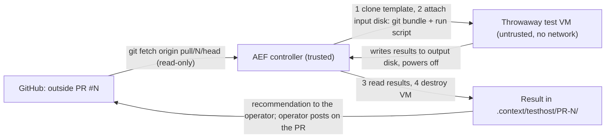

# T-5009 — AEF isolated test host: design (draft for operator sign-off)

Status: **draft, 2026-11-03.** Nothing is built. Every step that touches a host, a network or a package is the
operator's, handed over as one runme line. Arc `github-contributions` (arc-027), roadmap 3.1, target 2026-11-13.

## 1 What it is for

Two jobs, one mechanism:

| Job | Requirement | What runs | When |
|---|---|---|---|
| Deeper tests of an **unmerged outside PR** | R-22, R-53, 12.6, 12.11 | the PR's code, untrusted | before the operator merges; every outside PR with code waits for this |
| **Parity** with GitHub's checks | R-15, R-12, R-14 | the R-12 checks of `.github/workflows/test.yml`, on a commit GitHub already checked | once to prove it, then as a fallback for GitHub's runners |

The second job proves the host gives the same verdicts; the first is the reason it exists.

## 2 The constraint that decides the shape: R-54

R-54: a PR-triggered workflow **must not run on a self-hosted runner**. So the test host is **not** a GitHub
Actions runner. GitHub never sends it work and holds no token for it. Instead AEF **pulls**:

Nothing from the VM is executed by the controller: the result is data (a JSON summary plus bounded log files), read
from a disk image after the VM has stopped.

## 3 Architecture

**Controller:** the AEF host (trusted). It holds the only credential in the system: a hypervisor API token whose role
can create, start, stop and destroy VMs **in one resource pool only**, and nothing else. The token never enters a VM.

**Template (golden image):** a minimal Linux VM with exactly the toolchain the R-12 checks need (git, bash, bats,
python3 with pytest and pyyaml, the framework's other test dependencies), installed once by the operator. No SSH keys,
no tokens, no accounts beyond a test user, no mounted shares, guest agent **off**. Rebuilt on a schedule the operator
chooses; its package list is kept in the repo so parity drift is visible.

**Per run:**
1. Linked clone of the template into the test pool (fast, cheap, and the clone holds no state of its own).
2. Attach a small **input disk**: a `git bundle` of PR #N (fetched by the controller, read-only) and a fixed run
   script from AEF's repo at the operator's last released version (never from the PR).
3. Attach an empty **output disk**.
4. Start. The run script unpacks the bundle as a non-root user, runs the checks with a wall-clock limit, writes
   `result.json` and capped logs to the output disk, and powers the VM off.
5. Controller waits for power-off (or kills the VM at the time limit), reads the output disk, then **destroys** the
   VM and both disks.

**Network:** the VM's virtual NIC is either absent or on a bridge with **no uplink** (recommended: absent). The test
run needs no network because the template carries every dependency; a PR that needs a new dependency fails in a way
that names it, and the operator decides whether to add it to the template.

## 4 R-53 isolation floor, mapped

| R-53 asks | How the design meets it | Probe (6.11.2.c) |
|---|---|---|
| No access to credentials | the VM holds none; the hypervisor token lives on the controller; no guest agent, no shared folders | probe PR reads `~/.ssh`, env, `/root`, cloud metadata paths, and searches the disk for key-shaped strings: finds nothing |
| No network path to estate hosts | no NIC (or an uplink-less bridge) | probe PR tries TCP to the estate's address range, DNS, and the hypervisor's own address: all fail |
| No access to other projects | the VM's only disks are its clone, the input and the output disk | probe PR lists block devices and mounts and tries to write outside its work dir: only its own disks exist |
| Destroyed after each test | linked clone and both disks destroyed after the result is read | controller lists the pool after the run: empty |

Each probe attempt and its outcome is written into `result.json`; the probe PR is kept in the repo as a fixture and
runs whenever the template changes.

**What is left (for the threat modeler, R-53 says the exact floor is theirs):** a VM escape through the hypervisor
(low likelihood, high impact; mitigated by patching and by running test VMs on a node that hosts nothing sensitive);
resource exhaustion (CPU, memory and disk caps per VM, one run at a time); a malicious run script (it comes from AEF's
released version, not from the PR).

## 5 Why a VM and not a container

The PR's code is arbitrary. A container shares the host kernel, so a kernel exploit escapes it; a VM puts a hypervisor
boundary in between. Unprivileged containers are cheaper and faster, but cost is not the constraint here: an outside
PR waits for this anyway, and a linked-clone VM starts in seconds.

## 6 Who does what

| Step | Who | How |
|---|---|---|
| Choose the hypervisor node and confirm it hosts nothing sensitive | operator | answer Q-3 |
| Create the isolated test pool and a token limited to it | operator | one runme (prepared by AEF after Q-3) |
| Build the template from the repo's package list | operator | one runme |
| Controller verb (`fw testhost run --pr N`, `--commit SHA` for parity), local stub for tests | AEF | build task under T-5009 |
| Probe PR fixture and R-53 demonstration | AEF, operator watches | |
| Parity run against a commit GitHub already checked (R-15) | AEF | |
| Hook into the PR flow (the one-screen recommendation names the test-host result) | AEF | after the above |

## 7 Phases

1. **Design sign-off** (this note), with the questions in section 8 answered. The role-chain threat-modeler step
   reviews section 4 when it runs.
2. **Pool, token and template** (operator runmes).
3. **Controller verb** with a stubbed hypervisor API (tests run here without a real host).
4. **R-53 demonstration** with the probe PR on the real host.
5. **R-15 parity** on one commit.
6. **PR flow**: outside PRs with code stop waiting.

## 8 Open questions (asked one at a time; recommendation first)

- **Q-1 VM or container?** Recommend **VM** (section 5). **Answered 2026-11-03: VM (option 1).**
- **Q-2 Network for the test VM?** Recommend **none** (no NIC); alternative: a package mirror reachable through an
  allow-list, which widens what the threat modeler has to reason about.
- **Q-3 Which hypervisor node, and does it host anything sensitive?** Operator's knowledge; recommend a node with no
  production services, or the least sensitive one. **2026-11-03: deferred** (operator: "proceed as suggested") —
  AEF builds the controller against a stub hypervisor first (phase 3); the node is chosen before phase 4.
- **Q-4 Limits per run?** Recommend 2 vCPU, 4 GB RAM, 20 GB disk, 30 minutes wall clock, one run at a time.
- **Q-5 Template refresh?** Recommend monthly with the stable release, plus on demand when a PR names a missing
  dependency.

## 8a Q-2 options: how information comes out (2026-11-03)

Sources: `T-5009-review-codex.md`, `T-5009-review-opencode.md` (both subscription seats). Common to all three:
guest-written disks and logs are hostile input, read inside a disposable reader VM, never mounted on the controller;
deadlines, partial-log retention, explicit timeout/infrastructure-error states and destruction on every exit path are
controller duties.

| | A. Hardened disk-only | B. Disk + live serial log | C. Private enclave + collector VM |
|---|---|---|---|
| Out-channel | output disk; fsync'd phase markers; liveness from hypervisor counters | as A, plus the serial console streamed to a capped, sanitised collector | test VM's NIC on a bridge whose only peer is a throwaway collector VM |
| You see | post-mortem only, where it stopped | live tail, boot failures and hangs as they happen; logs survive a kill | structured live results, single-test re-runs |
| Added surface | none | one virtual device + hostile byte stream to a small receiver | guest network stack, listening service, firewall rules |
| D1 Antifragility | 3 | 4 | 4 |
| D2 Reliability | 4 | 5 | 3 |
| D3 Usability | 2 | 4 | 5 |
| D4 Portability | 5 | 4 | 3 |
| Total | 14 | **17** | 15 |

Both reviewers and the agent recommend **B**; C stays a documented later step for when structured incremental
results prove necessary, after the threat modeler signs it off.

**Q-2 answered 2026-11-03: B** — no NIC; input and bulk output on disks; live serial-console log to a capped,
sanitised collector with no hypervisor token; output disks read in a disposable reader VM. Sections 3 and 4 are read
with this amendment: "Network: none" stands, and the out-channel is disk + serial.

## 9 Dialogue log

- 2026-11-03: operator chose "design first" for T-5009 (options were: design first / name a host now / park).
- 2026-11-03, Q-1: operator answered "1" — VM, not container.
- 2026-11-03, Q-2 (network): operator objected to "no network": disk-only I/O sounds clunky, and "it's very
  difficult to get the right information out of it, and that in itself is a risk"; no human will coordinate sessions.
  Agent clarified that the controller automates the whole run (no interactive session). Operator asked for a short
  outside view from a subscription model before deciding; dispatched to codex (`T-5009-review-codex.md`). Q-2 open.
- 2026-11-03: operator asked for three architectures weighed on functionality vs security and mapped to D1-D4;
  opencode proposed A/B/C (section 8a). Operator answered "1" — **B, disk + live serial log**.
