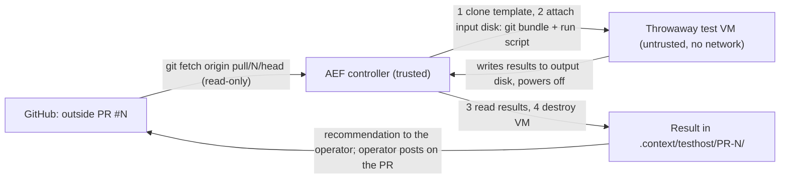

# T-5009 — AEF isolated test host: design (draft for operator sign-off)

Status: **draft, 2026-11-03.** Nothing is built. Every step that touches a host, a network or a package is the
operator's, handed over as one runme line. Arc `github-contributions` (arc-027), roadmap 3.1, target 2026-11-13.

## 1 What it is for

Two jobs, one mechanism:

| Job | Requirement | What runs | When |
|---|---|---|---|
| Deeper tests of an **unmerged outside PR** | R-22, R-53, 12.6, 12.11 | the PR's code, untrusted | before the operator merges; every outside PR with code waits for this |
| **Parity** with GitHub's checks | R-15, R-12, R-14 | the R-12 checks of `.github/workflows/test.yml`, on a commit GitHub already checked | once to prove it, then as a fallback for GitHub's runners |

The second job proves the host gives the same verdicts; the first is the reason it exists.

## 2 The constraint that decides the shape: R-54

R-54: a PR-triggered workflow **must not run on a self-hosted runner**. So the test host is **not** a GitHub
Actions runner. GitHub never sends it work and holds no token for it. Instead AEF **pulls**:

Nothing from the VM is executed by the controller: the result is data (a JSON summary plus bounded log files), read
from a disk image after the VM has stopped.

## 3 Architecture

**Controller:** the AEF host (trusted). It holds the only credential in the system: a hypervisor API token whose role
can create, start, stop and destroy VMs **in one resource pool only**, and nothing else. The token never enters a VM.

**Template (golden image):** a minimal Linux VM with exactly the toolchain the R-12 checks need (git, bash, bats,
python3 with pytest and pyyaml, the framework's other test dependencies), installed once by the operator. No SSH keys,
no tokens, no accounts beyond a test user, no mounted shares, guest agent **off**. Rebuilt on a schedule the operator
chooses; its package list is kept in the repo so parity drift is visible.

**Per run:**
1. Linked clone of the template into the test pool (fast, cheap, and the clone holds no state of its own).
2. Attach a small **input disk**: a `git bundle` of PR #N (fetched by the controller, read-only) and a fixed run
   script from AEF's repo at the operator's last released version (never from the PR).
3. Attach an empty **output disk**.
4. Start. The run script unpacks the bundle as a non-root user, runs the checks with a wall-clock limit, writes
   `result.json` and capped logs to the output disk, and powers the VM off.
5. Controller waits for power-off (or kills the VM at the time limit), reads the output disk, then **destroys** the
   VM and both disks.

**Network:** the VM's virtual NIC is either absent or on a bridge with **no uplink** (recommended: absent). The test
run needs no network because the template carries every dependency; a PR that needs a new dependency fails in a way
that names it, and the operator decides whether to add it to the template.

## 4 R-53 isolation floor, mapped

| R-53 asks | How the design meets it | Probe (6.11.2.c) |
|---|---|---|
| No access to credentials | the VM holds none; the hypervisor token lives on the controller; no guest agent, no shared folders | probe PR reads `~/.ssh`, env, `/root`, cloud metadata paths, and searches the disk for key-shaped strings: finds nothing |
| No network path to estate hosts | no NIC (or an uplink-less bridge) | probe PR tries TCP to the estate's address range, DNS, and the hypervisor's own address: all fail |
| No access to other projects | the VM's only disks are its clone, the input and the output disk | probe PR lists block devices and mounts and tries to write outside its work dir: only its own disks exist |
| Destroyed after each test | linked clone and both disks destroyed after the result is read | controller lists the pool after the run: empty |

Each probe attempt and its outcome is written into `result.json`; the probe PR is kept in the repo as a fixture and
runs whenever the template changes.

**What is left (for the threat modeler, R-53 says the exact floor is theirs):** a VM escape through the hypervisor
(low likelihood, high impact; mitigated by patching and by running test VMs on a node that hosts nothing sensitive);
resource exhaustion (CPU, memory and disk caps per VM, one run at a time); a malicious run script (it comes from AEF's
released version, not from the PR).

## 5 Why a VM and not a container

The PR's code is arbitrary. A container shares the host kernel, so a kernel exploit escapes it; a VM puts a hypervisor
boundary in between. Unprivileged containers are cheaper and faster, but cost is not the constraint here: an outside
PR waits for this anyway, and a linked-clone VM starts in seconds.

## 6 Who does what

| Step | Who | How |
|---|---|---|
| Choose the hypervisor node and confirm it hosts nothing sensitive | operator | answer Q-3 |
| Create the isolated test pool and a token limited to it | operator | one runme (prepared by AEF after Q-3) |
| Build the template from the repo's package list | operator | one runme |
| Controller verb (`fw testhost run --pr N`, `--commit SHA` for parity), local stub for tests | AEF | build task under T-5009 |
| Probe PR fixture and R-53 demonstration | AEF, operator watches | |
| Parity run against a commit GitHub already checked (R-15) | AEF | |
| Hook into the PR flow (the one-screen recommendation names the test-host result) | AEF | after the above |

## 7 Phases

1. **Design sign-off** (this note), with the questions in section 8 answered. The role-chain threat-modeler step
   reviews section 4 when it runs.
2. **Pool, token and template** (operator runmes).
3. **Controller verb** with a stubbed hypervisor API (tests run here without a real host).
4. **R-53 demonstration** with the probe PR on the real host.
5. **R-15 parity** on one commit.
6. **PR flow**: outside PRs with code stop waiting.

## 8 Open questions (asked one at a time; recommendation first)

- **Q-1 VM or container?** Recommend **VM** (section 5). **Answered 2026-11-03: VM (option 1).**
- **Q-2 Network for the test VM?** Recommend **none** (no NIC); alternative: a package mirror reachable through an
  allow-list, which widens what the threat modeler has to reason about.
- **Q-3 Which hypervisor node, and does it host anything sensitive?** Operator's knowledge; recommend a node with no
  production services, or the least sensitive one. **2026-11-03: deferred** (operator: "proceed as suggested") —
  AEF builds the controller against a stub hypervisor first (phase 3); the node is chosen before phase 4.
  **Answered 2026-11-12 (interim, final): a no-NIC VM on the 'proxmox' node** until proxmox3 works (proxmox3 did
  not come up today). 2 vCPU (the node has 4 threads), 8 GB, 40 GB, 60 min, one run at a time, destroyed after each
  run; Q-2 B (disk in/out, live serial log) unchanged. **Accepted residual risk:** a QEMU/KVM escape on that node
  could reach CT 400 (CI registry push credentials) and CT 401 (garage-1 object data). Rejected: node1 (a job is a
  sandboxed process on a kernel shared with node1's Claude token, hub secrets and other projects' jobs; no serial
  or disk channel; ~10 GB work space; ring20: "the weakest option for untrusted PR code") and this AEF host (the
  operator's GitHub login, every project, the review signing key and skill secrets; ruled out by R-53).
- **Q-4 Limits per run?** Recommend 2 vCPU, 4 GB RAM, 20 GB disk, 30 minutes wall clock, one run at a time.
  **Answered 2026-11-12: 4 vCPU, 8 GB RAM, 40 GB disk, 60 minutes wall clock, one run at a time.**
- **Q-5 Template refresh?** Recommend monthly with the stable release, plus on demand when a PR names a missing
  dependency. **Answered 2026-11-12: as recommended (monthly with the stable release, plus on demand).**

## 8a Q-2 options: how information comes out (2026-11-03)

Sources: `T-5009-review-codex.md`, `T-5009-review-opencode.md` (both subscription seats). Common to all three:
guest-written disks and logs are hostile input, read inside a disposable reader VM, never mounted on the controller;
deadlines, partial-log retention, explicit timeout/infrastructure-error states and destruction on every exit path are
controller duties.

| | A. Hardened disk-only | B. Disk + live serial log | C. Private enclave + collector VM |
|---|---|---|---|
| Out-channel | output disk; fsync'd phase markers; liveness from hypervisor counters | as A, plus the serial console streamed to a capped, sanitised collector | test VM's NIC on a bridge whose only peer is a throwaway collector VM |
| You see | post-mortem only, where it stopped | live tail, boot failures and hangs as they happen; logs survive a kill | structured live results, single-test re-runs |
| Added surface | none | one virtual device + hostile byte stream to a small receiver | guest network stack, listening service, firewall rules |
| D1 Antifragility | 3 | 4 | 4 |
| D2 Reliability | 4 | 5 | 3 |
| D3 Usability | 2 | 4 | 5 |
| D4 Portability | 5 | 4 | 3 |
| Total | 14 | **17** | 15 |

Both reviewers and the agent recommend **B**; C stays a documented later step for when structured incremental
results prove necessary, after the threat modeler signs it off.

**Q-2 answered 2026-11-03: B** — no NIC; input and bulk output on disks; live serial-console log to a capped,
sanitised collector with no hypervisor token; output disks read in a disposable reader VM. Sections 3 and 4 are read
with this amendment: "Network: none" stands, and the out-channel is disk + serial.

## 8b Q-2 revised 2026-11-12: A — read-only ISO in, framed serial out

Building B on Proxmox with only a pool-limited API token needs an output disk read inside a second reader VM.
The operator asked whether we were over-protecting at the cost of a workable host; review round 3 (codex,
opencode: `T-5009-review-r3-*.md`, brief `T-5009-review-r3-brief.md`) answered that the isolation is right and
the plumbing over-built. **Operator, 2026-11-12: A as the reviewers revised it.** This replaces the disk parts of
section 3 step 2-5 and of 8a B:

- **In:** the controller builds an ISO (git bundle of the PR + `guest-run.sh` and `pr-checks.sh` from the
  framework's released copy), uploads it to the node's ISO storage, attaches it read-only, deletes it after.
- **Out:** the serial console only, read through the Proxmox API (termproxy websocket). Live log as text; at the
  end one framed block (begin marker, gzip + base64, sha256, end marker) carrying `result.json` and the capped
  checks log, a few MB at most; truncation or a bad checksum is detected and reported, never guessed. A total byte
  cap and a rate limit apply to the whole stream. The run ends with a short summary (failed tests, last lines).
- **No output disk, no reader VM, no node-side helper**, nothing guest-produced mounted anywhere.
- **Token:** the pool, plus upload on the ISO storage and allocation on the VM-disk storage; verified before the
  first run that it can touch nothing else (T-5099).
- **Must not be skipped, even for the trusted pilot:** VM, no NIC, controller-enforced timeout and destroy on
  every exit path, bounded parsing, safe log rendering; one deliberate timeout run and one output-flood run before
  the first real PR. No trusted-contributor fast lane.
- **Weakest wall, accepted by the operator:** co-tenancy with CT 400 / CT 401 on the node; the standalone MacBook
  host (T-5100) is the fix.

## 8c Node-side specification (T-5099), for ring20's check and the operator's approval

Everything here is an estate change on the 'proxmox' node; AEF does not run it. Names in `<>` are for ring20 to fill
from the node's own conventions.

**1. Pool, user, role, token**

| Item | Value |
|---|---|
| Pool | `aef-pr-test` (comment "AEF throwaway PR test VMs, T-5009") |
| User | `aef-testhost@pve`, no password, no other groups or ACLs |
| Role `AEFPRTest` | `VM.Allocate VM.Config.CDROM VM.Config.Disk VM.Config.Options VM.PowerMgmt VM.Console VM.Audit Pool.Audit` |
| Role `AEFPRTemplate` | `VM.Clone VM.Audit` |
| Role `AEFPRIso` | `Datastore.AllocateTemplate Datastore.Audit` |
| Role `AEFPRDisk` | `Datastore.AllocateSpace` |
| ACLs (user, propagate) | `/pool/aef-pr-test` AEFPRTest; `/vms/<template-vmid>` AEFPRTemplate; `/storage/<iso-storage>` AEFPRIso; `/storage/<disk-storage>` AEFPRDisk. Nothing on `/`, `/nodes`, `/access`, `/sdn`, other VMs or storages |
| Token | `aef-testhost@pve!prtest`, privilege separation **off** (inherits exactly the ACLs above), expiry: the operator's choice, recorded |

The template VM is **not** in the pool, so the token can clone it but never change or delete it.
`fw testhost check-token` (T-5099) reads `GET /access/permissions` with the token and fails on any privilege outside
these four paths and the pool's own VMs, and on any listed privilege that is missing. It runs before the first test
run and after every ACL change.

**2. Template VM** `<template-vmid>`, name `aef-testhost-tpl`, not in the pool:

- Debian 12 genericcloud amd64 image, sha512 checked against Debian's `SHA512SUMS`; disk 40 GB on `<disk-storage>`.
- 2 vCPU, 8 GB RAM, `serial0: socket`, `vga: serial0`, **no `netN` device** in the final template (a build-time
  NIC is removed before converting to a template), no QEMU guest agent, no cloud-init drive left attached.
- Contents per `agents/testhost/template/packages.txt`; the `testhost` user (no password, no sudo, no keys);
  `aef-testhost-boot.sh` at `/usr/local/sbin/` (0755) and `aef-testhost.service` enabled; serial getty off, so
  only the run's output appears on the console.
- Build check, before converting: boot it once with a hand-made `AEFRUN` ISO holding a bundle of a known commit
  and a nonce; the console must show `== PHASE lint end rc=0` and the framed result block, and the VM must power
  off by itself.

**3. On this host (AEF, operator runme):** `TESTHOST_PVE_*` keys in `.framework.yaml` (URL, node, pool, template
VMID, ISO storage, disk storage, CA file path), the node's CA certificate in `.context/secrets/testhost-pve-ca.pem`,
and the token in `.context/secrets/testhost-pve-token` (0600). The token secret is created on the node and written
straight into that file by the runme; it is never printed, logged or sent over the sidecar.

**4. ring20's review, 2026-11-12 (node on PVE 9.2.3; adopted):**

- Privileges are enough for every step. **Changed:** ISO uploads go to a **dedicated directory storage
  `aef-pr-iso`** (content `iso`, on the node's local disk) and `AEFPRIso` is granted only there; on `local` the
  token could have uploaded and deleted every ISO and container template on the node.
- Clone disks on `local-usb` (lvm-thin; linked clones need the template on the same storage). Not the NAS shares.
- **VMID block:** template `9500`, clones `9501-9509`. The controller takes clone IDs only from
  `TESTHOST_PVE_VMID_RANGE` and refuses any other ID (T-5099, tested).
- **Template build: ring20, as its own task under its operator's approval, never with a NIC:** Debian 12 genericcloud
  qcow2 (sha512 against Debian's SHA512SUMS), packages and the boot files added offline with `virt-customize` on the
  host, disk imported to `local-usb`, `serial0 socket`, `vga serial0`, no net, no agent, `qm template 9500`. No
  cloud-init, no snippets. Monthly rebuild is the same runme.
- **No HA** for test VMs (the node's HA LRM has been dead since 2025-09). Firewall irrelevant without a NIC. RAM: an
  8 GB run leaves about 4 GB for the node's other guests; one run at a time is right.
- **Token:** created on the node by a runme from ring20-manager (which reaches the node as root over ssh), stored in
  Infisical following the estate pattern, printed only as a fingerprint; this host's 0600 file is written from the
  Infisical copy, never printed. Which of the two this host reads is the operator's choice.

**Operator, 2026-11-12:** (1) ring20 builds the node side as its own task, with its runmes from ring20-manager,
exactly per this spec; AEF reads the runmes against the spec before the operator runs them. (2) Token in Infisical
**and** a 0600 file on this host written from the Infisical copy; the controller reads the file, Infisical stays the
source for rotation.

## 9 Dialogue log

- 2026-11-03: operator chose "design first" for T-5009 (options were: design first / name a host now / park).
- 2026-11-03, Q-1: operator answered "1" — VM, not container.
- 2026-11-03, Q-2 (network): operator objected to "no network": disk-only I/O sounds clunky, and "it's very
  difficult to get the right information out of it, and that in itself is a risk"; no human will coordinate sessions.
  Agent clarified that the controller automates the whole run (no interactive session). Operator asked for a short
  outside view from a subscription model before deciding; dispatched to codex (`T-5009-review-codex.md`). Q-2 open.
- 2026-11-03: operator asked for three architectures weighed on functionality vs security and mapped to D1-D4;
  opencode proposed A/B/C (section 8a). Operator answered "1" — **B, disk + live serial log**.
- 2026-11-12: operator, "let's focus on everything we can enable Medi to start putting in pull requests"; the pilot
  plan was signed off with code PRs waiting for this host. Q-4: "4 vCPU, 8 GB, 40 GB, 60 min" (one run at a time).
  Q-5: monthly + on demand (recommended). Q-3: "Let AEF propose one" — AEF reads the node list read-only and proposes
  the least sensitive node with room for the Q-4 limits; the operator confirms.
- 2026-11-12, Q-3: the node list needed an elevated credential (request timed out); ring20 measured instead and
  proposed 'proxmox' with caveats (4 CPU threads; CT 400 holds CI registry push credentials; USB disk), proxmox3 as
  the cleanest but retired. Operator: proxmox3 "doesn't work now directly"; suggested this host or node1 "for this
  run, until we have something better". Agent advised strongly against this host (R-53). Operator: **node1**.
- 2026-11-12, Q-3 reopened: ring20 answered how node1 isolates a job (process sandbox on a shared kernel, with
  node1's Claude token, hub secrets and other projects' jobs on the same kernel; 40 GB does not fit) and called it
  the weakest option for untrusted code. Operator recalled Q-2 B (no NIC, serial log), which needs a VM. Operator:
  **no-NIC VM on 'proxmox'**, accepting the CT 400 / CT 401 escape risk; "or ask around" for a better place, asked
  of ring20 the same day.
- 2026-11-12, asked around: ring20 found no live Proxmox node free of sensitive guests; the operator's laptop is
  out; proxmox3 is hard down since the 2026-09-17 power event (needs hands on the machine, then a fresh standalone
  install, not rejoining the cluster). Better targets it named: (a) one of the operator's Intel MacBooks (ring20
  T-2638) as a standalone KVM host outside the cluster; (b) CT 400 moved off the 'proxmox' node. Operator: **start
  on 'proxmox' now, set up a MacBook as the dedicated test host in parallel, switch when it passes the same probe.**
