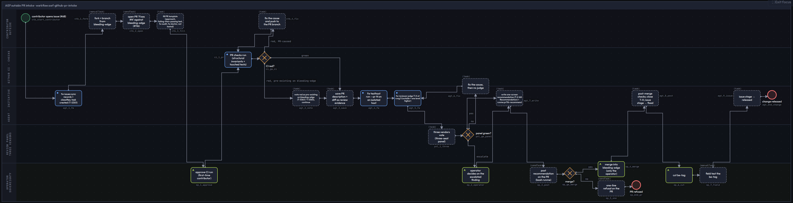

# T-5393 — Outside contributor sees the PR process in their own PR

Status: exploring. Operator request 2026-11-24.

## The gap

The PR workflow map (`aef-github-pr-intake`, the 8 steps of CONTRIBUTING.md "Pull Request Process") exists only on
our side: a designer corpus map (Watchtower `/designer`, LAN only) and a link in our task files (T-5391). The
contributor never sees it. On PR #116 every step happened, but the contributor saw only CI results; the process was
invisible to the one person it was about.

## Persona — "Mika, first-time outside contributor"

| | |
|---|---|
| Who | A developer who uses AEF in their own project, hits a bug and fixes it. Not part of ring20; does not know our agents, hosts, task ids or Watchtower. |
| Has | A GitHub account, a fork, the PR template, CONTRIBUTING.md (if they read it). |
| Can see | Everything committed and pushed: task files, the map files under `.context/designer/projects/`, reports — on GitHub, branch `bleeding-edge` (operator correction 2026-11-24). |
| Does not have | Watchtower, TermLink, hosts: anything served only inside our LAN. |
| Wants | Did anyone see my PR? What happens next, who does it? Must I do something? How long? Why is CI red? |
| Fears | Silence; a PR that rots; red CI that is not their fault; being judged by rules they could not see. |
| Real example | PR #116 (issue #68): the contributor even diagnosed our own CI hang while waiting without knowing the stage. |

## Journey — what Mika should experience

| # | Moment | What Mika sees in the PR | Today |
|---|--------|--------------------------|-------|
| 0 | Opens the PR | Within one sync cycle, a **process comment**: thanks; "this is how a pull request works here"; the 8 steps as a short checklist; **a link to the workflow map**; "you are here: step 5". | Nothing. |
| 1 | First-time CI held | Same comment: "GitHub holds the first run until the maintainer approves it; nothing needed from you." | Unexplained wait. |
| 2 | CI red | Comment updated: "red on X is pre-existing on bleeding-edge (our issue, linked), not your change", or "red on Y comes from the change: please look at …". | Contributor worked it out alone. |
| 3 | Review running | "Step 6: review in progress: deeper tests on an isolated host and a three-vendor panel (one level higher because the change is from outside)." | Invisible. |
| 4 | Recommendation | The one-screen recommendation (as drafted for #116), linking back to the same map. | Drafted, not posted. |
| 5 | Merge / refusal | "Step 7: merged into bleeding-edge", or a one-line refusal with the reason. | — |
| 6 | Release | "Step 8: shipped in be-tag X; field-tested before stable." | Issue sync does this for issues (T-4340). |

Principle: **one sticky process comment per PR, edited as the PR moves** (checklist, current step marked), plus the
recommendation as its own comment. Not a new comment per step.

### Draft process comment (step 5 state)

> Thanks for the pull request! Here is how a pull request moves through this project, and where yours is now.
>
> 
>
> Your part is the top lane, **Contributor**; the lanes below are GitHub CI, our agents, the review panel and the maintainer.
> (Workflow ID `aef-github-pr-intake`, kept in this repository under `.context/designer/projects/`.)
>
> Our task for this PR: [T-5301](https://github.com/DimitriGeelen/agentic-engineering-framework/blob/bleeding-edge/.tasks/active/T-5301-gh-68-fw-doctors-watchtower-remedy-print.md) (what we check and decide, kept up to date)
>
> - [x] 1. Issue first — #68
> - [x] 2. Fork and branch from `bleeding-edge`
> - [x] 3. Pull request against `bleeding-edge`, "Fixes #68"
> - [x] 4. Template filled in
> - [ ] **5. Checks on GitHub ← you are here.** First-time contributors: the maintainer approves the run; nothing needed from you.
> - [ ] 6. Review: deeper tests on an isolated host, a three-vendor review panel, a one-screen recommendation here
> - [ ] 7. The maintainer merges into `bleeding-edge` (or explains a refusal in one line)
> - [ ] 8. Ships in the next be-tag, field-tested before pre-release and stable
>
> This comment is updated as your pull request moves.

## The links are GitHub links

Task files and map files are in the repository, so the comment links them on GitHub (`blob/bleeding-edge/…`), never
Watchtower (LAN-only). One gap remains: the map is stored as BPMN, which GitHub shows as XML, not as a picture. So the
map also needs a rendered page:

- **Proposed:** generate `docs/contributing/pr-workflow.md` from the corpus map: a Mermaid flowchart (GitHub renders
  Mermaid) with the 5 lanes, plus the 8 steps in words, each with an anchor (`#step-5`). Generated, not hand-drawn, so
  map and page cannot drift; a check fails when they differ. Only contributor-facing content: no hosts, no internal
  task ids beyond the example.
- Linked on `bleeding-edge` (the PR base); master only moves at release.
- CONTRIBUTING.md "Pull Request Process" links to the same page.

## Open questions for the operator

1. **IW-1 Who posts?** GitHub posts are operator-only today. (a) A standing rule that the process comment and its step
   updates are routine, posted by the 2-hourly sync (like issue thank-you closes, T-4660). (b) An operator runme per post.
2. **IW-2 Public map page** as proposed?
3. **IW-3 One sticky comment** edited per step (proposed), or one comment per step?
4. Pilot on PR #116: post the process comment there now, then the recommendation.

## Two classes of map (operator, 2026-11-24)

- **Framework-process maps** (task lifecycle, inception flow/lifecycle, session lifecycle, tier0 escalation, dispatch
  loop, audit cron, greenfield/existing onboarding): describe how AEF works in ANY project. They ship to consumers and
  a consumer should be able to open them on their own Watchtower. Gap: a consumer's `/designer` lists only the
  project's own store, so today they cannot (follow-up build).
- **Maps of developing AEF itself** (`aef-github-pr-intake`: our GitHub, our review panel, our test host, PR #116 as
  example): mean nothing in a consumer project. Shown to contributors as a screenshot in this repository; the comment
  does not point into the contributor's install. Gap: today every map in the store ships, this one too (same class as
  the T-5392 finding: project-specific content in what every consumer receives); `draft-t2584-scratch` likewise.
  Follow-up: a scope marker on each map (framework | project) and vendoring only `framework`.

## Dialogue log

- 2026-11-24 operator: framework-class maps (task, inception …) should be findable on a consumer's own instance; the
  PR map is specific to our own installation for developing the framework, so a screenshot is right. Agreed.

- 2026-11-24 operator: no generated map page; use a screenshot, and tell the contributor that once AEF is installed the
  map is on their own instance (workflow ID, their part, the rest). Done: `docs/contributing/pr-workflow-map.png`
  (Watchtower designer, fit to diagram). Checked: the map ships to consumers (vendored
  `.context/designer/projects/`) and `fw corpus explain` reads it there; a consumer's Watchtower `/designer` lists only
  the project's own store, so a Watchtower link to it does not work yet (small build if wanted).
- 2026-11-24 operator correction: contributors CAN see task files; they are in the repository on GitHub, and linking
  them with hyperlinks is an existing requirement. The comment now links the PR's own task file and the map page.

- 2026-11-24 operator: "the workflow design you pushed as a commit and not as a comment … I want the integral part …
  where the workflow design is … part of the PR comments … create a user persona contributor … take the user journey:
  I'm here now, get a comment, … this is the process of the PR and therefore also I have this link so I can see what the
  steps are."
